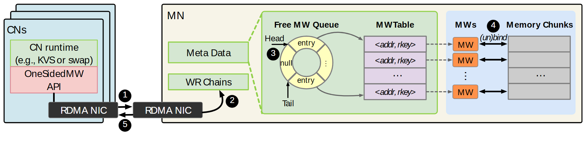

# VA-157 · 远端环形队列与窗口绑定流程

左侧客户端堆叠代表多个请求端，右侧远端节点以队列、地址表、窗口和内存块展示请求落地的内部结构。环形空闲队列把Head、Tail和null显式画出来，适合解释资源领取、绑定及返回。



## 适用范围

- 远程资源池的领取与绑定流程
- 客户端到设备端的队列式资源管理

不适合：只有单一顺序处理而无队列状态的流程；需要展示真实队列占用率随时间变化的结果。

## 阅读顺序

1. 从左侧客户端运行时和API进入网卡。
2. 沿1、2进入远端网卡与工作请求链。
3. 看3附近环形队列的Head、Tail、null及地址表。
4. 看4处窗口与内存块双向绑定，最后沿5返回客户端。

## 图形表达

**布局**：窄客户端堆叠在左，宽远端容器在右，远端内部从元数据到队列再到内存横向展开。

**对象**：环形分格队列、行式地址表、橙色窗口小块和灰色内存分块各自承担不同抽象。

**连线**：网卡之间双向粗箭头表示请求与返回；灰色虚线映射表项到窗口，黑双向箭头表示绑定关系。

**配色**：浅蓝客户端与窗口区，浅绿队列/元数据区，浅紫地址表，橙色窗口与灰色内存。

**文字**：标题与关键队列名加粗；地址/rkey用倾斜文本；圈号深色底白字。

## 部件与复用

| 部件 | 含义 | 改造方法 |
|---|---|---|
| 客户端堆叠 (`client-stack`) | 多个客户端及其运行时、API和网卡 | 增减叠层时保持前端文字与网卡位置 |
| 元数据与工作链 (`request-metadata`) | 远端请求执行所依赖的描述结构 | 更改处理过程时同步改工作链名称 |
| 空闲资源环 (`free-ring`) | 显示Head、Tail及空槽的循环资源队列 | 重画分格和指针以对应新资源状态 |
| 地址窗口表 (`window-table`) | 地址与密钥项对应后续窗口 | 表项数量变化时调整虚线映射 |
| 窗口与内存绑定区 (`binding-region`) | 多个窗口与对应内存块的绑定关系 | 改为任务槽或连接槽时重建双向对应线 |

## 改造步骤

1. 把客户端、资源池和资源实例映射到新领域，先确定是否仍需要环形队列。
2. 在环中明确队头、队尾与空槽，不能把圆环仅当装饰。
3. 窗口表的行数与右侧映射关系一起修改。
4. 网卡交互、绿色展开虚线和跨区绑定连线留在整图；改变区域宽度需代码重连。

## 新情景示例（假设）

假设边缘节点向中心申请临时计算槽。

客户端映射为边缘节点，窗口表映射为槽地址表，内存块映射为执行槽。

把绑定/解绑改为占用/释放语义，明确任务返回是否走独立反馈路径。

## 编辑入口

**入口**：make_figure.py 运行本图构建与 customize 入口；example.json 提供实例配置，labels.json 定位文字键，asset.json 定义部件及 element_keys。运行 python make_figure.py --config example.json --out . --parts。

**配置可改**：labels、components 可改文字、配色、显隐和位移；配置不自动重排、延长连线或重新计算容器。

**需改代码**：结构变化在 customize(root, context) 中编辑；新增对象赋予唯一 data-asset-key 并补入所属部件的 element_keys。跨区域连线保留在整图时，移动部件后须显式重接；重叠部件不可重复平移同一元素。

**字体**：整体为无衬线文本，关键标题加粗，绑定动词和地址字段倾斜；字体映射需保持这些角色。 最终字体文件以构建映射为准；局部 font_size 是源坐标中的字号，不等于论文纸面 pt，换字后须检查实际宽度。本批构建已确认并嵌入完整字体：Arimo-Bold.ttf, Arimo-Italic.ttf, Arimo-Regular.ttf。映射可能改变原字形和字宽，需按实际论文尺寸复核。

准备独立工作副本：

```text
python "<SKILL>/scripts/prepare_architecture.py" --id VA-157 --out figures/architecture
```

在工作副本运行：

```text
python make_figure.py --config example.json --out . --parts
python render_architecture.py fig.svg
```

## 本图检查

- Head、Tail指向真实的环形入口。
- null槽和有效entry不会混淆。
- 每个表项的虚线都对应正确资源。
- 1至5的交互顺序与说明一致，返回线不与请求线合并。

部件图用于复用局部对象；跨边界的连接和共享容器仍需按新关系处理。示例名称、数值和曲线不是当前研究结果。

来源与许可见 [ATTRIBUTION.md](ATTRIBUTION.md)。
