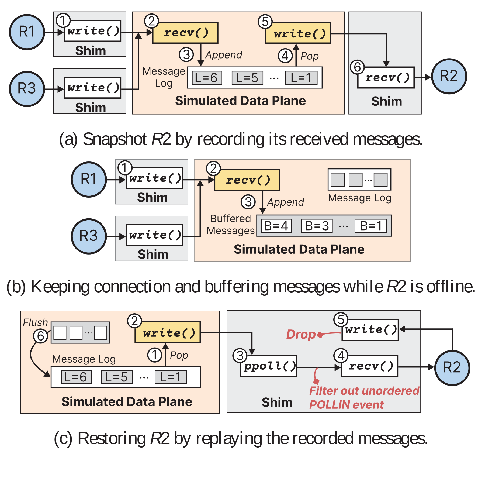

# VA-056 · 记录—缓冲—重放的三状态恢复图

三个上下排列的小面板分别描述正常记录、接收方暂停、接收方恢复时的消息处理。相同参与者和队列在不同面板重复出现，便于比较状态变化；每面板的圆圈编号只在本面板内排序。最后一行除重放外还明确画出过滤乱序事件和丢弃恢复期发送，不能将它简化为普通的消息转发图。



## 适用范围

- 需要说明暂停和恢复期间消息如何保持顺序
- 有日志记录、离线缓冲及重放语义的中间层

不适合：无状态服务的简单重启流程；无需有序交付也不保留日志的通信系统。

## 阅读顺序

1. 先看第一行：发送方通过接口层进入记录队列，再交给接收方
2. 第二行保持发送方连接，消息进入缓冲而接收方不在线
3. 第三行从日志取出消息，经过滤接口恢复交付
4. 最后核对红色丢弃和过滤标记的对象与方向

## 图形表达

**布局**：纵向三面板按状态递进，每行保持发送侧、模拟处理区、接收侧的大致方向一致。

**对象**：圆形表示参与节点，小矩形表示接口调用，连续小格表示有序日志或缓冲，容器表达拦截范围。

**连线**：细黑箭头给出消息与调用方向，圆圈编号提供局部次序；红色标注只用于抑制或过滤路径。

**配色**：浅蓝节点、浅灰接口层、浅橙中间处理区保持跨面板一致，黄色强调正在执行的收发调用。

**文字**：函数名保留代码式视觉，面板说明另起一行；细小队列标签应按最终印刷宽度检查，不让编号压住箭头。

## 部件与复用

| 部件 | 含义 | 改造方法 |
|---|---|---|
| 正常记录阶段 (`record-phase`) | 消息被拦截、记录后继续转发给在线接收者。 | 说明记录时点在交付前还是后，并据实际语义调整编号。 |
| 暂停缓冲阶段 (`buffer-phase`) | 接收端暂停时，上游仍保持连接，新增消息排队。 | 写明缓冲上限或溢出行为，不把无限缓存作为默认能力。 |
| 恢复重放阶段 (`replay-phase`) | 历史消息按序恢复，旁路行为被抑制。 | 区分重放日志与停机期间新增消息，标明什么时候切回正常模式。 |
| 消息格条 (`message-log`) | 小格条展示消息记录与次序。 | 用当前消息身份和顺序替换编号，保留日志与缓冲的区别。 |

## 改造步骤

1. 先定义三种状态及状态转换条件，再填写每行接口操作
2. 把历史日志和停机新增消息分开命名，避免恢复时重复交付
3. 按实际设计保留或删除红色过滤路径，不能无依据宣称确定性重放
4. 修改节点数时保持三行身份一致并同步更新编号

## 新情景示例（假设）

可用于假设的订单处理节点计划维护方案。

发送节点是订单入口，接收节点是订单处理器，中间层记录已接收事件并在维护时缓冲新事件。

将网络调用名改成事件接入与交付；增加已处理事件标识说明，若没有确定性重放能力，不画丢弃副作用即可恢复的结论。

## 编辑入口

**入口**：make_figure.py 读取 example.json 生成 fig.svg；加 --parts 导出部件，render_architecture.py 渲染预览及 PDF。

**配置可改**：labels 按 labels.json 对象键改字；components 支持 visible、dx/dy、attributes；elements 改对象属性。位移用图内坐标，连线不自动重布。

**需改代码**：增删模块、改连接和布局须修改 customize()。新对象须有唯一 data-asset-key 并登记部件归属；嵌套部件选一个层级平移，避免重复移动。

**字体**：当前完整字体为 Arimo-Italic, Arimo-Regular。font_size 是元素局部坐标单位，受缩放变换影响，不是纸面字号；改长标签后按最终版面宽度复核换行与字距。

准备独立工作副本：

```text
python "<SKILL>/scripts/prepare_architecture.py" --id VA-056 --out figures/architecture
```

在工作副本运行：

```text
python make_figure.py --config example.json --out . --parts
python render_architecture.py fig.svg
```

## 本图检查

- 三行同名参与者是否保持相同角色
- 日志与缓冲的先后次序是否避免遗漏或重复交付
- 红色丢弃对象是否明确且不会误伤正常新消息

部件图用于复用局部对象；跨边界的连接和共享容器仍需按新关系处理。示例名称、数值和曲线不是当前研究结果。

来源与许可见 [ATTRIBUTION.md](ATTRIBUTION.md)。
