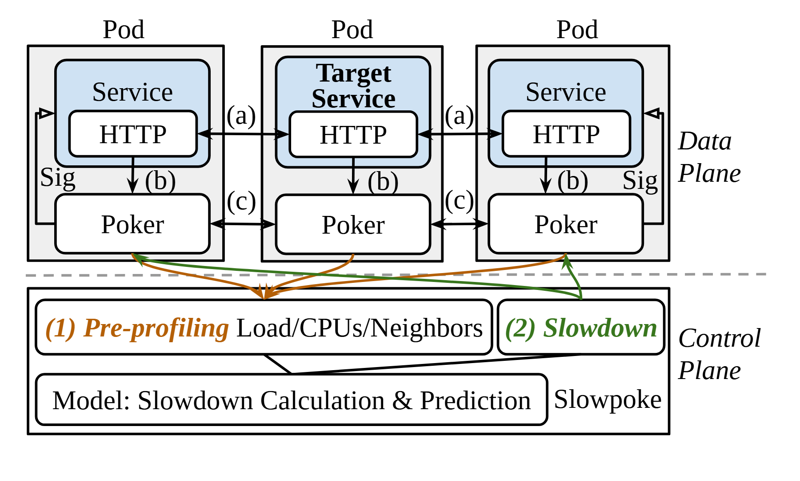

# VA-017 · 业务链与观测干预双平面

上半部是三个重复的业务单元，每个单元都带一个就地观测或执行代理；下半部汇总观测并生成干预。中间单元突出为研究目标，橙色收集线和绿色下发线跨越分隔线，让系统执行与分析控制共存于一张图。它适合解释“观测谁、干预谁、如何预测”的闭环，但不自动说明干预的因果有效性。



## 适用范围

- 服务链性能诊断或受控运行实验
- 分布式设备各带本地代理、中央统一分析的体系

不适合：只有单向采集而没有控制动作的监测图；无法区分目标对象与邻居关系的抽象概览。

## 阅读顺序

1. 从上方横向业务链识别各节点与被突出显示的目标。
2. 进入每个节点，区分业务模块、接口和本地代理。
3. 沿橙色汇聚线读观测输入，再读底部模型和绿色干预返回线。
4. 最后解释节点间字母标记，必须与本图自己的图例或正文定义对应。

## 图形表达

**布局**：上方三列同宽节点，下方一条控制栏和宽预测模型；虚线只分隔两个逻辑平面。

**对象**：嵌套圆角框说明部署归属：接口属于业务服务，本地代理在同一单元但不属于服务内部。

**连线**：黑线承担业务和节点内信号，橙色为观测汇聚、绿色为干预；有向回边需避开服务链箭头。

**配色**：浅蓝标识业务区域、灰色标识部署外壳；中间标题加粗承担目标强调，不需另加高饱和背景。

**文字**：标题和控制阶段文字用粗体或斜体区分层次；短字母标记保持可读并给出明确释义。

## 部件与复用

| 部件 | 含义 | 改造方法 |
|---|---|---|
| 分布式业务链 (`service-chain`) | 三组业务接口与本地代理及邻接关系 | 可改为生产工位或服务链；链路方向和代理通信须分别改写。 |
| 目标观测单元 (`target-service`) | 被重点分析的业务节点及其本地代理 | 目标不一定居中；移动目标强调时同时修改控制关系。 |
| 观测与干预栏 (`profiling-control`) | 将状态汇总与控制动作并置显示 | 若只有监测删除干预模块和返回线，避免制造闭环。 |
| 统一分析模型 (`predictive-model`) | 把各节点状态映射为预测或干预参数 | 列出实际输入输出，避免把预测结果画成已经证实的因果效果。 |

## 改造步骤

1. 明确研究目标与可干预变量，再决定保留几个邻接节点。
2. 将业务流、代理协同、观测汇报和干预下发分别列出，再设置箭头及颜色。
3. 替换底部模型名称与输入内容，清理无对应解释的字母编号。
4. 检查中间目标的突出方式是否仍与实际受测对象一致，并以最终宽度检查交汇区域。

## 新情景示例（假设）

假设说明三段制造工序的瓶颈诊断。

业务框对应工位，本地代理对应采样与限流单元，中央模型估计整体节拍；第二工位是待改造目标。

将 HTTP 接口换成工序交接记录；干预只作用于允许限速的邻站，并删除不存在的代理间通信。

## 编辑入口

**入口**：在工作副本修改 example.json，运行 python make_figure.py --config example.json --out output --parts；再通过 Vivid 的矢量渲染入口检查 SVG 与 PDF。

**配置可改**：labels 按 labels.json 的元素键改字；components 按本页部件 id 设置 visible、dx、dy 或 attributes；elements 修改指定矢量元素属性。重叠部件可能共享元素，避免对父区域和内部区域重复位移。

**需改代码**：改变服务数量、改变目标位置或重排汇聚曲线，需要在 customize 中调整节点框和相应路径。这些接口不会自动重排，也不会随部件移动自动修复跨部件连线。

**字体**：本资产已记录的完整字形资源：Tinos-Bold.ttf, Tinos-BoldItalic.ttf, Tinos-Italic.ttf, Tinos-Regular.ttf。修改英文标签优先沿用对应字体族与字重；文字变长时调整框宽和换行，不靠整体缩小压入。其他语言须另选覆盖所需字符的字体并实查导出。

准备独立工作副本：

```text
python "<SKILL>/scripts/prepare_architecture.py" --id VA-017 --out figures/architecture
```

在工作副本运行：

```text
python make_figure.py --config example.json --out . --parts
python render_architecture.py fig.svg
```

## 本图检查

- 业务链上的来回箭头是否真的代表双向交换，还是应拆成物料单向与信息回传？
- 中央模型输出是否经过干预栏和本地代理到达对应节点？
- 目标节点与橙绿线是否仍可在灰度及论文缩放下辨认？

部件图用于复用局部对象；跨边界的连接和共享容器仍需按新关系处理。示例名称、数值和曲线不是当前研究结果。

来源与许可见 [ATTRIBUTION.md](ATTRIBUTION.md)。
