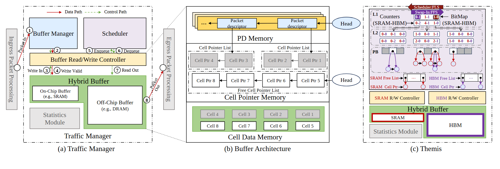

# VA-158 · 流量管理与分层缓冲的三联展开

左面板交代管理流程，中间展开包描述符、指针和数据三层内存，右面板解释混合存储的位图与控制器。它用同一缓冲概念连接系统层、数据结构层和实现层，适合复杂模块的逐层说明。



## 适用范围

- 一个子系统需要同时解释总体流程、数据结构和专用实现
- 混合存储或资源调度器的三级展开

不适合：面向非技术读者的单一概念图；仅有少数模块且没有数据结构细节的系统。

## 阅读顺序

1. 先读左图图例与管理器、调度器、读写控制器。
2. 沿左图圈号读入、有效写入、出队和读出。
3. 读中图从包描述符到指针链再到数据单元的对应。
4. 最后读右图位图层级、空闲链和两类存储控制器。

## 图形表达

**布局**：三幅并排子图；左图用虚线投影引出中图，右图独立显示具体实现。

**对象**：矩形模块、链表格子、圆形Head、层级位图及多个小圆节点组合，信息密度高。

**连线**：左图红实线为数据路径、绿虚线为控制路径；中图黑箭头串链；右图红/紫线分别落到两类存储资源。

**配色**：蓝紫区分左侧管理/调度，绿色用于缓冲底座，右图红色表示SRAM相关路径、紫色表示HBM相关路径。

**文字**：模块名称衬线体；位图数字、链表项和微小标注需保留明显字号层次。

## 部件与复用

| 部件 | 含义 | 改造方法 |
|---|---|---|
| 流量管理面板 (`manager-panel`) | 从入口处理经缓冲管理到出口处理的完整子系统 | 改请求流时一并改圈号和数据/控制图例 |
| 缓冲内存展开 (`memory-panel`) | 包描述符、单元指针、数据三层关联 | 重建链表顺序并核对空闲单元归属 |
| 混合存储实现面板 (`hybrid-panel`) | 位图调度与双存储控制器的实现 | 替换资源种类时同时改位图计数、链表与底层存储 |

## 改造步骤

1. 先决定是否确实需要三层视角，删面板时同步删除其跨面板投影线。
2. 将管理动作与数据结构实体分别命名，避免同名对象在三个面板中换含义。
3. 所有指针链、Head及空闲列表按新状态重建，不能只替换标题。
4. 以双栏或横版展示；长篇机制细节可拆为两图，共享颜色和术语。

## 新情景示例（假设）

假设展示冷热数据联合缓存。

左面板为访问调度，中间为缓存目录与块链，右面板为内存/SSD混合资源控制。

将SRAM/HBM计数与指针逻辑改为实际缓存状态，更新调度规则而非沿用位图数字。

## 编辑入口

**入口**：make_figure.py 运行本图构建与 customize 入口；example.json 提供实例配置，labels.json 定位文字键，asset.json 定义部件及 element_keys。运行 python make_figure.py --config example.json --out . --parts。

**配置可改**：labels、components 可改文字、配色、显隐和位移；配置不自动重排、延长连线或重新计算容器。

**需改代码**：结构变化在 customize(root, context) 中编辑；新增对象赋予唯一 data-asset-key 并补入所属部件的 element_keys。跨区域连线保留在整图时，移动部件后须显式重接；重叠部件不可重复平移同一元素。

**字体**：主要为衬线字，位图数字最小，右上操作标签为反白小字；导出需特别检查小号文字与上边界。 最终字体文件以构建映射为准；局部 font_size 是源坐标中的字号，不等于论文纸面 pt，换字后须检查实际宽度。本批构建已确认并嵌入完整字体：Tinos-Bold.ttf, Tinos-Regular.ttf。映射可能改变原字形和字宽，需按实际论文尺寸复核。

准备独立工作副本：

```text
python "<SKILL>/scripts/prepare_architecture.py" --id VA-158 --out figures/architecture
```

在工作副本运行：

```text
python make_figure.py --config example.json --out . --parts
python render_architecture.py fig.svg
```

## 本图检查

- 数据路径与控制路径的颜色和线型一致。
- Head与链表箭头顺序自洽，空闲和占用单元没有重复归属。
- 左右对同一存储种类使用统一配色。
- 最终尺寸能读清位图数字；否则应拆图。

部件图用于复用局部对象；跨边界的连接和共享容器仍需按新关系处理。示例名称、数值和曲线不是当前研究结果。

来源与许可见 [ATTRIBUTION.md](ATTRIBUTION.md)。
