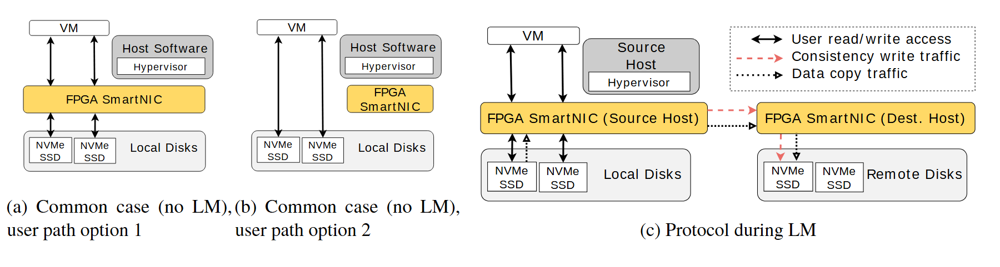

# VA-159 · 常态路径与迁移路径三方案对照

左侧两个小面板比较常态I/O是否经过中间设备，右侧大面板展示源端到目标端的迁移。共享器件形状和颜色，让差异落在连接关系上，适合比较同一硬件或服务在不同运行模式下的行为。



## 适用范围

- 正常模式、旁路模式与迁移模式的拓扑比较
- 同一基础设施的运行状态切换说明

不适合：三个对象完全不同且不存在共同节点；需要按时间记录并发时序的协议图。

## 阅读顺序

1. 读左侧常态方案1：虚拟机经设备访问磁盘。
2. 读中间常态方案2：虚拟机直接访问磁盘，设备位于侧边。
3. 读右图图例，区分双向读写、红色一致性写及黑色复制。
4. 沿源设备到目标设备及远端磁盘查看迁移方向。

## 图形表达

**布局**：左右宽度不等的三个面板：两幅窄常态路径加一幅双端迁移图。

**对象**：虚拟机小框、灰色主机与磁盘容器、黄色设备横条在各面板复用。

**连线**：黑色双向实线为用户访问；红虚线为一致性写；黑点线为空心箭头的数据复制。

**配色**：黄色只强调设备，灰色为主机/磁盘容器；红色仅编码一致性流量。

**文字**：标签为无衬线，NVMe/SSD分行；长面板标题在下方，占用两行高度。

## 部件与复用

| 部件 | 含义 | 改造方法 |
|---|---|---|
| 经过设备的常态路径 (`mediated-path`) | 设备位于虚拟机与磁盘之间 | 替换设备功能时保留串联关系 |
| 旁路常态路径 (`bypass-path`) | 用户访问绕过侧边设备 | 确保旁路箭头没有误接到侧边设备 |
| 迁移源端 (`migration-source`) | 源主机设备和本地磁盘 | 改源端内容时重接两种跨端流量 |
| 迁移目标端 (`migration-destination`) | 目标设备接收两类流量并写入远端磁盘 | 明确目标写入合流位置 |
| 迁移流量图例 (`traffic-legend`) | 定义三类箭头 | 每增加一种流量都应新增明确图例 |

## 改造步骤

1. 先对齐三个方案中真正相同的实体名称，避免比较对象漂移。
2. 明确常态方案2的旁路连接；侧边设备不能因靠近而被误读为中转。
3. 按真实迁移协议重画红色和黑色跨端流量及目标盘写入。
4. 面板标题目前接近相邻边界；改长标题时增大面板间距并重新定位。

## 新情景示例（假设）

假设比较仓库数据服务的直连、网关和迁移模式。

VM映射为业务服务，黄色设备为数据网关，磁盘为仓库存储。

删去硬件术语并确定迁移期间双写与批量复制的真实起止点。

## 编辑入口

**入口**：make_figure.py 运行本图构建与 customize 入口；example.json 提供实例配置，labels.json 定位文字键，asset.json 定义部件及 element_keys。运行 python make_figure.py --config example.json --out . --parts。

**配置可改**：labels、components 可改文字、配色、显隐和位移；配置不自动重排、延长连线或重新计算容器。

**需改代码**：结构变化在 customize(root, context) 中编辑；新增对象赋予唯一 data-asset-key 并补入所属部件的 element_keys。跨区域连线保留在整图时，移动部件后须显式重接；重叠部件不可重复平移同一元素。

**字体**：无衬线标签，源文件混用Verdana与Nimbus字体；底部标题较大，字体替换后最易互相挤压。 最终字体文件以构建映射为准；局部 font_size 是源坐标中的字号，不等于论文纸面 pt，换字后须检查实际宽度。本批构建已确认并嵌入完整字体：Arimo-Regular.ttf, texgyretermes-regular.otf。映射可能改变原字形和字宽，需按实际论文尺寸复核。

准备独立工作副本：

```text
python "<SKILL>/scripts/prepare_architecture.py" --id VA-159 --out figures/architecture
```

在工作副本运行：

```text
python make_figure.py --config example.json --out . --parts
python render_architecture.py fig.svg
```

## 本图检查

- 三个方案同类实体尺寸和颜色一致。
- 常态2的箭头直达存储，未误穿设备。
- 两类迁移箭头都能辨认并有图例。
- 面板a、b的底部标题不发生连字或挤占。

部件图用于复用局部对象；跨边界的连接和共享容器仍需按新关系处理。示例名称、数值和曲线不是当前研究结果。

来源与许可见 [ATTRIBUTION.md](ATTRIBUTION.md)。
