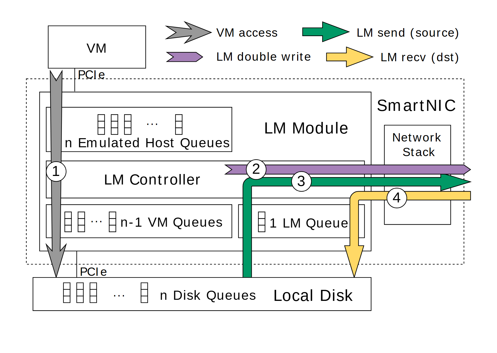

# VA-160 · 设备内部队列与四类粗路径叠加

在SmartNIC设备内部画出模拟主机队列、控制器和普通/迁移队列，再叠加四种粗彩色箭头。布局强调不同流量跨越哪些模块，粗路径比细线更适合表达少量关键通道。



## 适用范围

- 设备或网关内部多个数据通道的分工
- 正常读写、双写与迁移收发的路径对比

不适合：流量种类很多的密集网络；精确时序、延迟或带宽展示。

## 阅读顺序

1. 先读顶部四种箭头的图例。
2. 从左上VM沿灰色路径到下方本地盘。
3. 读设备内部主机队列、控制器与普通/迁移队列的层次。
4. 看紫色双写、绿色发送与黄色接收如何经过控制器、迁移队列和网络栈。

## 图形表达

**布局**：左上外部请求端，下方设备虚线框，底部磁盘条；网络栈位于设备右侧。

**对象**：队列用重复窄竖格表示，模块用白底矩形，四条粗箭头覆盖在模块之上。

**连线**：灰色竖向通道贯穿设备；紫色向右，绿色折返向右发送，黄色从右侧进入并向下写盘。

**配色**：灰、紫、绿、黄分别编码普通访问、双写、发送、接收；颜色必须与顶部图例对应。

**文字**：无衬线大标签，队列数量以n、n-1、1表达；白色圈号标识路径。

## 部件与复用

| 部件 | 含义 | 改造方法 |
|---|---|---|
| 外部虚拟机 (`vm-source`) | 普通访问发起端 | 替换发起者后检查PCIe等接口术语 |
| 四类路径图例 (`path-legend`) | 定义粗箭头颜色与端点角色 | 路径删改时同步增减图例 |
| 模拟主机队列 (`host-queues`) | 设备模拟的n个主机队列 | 队列数改变时重新布置图形和省略号 |
| 普通队列组 (`vm-queues`) | 普通虚拟机队列的独立区域 | 核对n-1与迁移队列共同组成总数 |
| 专用迁移队列 (`migration-queue`) | 迁移专用的一条队列 | 修改用途时重接收发通道 |
| 本地磁盘队列 (`local-disk`) | 底部n个磁盘队列与本地存储 | 调整磁盘入口及队列数时同步校正流量落点 |

## 改造步骤

1. 先明确新系统是否同样把普通流量与专用迁移队列分离。
2. 按新数量关系同时修改n、n-1和1，不只改其中一个标签。
3. 粗箭头、控制器、网络栈和设备外框作为整图共享结构保留；移动部件后必须手工重画路径。
4. 粗路径会遮挡底层模块，新增标签应避开箭头和圈号。

## 新情景示例（假设）

假设设计多通道边缘数据同步网关。

主机队列为输入通道，普通队列为在线请求，迁移队列为同步作业，磁盘为本地缓存。

把PCIe改成实际接口，并依据同步行为确定双写和接收路径是否需要同时存在。

## 编辑入口

**入口**：make_figure.py 运行本图构建与 customize 入口；example.json 提供实例配置，labels.json 定位文字键，asset.json 定义部件及 element_keys。运行 python make_figure.py --config example.json --out . --parts。

**配置可改**：labels、components 可改文字、配色、显隐和位移；配置不自动重排、延长连线或重新计算容器。

**需改代码**：结构变化在 customize(root, context) 中编辑；新增对象赋予唯一 data-asset-key 并补入所属部件的 element_keys。跨区域连线保留在整图时，移动部件后须显式重接；重叠部件不可重复平移同一元素。

**字体**：无衬线字体，n-1等数量表达需要清晰，标签采用大字但不意味可直接填长句。 最终字体文件以构建映射为准；局部 font_size 是源坐标中的字号，不等于论文纸面 pt，换字后须检查实际宽度。本批构建已确认并嵌入完整字体：Arimo-Regular.ttf。映射可能改变原字形和字宽，需按实际论文尺寸复核。

准备独立工作副本：

```text
python "<SKILL>/scripts/prepare_architecture.py" --id VA-160 --out figures/architecture
```

在工作副本运行：

```text
python make_figure.py --config example.json --out . --parts
python render_architecture.py fig.svg
```

## 本图检查

- 四种颜色与图例一一对应。
- 发送朝外、接收朝内，折线的末端方向准确。
- n等于普通队列与专用队列之和。
- 模块名称没有被粗箭头或路径圈号遮住。

部件图用于复用局部对象；跨边界的连接和共享容器仍需按新关系处理。示例名称、数值和曲线不是当前研究结果。

来源与许可见 [ATTRIBUTION.md](ATTRIBUTION.md)。
