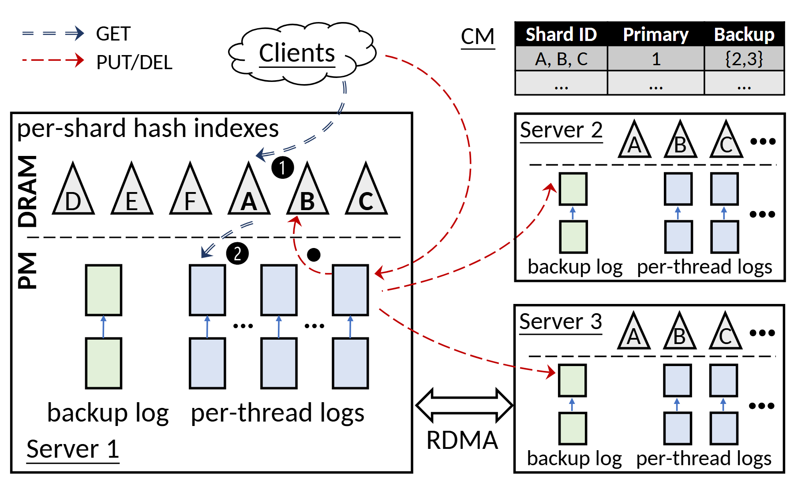

# VA-018 · 主节点展开与备份日志复制

用一大两小的节点视图说明分片请求如何到达主节点，并把写入复制到备份。大节点展开内存索引和持久日志，小节点保留相同层次；上方映射表交代分片的主备位置。



## 适用范围

- 分片存储与主备复制
- 需要展示索引和日志区别的系统

不适合：无持久化概念的普通工作流；需要完整表达一致性协议状态机的场景。

## 阅读顺序

1. 从顶部位置表确定分片与主备关系。
2. 从客户端的查询和更新两种路径进入主节点。
3. 区分上层三角索引与下层日志段。
4. 沿复制箭头观察两个备份节点接收位置。

## 图形表达

**布局**：左侧主节点占大面积，右侧备份上下排列，顶部留给入口和映射表。

**对象**：三角形是索引，竖排矩形是日志段；虚线分开内存和持久层。

**连线**：蓝色虚线和红色虚线区分查询与更新；跨节点箭头必须落到接收日志而非节点空白处。

**配色**：绿色后备日志与蓝色工作日志区分职责，红色强调更新传播。

**文字**：表头加粗，分片字母保持短小；层名竖排，需要检查转向后的基线。

## 部件与复用

| 部件 | 含义 | 改造方法 |
|---|---|---|
| 请求入口 (`client-routing`) | 客户端产生查询和更新。 | 用新系统真实请求类型改图例及箭头。 |
| 展开的主节点 (`primary-server`) | 上层索引定位下层日志对象。 | 替换实体时保留查找和持久化的区分。 |
| 主备位置表 (`mapping-table`) | 说明每个分片对应哪些节点。 | 填写示例或真实位置，勿让表中编号和节点标签冲突。 |
| 备份节点一 (`replica-two`) | 接收主节点复制的数据。 | 指向实际接收的后备日志。 |
| 备份节点二 (`replica-three`) | 表达另一同构副本。 | 减少副本时删除该节点及所有相关箭头。 |

## 改造步骤

1. 先明确查询、写入和复制是否走不同通道。
2. 日志段数量仅作示意时在图注说明，不暗示容量。
3. 如需要确认、选主或故障切换，另增明确步骤，现有箭头不能代替这些协议。

## 新情景示例（假设）

假设用于跨仓库库存日志同步。

客户端为订单服务，分片为商品分组，主节点记录库存变动，备份站点保存更新日志。

删去硬件专用传输名称，改成实际网络通道；索引换为商品定位表并补充确认关系。

## 编辑入口

**入口**：以 make_figure.py 为入口，先复制 example.json 作为当前情景配置；labels.json 定位标签，asset.json 定位部件。

**配置可改**：labels 可改文字和文字样式，components 可做显隐、平移和局部样式调整；elements 可定位矢量元素。配置只作用于已有几何，不会自动解决布局冲突。

**需改代码**：改变副本数量、索引形状或日志段结构需修改矢量与连线路径；配置移动不会自动重连跨节点曲线。

**字体**：当前替换字体为 Carlito-Bold、Carlito-Regular、Tinos-Regular。改字后检查字宽、基线及 PDF 字体嵌入；原图的逐字定位不保证能容纳更长名称。

准备独立工作副本：

```text
python "<SKILL>/scripts/prepare_architecture.py" --id VA-018 --out figures/architecture
```

在工作副本运行：

```text
python make_figure.py --config example.json --out . --parts
python render_architecture.py fig.svg
```

## 本图检查

- 位置表中的主备编号与节点名称逐一对应。
- 查询箭头与更新箭头落点符合各自数据来源。
- 持久层边界没有把索引错误包含进去。

部件图用于复用局部对象；跨边界的连接和共享容器仍需按新关系处理。示例名称、数值和曲线不是当前研究结果。

来源与许可见 [ATTRIBUTION.md](ATTRIBUTION.md)。
