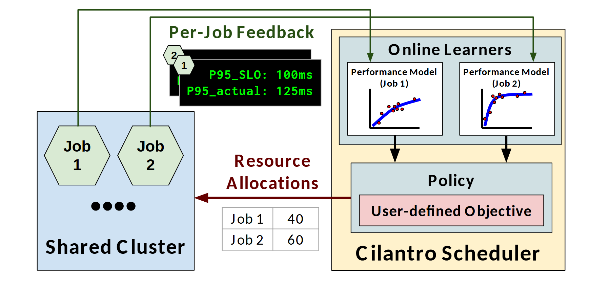

# VA-019 · 逐对象建模驱动的资源分配闭环

左侧对象共享资源，顶部观测卡把实际表现送到右侧多个独立模型，模型再进入同一个目标驱动策略，分配结果从中部返回资源池。图的关键是每个对象有自己的反馈与模型，而不是把所有观测混成一个黑箱；返回箭头使在线调整闭环一眼可见。



## 适用范围

- 依据反馈反复调整共享资源的调度系统
- 对象差异显著、需要分别学习响应曲线的控制问题

不适合：只做一次离线优化且无反馈更新；资源之间不竞争的独立任务清单。

## 阅读顺序

1. 从左下资源池识别对象集合与共享范围。
2. 向上读逐对象反馈，再进入右上对应模型。
3. 向下读目标与策略，沿返回箭头核对分配表如何作用于对象。

## 图形表达

**布局**：资源池和策略平台左右并列，上方绕行观测线，下方直接回送决策，形成不对称闭环。

**对象**：六边形表示对象，黑底叠卡表示多份实时记录，小曲线框表示对象模型，表格表示可执行分配。

**连线**：细绿色路径连接观测与模型，深红粗箭头强调资源回配；模型向策略的短箭头表示依赖。

**配色**：蓝色资源池、浅青模型和浅黄平台划分职责，粉色目标框嵌在策略中；黑绿日志用于突出观测形式。

**文字**：标题粗体与等宽日志分工明确；模型内部标签很小，应在最终尺寸核对，不能靠放大截图确认。

## 部件与复用

| 部件 | 含义 | 改造方法 |
|---|---|---|
| 共享对象池 (`shared-pool`) | 几个对象争用同一总资源。 | 改为用户、站点或任务，并明确资源约束。 |
| 逐对象观测卡 (`feedback-cards`) | 叠置卡片表示多份目标与实际值记录。 | 使用真实指标与单位；纯示意时移除看似精确的数值。 |
| 对象响应模型 (`learned-models`) | 并排小图说明不同对象有不同响应关系。 | 替换成实际模型结构或明确标为示意曲线。 |
| 目标约束与决策 (`objective-policy`) | 用户偏好位于策略框内，说明决策依据。 | 写出本任务的目标，不能以平台名称替代优化含义。 |
| 资源回配清单 (`allocation-table`) | 表格把策略输出转换为对象级数量。 | 修改列名、份额及单位，并与资源池对象一一对齐。 |

## 改造步骤

1. 先统一对象编号，让资源池、观测卡、模型和分配表四处保持同名。
2. 按新模型决定是否仍需多个小曲线；没有学习过程时改为估计器并调整反馈解释。
3. 保留观测上行和决策回送的分离，把新增约束接到策略而非观测卡。

## 新情景示例（假设）

假设做共享充电站的在线功率分配。

六边形为车辆，卡片为剩余电量与离站需求，模型为充电响应，目标框为公平性和完工要求。

把返回表改为车辆功率；车辆数增加时扩展模型行并重新布置顶部路径。

## 编辑入口

**入口**：以 make_figure.py 为入口，example.json 提供编辑配置，labels.json 用于查文字键，asset.json 对应下列部件。

**配置可改**：labels 改指定文字与字号；components 可显隐、平移和改属性；elements 修改单个矢量对象。平移保留固定几何，不会自动重新布线。

**需改代码**：增加对象模型、改变反馈方向或把单目标改成并列策略时，需要重画模型网格与返回路径。 必须在 customize() 中处理新增矢量对象及连接，不能只扩大文字框。

**字体**：当前字体映射使用 Arimo-Bold.ttf, Carlito-Bold.ttf, Carlito-Regular.ttf, Inconsolata-Bold.ttf；换标签后按最终插入宽度检查字宽、上下标和边界，不直接继承小字号。

准备独立工作副本：

```text
python "<SKILL>/scripts/prepare_architecture.py" --id VA-019 --out figures/architecture
```

在工作副本运行：

```text
python make_figure.py --config example.json --out . --parts
python render_architecture.py fig.svg
```

## 本图检查

- 对象编号是否贯穿池、模型和表格。
- 分配数值之和是否受总资源约束，单位是否一致。
- 卡片有意叠放是否遮住当前卡的关键观测。

部件图用于复用局部对象；跨边界的连接和共享容器仍需按新关系处理。示例名称、数值和曲线不是当前研究结果。

来源与许可见 [ATTRIBUTION.md](ATTRIBUTION.md)。
