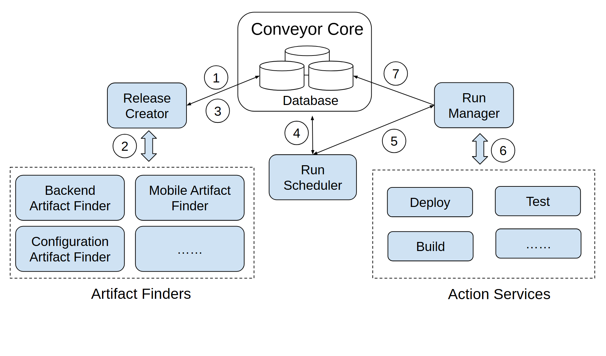

# VA-020 · 共享状态驱动的作业生命周期

中央状态存储连接任务发现、运行调度与执行管理，左右两组可扩展插件负责输入发现和具体动作。环绕中心的编号把结构图变成一次作业的执行说明，强调状态持久化与服务职责分离。



## 适用范围

- 围绕共享状态协调的作业系统
- 输入插件和执行插件可扩展的自动化平台

不适合：服务完全点对点通信且无状态中心；需要表达严格时间比例的调度结果。

## 阅读顺序

1. 先认中央存储及左右管理服务。
2. 沿编号 1 至 3 理解扫描输入与登记新任务。
3. 接着读中间调度器与编号 4、5。
4. 最后沿执行服务及回写路径完成 6、7。

## 图形表达

**布局**：中心存储位于上部，发现和执行两翼对称展开，调度器居中略低；编号占用留白。

**对象**：圆柱表示状态存储，浅蓝圆角块表示服务，虚线框表示可扩展同类集合。

**连线**：细斜线连接中央状态，粗双箭头连插件集合；编号为业务步骤，不是并发级别。

**配色**：统一浅蓝强调服务平级，数据库保持白底以避免误读成优先级色阶。

**文字**：短模块名放框内；圆圈编号靠近对应线，组名置于虚线框下。

## 部件与复用

| 部件 | 含义 | 改造方法 |
|---|---|---|
| 共享状态核心 (`state-core`) | 记录任务定义、进度和结果的中心状态。 | 替换为任务库；若用多库，明确分区语义而非把三个圆柱当三种数据库。 |
| 输入发现集合 (`artifact-finders`) | 左下多个发现插件的扩展区域。 | 改成文件、事件或传感数据发现器；该部件边界未包含上方任务创建服务。 |
| 运行调度器 (`run-scheduler`) | 依据状态决定下一次可执行动作。 | 替换调度职责，别与管理执行过程混写。 |
| 动作服务集合 (`action-services`) | 右下可调用的具体任务插件。 | 按真实动作列示，省略号表示同类扩展。 |
| 执行管理器 (`run-manager`) | 分派动作并记录执行结果。 | 改任务管理名并保留回写路径；不擅自增加与输入插件的直接调用。 |

## 改造步骤

1. 先列一次任务生命周期，再将每一步映射到服务。
2. 调整编号时同时检查箭头方向和创建、调度、执行的先后依赖。
3. 虚线组内只放可替换同类插件，基础数据库不归入插件组。
4. 重排时保留数据库到两翼的可读斜线空间。

## 新情景示例（假设）

假设绘制水文预测任务平台。

输入插件发现雨量和水位数据，中央库保存预测批次，调度器触发校验、求解和报告动作。

将构建、部署动作替换为清洗、模拟、发布；按真实回写流程重新编号。

## 编辑入口

**入口**：运行 make_figure.py，以 example.json 为改造配置；labels.json 查文字键，--parts 同步导出部件。

**配置可改**：labels 改文字，components 改显示、位移及样式，elements 改单个矢量属性；只选一个部件层级移动，避免重叠归属使对象移动两次。

**需改代码**：这是可编辑矢量结构，未实现自动布局。增删模块、改变连接或重新排版，须在 customize() 中改真实对象并更新部件成员。

**字体**：使用随包完整映射字体；改字后核查换行、符号和最终纸面字号。font_size 是对象局部单位，不能直接当作 PDF 的磅值。

准备独立工作副本：

```text
python "<SKILL>/scripts/prepare_architecture.py" --id VA-020 --out figures/architecture
```

在工作副本运行：

```text
python make_figure.py --config example.json --out . --parts
python render_architecture.py fig.svg
```

## 本图检查

- 编号是否覆盖一次完整循环且无重复遗漏。
- 左侧创建服务是否误被写成发现器部件的内部对象。
- 共享状态线与跨服务通知线是否被错误合并。

部件图用于复用局部对象；跨边界的连接和共享容器仍需按新关系处理。示例名称、数值和曲线不是当前研究结果。

来源与许可见 [ATTRIBUTION.md](ATTRIBUTION.md)。
