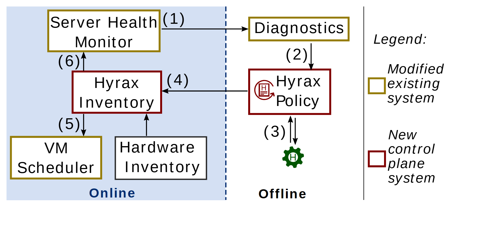

# VA-058 · 在线运维与离线诊断闭环

以左右分区组织在线运行和离线决策：监测发现问题，诊断生成策略，策略更新可用资源清单，清单再影响调度和监测。边框颜色额外区分已有系统的改造与新增控制模块，适合交代方法嵌入现有平台的位置。



## 适用范围

- 诊断后调整资源容量的运维
- 需要区分新增与改造模块的方案

不适合：纯实时紧耦合控制；没有状态清单或调度反馈的线性检测流程。

## 阅读顺序

1. 先区分左在线区与右离线区。
2. 从顶部监测沿箭头进入诊断。
3. 向下读策略及其外部交互。
4. 回到左侧清单，看它如何影响调度与监测。

## 图形表达

**布局**：在线区浅蓝底并占左半，离线区白底；右侧独立竖线隔出图例。

**对象**：简单矩形承担模块，策略旁小齿轮暗示与外部执行或管理接口交互。

**连线**：实线箭头上编号串联闭环；清单到监测及调度的分支分别表达不同作用。

**配色**：浅蓝只标运行区域；土黄与暗红边框表示改造模块和新增模块，不能再赋予健康程度含义。

**文字**：模块名分成短行；编号靠近箭头而非模块标题；图例斜体提示分类。

## 部件与复用

| 部件 | 含义 | 改造方法 |
|---|---|---|
| 在线运行区 (`online-control`) | 运行期监测、状态维护和调度。 | 明确哪些部分持续运行，避免把离线诊断塞进同一时序。 |
| 诊断与策略 (`offline-diagnosis`) | 分析异常并生成处置。 | 改为本场景真实诊断和策略输入输出。 |
| 清单与调度接口 (`inventory-scheduler`) | 将资源状态转为放置约束。 | 清单需注明容量、可用性或风险，不能混为同一指标。 |
| 改造范围图例 (`change-legend`) | 说明哪些模块新增、哪些沿用改造。 | 按实际贡献重新着色，现有颜色不是自动创新声明。 |

## 改造步骤

1. 定义从诊断到清单更新的具体字段。
2. 离线不等于人工，若由人员审批需额外标注。
3. 重新编号完整路径，并解释清单回馈监测的用途。

## 新情景示例（假设）

假设用于公交车辆健康管理。

在线监测发现异常，离线诊断形成维修策略，车辆清单更新可用状态，再影响排班。

将虚拟机调度改成车次分配，硬件清单改成车辆档案，策略侧增加真实维修执行接口。

## 编辑入口

**入口**：以 make_figure.py 为入口，先复制 example.json 作为当前情景配置；labels.json 定位标签，asset.json 定位部件。

**配置可改**：labels 可改文字和文字样式，components 可做显隐、平移和局部样式调整；elements 可定位矢量元素。配置只作用于已有几何，不会自动解决布局冲突。

**需改代码**：增加审批、维修执行或诊断子阶段需改变现有布局和连线；配置不会自动恢复闭环完整性。

**字体**：当前替换字体为 Arimo-Bold、Arimo-Italic、Arimo-Regular。改字后检查字宽、基线及 PDF 字体嵌入；原图的逐字定位不保证能容纳更长名称。

准备独立工作副本：

```text
python "<SKILL>/scripts/prepare_architecture.py" --id VA-058 --out figures/architecture
```

在工作副本运行：

```text
python make_figure.py --config example.json --out . --parts
python render_architecture.py fig.svg
```

## 本图检查

- 新增与改造的边框分类符合本次方法。
- 策略更新的是清单中明确定义的字段。
- 监测回路与调度分支箭头没有反向。

部件图用于复用局部对象；跨边界的连接和共享容器仍需按新关系处理。示例名称、数值和曲线不是当前研究结果。

来源与许可见 [ATTRIBUTION.md](ATTRIBUTION.md)。
