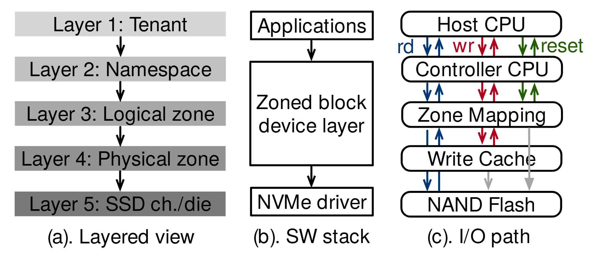

# VA-095 · 概念层级、软件实现与操作路径三视角

三个面板描述同一个系统：左侧解释对象如何逐层归属，中间说明软件调用经过什么层，右侧展示不同操作实际走哪些节点。三者并不要求层数相等，重点是让抽象关系、实现边界与执行语义相互对应。



## 适用范围

- 同一系统需要同时解释资源层级、软件栈和实际操作
- 不同操作在相同组件上走不同路径或异步完成

不适合：三个面板主题不一致的素材拼接；需要逐层一一映射但尚未确认对应关系。

## 阅读顺序

1. 左列由浅到深，读出从使用主体到物理资源的归属。
2. 中列从应用向下识别软件接口和驱动层。
3. 右列先读顶部操作简称与颜色，再分别追踪路径。
4. 重点查看绕过中间层的灰色通路和提前返回位置。

## 图形表达

**布局**：三列横向并置，各列内部自上而下；列宽根据内容分配而非强求相同层数。

**对象**：左列用灰阶条带表示抽象层，中列矩形表示软件模块，右列圆角框表示执行节点。

**连线**：左中黑箭头表示逐层关系，右侧成对彩色箭头区分请求及返回；长灰箭头表示后台动作或旁路。

**配色**：左列灰度仅帮助识别层次；右侧蓝、红、绿对应读、写、重置，灰色对应异步工作，迁移后须重定义。

**文字**：大号无衬线短标签，三列说明独立放底部；右侧操作名用颜色与文字双重编码。

## 部件与复用

| 部件 | 含义 | 改造方法 |
|---|---|---|
| 概念归属层级 (`concept-layers`) | 五级条带描述逻辑对象到物理资源的分层关系。 | 按新系统重定层级，不将包含、映射和管理关系混成同一种箭头。 |
| 软件实现栈 (`software-stack`) | 应用通过中间接口到达底层驱动。 | 保留真实实现边界，不为与左列对齐而虚构软件层。 |
| 运行操作路径 (`operation-paths`) | 多种操作在同一组节点上分别传递及返回。 | 逐条重画同步返回与异步后续工作，避免仅替换操作名字。 |

## 改造步骤

1. 先用一张映射表确认三个视角的对象联系，再安排并列位置。
2. 不同层数允许保留，必要时在正文解释一对多关系。
3. 为每类操作写明终点与返回条件，尤其是提前返回的请求。
4. 颜色之外保留操作简称；黑白输出时可增加不同线型。

## 新情景示例（假设）

可用于多租户数据平台的项目归属、服务接口与读写删除流程。

左列为组织、项目、数据集、分片、设备；中列为应用、存储服务、驱动；右列展示读取、写入和删除。

删除操作可在索引失效后返回，实际回收另画后台路径，但只有实现确实如此才使用该结构。此处为可能的映射。

## 编辑入口

**入口**：以 make_figure.py 为入口，example.json 存修改参数；labels.json 定位文字键，asset.json 定位部件。运行后查看整图和独立部件。

**配置可改**：labels 改文字及字体；components 改显示、dx/dy 和属性；elements 改对象属性。位移采用整图 viewBox 单位，父子部件重叠时只选一个层级移动。

**需改代码**：改层数、操作种类或提前返回节点需改 customize()。三列不会因标签长度自动对齐，长名须重新安排盒宽与连线。

**字体**：主要使用 TeX Gyre Heros Regular；右侧多条细线密集，优先保持短操作名而非缩小所有文字。 font_size 是元素局部单位，受变换影响，不等于纸面字号。

准备独立工作副本：

```text
python "<SKILL>/scripts/prepare_architecture.py" --id VA-095 --out figures/architecture
```

在工作副本运行：

```text
python make_figure.py --config example.json --out . --parts
python render_architecture.py fig.svg
```

## 本图检查

- 左右同名对象的粒度是否一致。
- 灰色后台通路是否被误读成同步完成。
- 顶部彩色操作简称是否能唯一解释全部同色箭头。

部件图用于复用局部对象；跨边界的连接和共享容器仍需按新关系处理。示例名称、数值和曲线不是当前研究结果。

来源与许可见 [ATTRIBUTION.md](ATTRIBUTION.md)。
