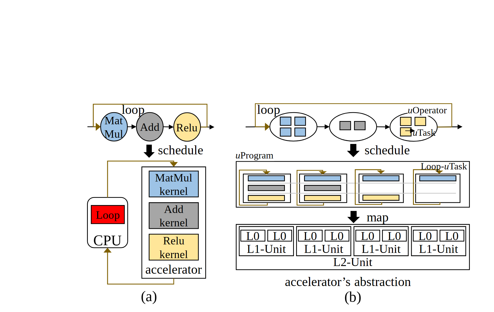

# VA-161 · 分离调度与统一任务映射对照

左图把循环控制放在CPU、算子内核放在加速器；右图把算子拆成小任务，统一调度到程序条带，再映射到多级硬件。它把抽象策略与实际部署对应起来，适合说明为何调度粒度改变了执行结构。



## 适用范围

- 集中调度与分离调度的架构比较
- 从逻辑算子到任务再到硬件单元的映射

不适合：只有一个无层次流水线的简单过程；要量化加速比或资源利用率的图。

## 阅读顺序

1. 先读左上MatMul、Add、Relu及循环回边。
2. 看左下CPU的Loop与加速器内核分离。
3. 读右上算子分解为小方块任务。
4. 沿schedule到程序条带，再沿map到L0/L1/L2硬件层。

## 图形表达

**布局**：两个不等宽面板，左侧对照较窄，右侧分三层展示统一表示与部署。

**对象**：左侧圆形算子与矩形内核，右侧椭圆算子内嵌任务方块、多列条带及嵌套硬件格。

**连线**：黑粗箭头连接schedule与map，棕色细回边表示loop；回边方向必须单独核对。

**配色**：蓝、灰、淡黄在算子、任务、内核三层保持对应；红色仅突出左图CPU循环控制。

**文字**：衬线文本，uProgram/uTask等记号带斜体前缀，多级单元标签大小接近。

## 部件与复用

| 部件 | 含义 | 改造方法 |
|---|---|---|
| 基准算子与循环 (`baseline-operators`) | 循环包围的三算子链 | 更改算子种类时同步改下层内核 |
| 分离执行部署 (`split-execution`) | CPU循环控制与加速器内核分离 | 改设备角色时保持控制回路可见 |
| 任务化算子链 (`task-operators`) | 椭圆算子内部拆分小任务 | 改变任务数量时重布椭圆内部对象 |
| 统一任务程序 (`unified-program`) | 多列任务和局部循环共同组成程序 | 按实际调度重排每列任务 |
| 多级硬件映射 (`hardware-map`) | L0嵌于L1，L1共同组成L2 | 层级数改变时重建容器嵌套 |

## 改造步骤

1. 保留从逻辑操作到执行实体的颜色对应，先定义每个小方块代表什么。
2. 确认对照方案的循环控制位置，不能让CPU红块只剩装饰作用。
3. 任务序列、循环回边与硬件单元映射一起改，不承诺任务数改变后自动重排。
4. 源viewBox顶部约三成是留白；成稿裁边时同步更新画布和导出坐标。

## 新情景示例（假设）

假设比较机器人任务的集中控制与分布式任务调度。

三种算子为感知、规划、执行，小方块为子任务，L0/L1/L2为核心、设备、集群。

重建循环和部署映射；若层级含义不是包含关系，应改成网络连接而非嵌套格。

## 编辑入口

**入口**：make_figure.py 运行本图构建与 customize 入口；example.json 提供实例配置，labels.json 定位文字键，asset.json 定义部件及 element_keys。运行 python make_figure.py --config example.json --out . --parts。

**配置可改**：labels、components 可改文字、配色、显隐和位移；配置不自动重排、延长连线或重新计算容器。

**需改代码**：结构变化在 customize(root, context) 中编辑；新增对象赋予唯一 data-asset-key 并补入所属部件的 element_keys。跨区域连线保留在整图时，移动部件后须显式重接；重叠部件不可重复平移同一元素。

**字体**：主要为衬线体，符号前缀倾斜；Loop、L0等短标签字体替换后仍需检查数字与字母区别。 最终字体文件以构建映射为准；局部 font_size 是源坐标中的字号，不等于论文纸面 pt，换字后须检查实际宽度。本批构建已确认并嵌入完整字体：Tinos-Italic.ttf, Tinos-Regular.ttf。映射可能改变原字形和字宽，需按实际论文尺寸复核。

准备独立工作副本：

```text
python "<SKILL>/scripts/prepare_architecture.py" --id VA-161 --out figures/architecture
```

在工作副本运行：

```text
python make_figure.py --config example.json --out . --parts
python render_architecture.py fig.svg
```

## 本图检查

- 同类任务在逻辑层、程序层和硬件层保持颜色一致。
- schedule与map不能被误写为同一操作。
- 循环箭头端点回到正确阶段。
- 裁剪上方留白后没有丢失回边或标题。

部件图用于复用局部对象；跨边界的连接和共享容器仍需按新关系处理。示例名称、数值和曲线不是当前研究结果。

来源与许可见 [ATTRIBUTION.md](ATTRIBUTION.md)。
