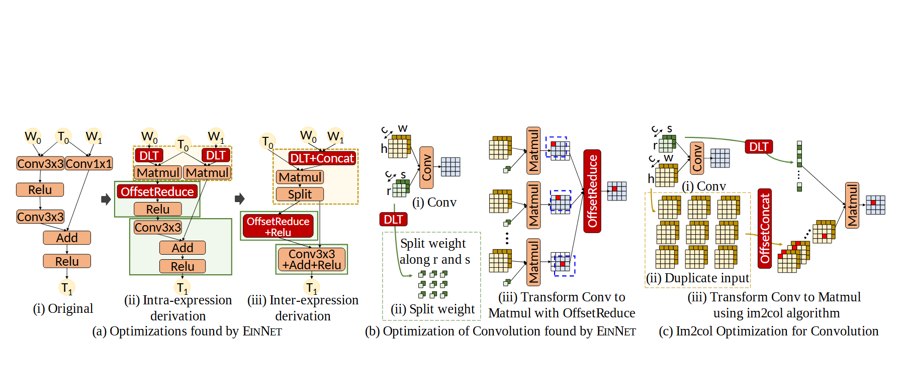

# VA-162 · 算子改写与张量变换三联解释

左面板用三步算子图展示局部改写和融合，中面板用张量格解释分裂权重的矩阵乘法变换，右面板展示复制输入的另一变换。既展示抽象算子，又展示数据布局，是编译与算法结构优化的密集解释图。



## 适用范围

- 同时解释算子图变化和数据布局变化
- 两种等价计算实现的结构对照

不适合：没有张量或分块对象的普通业务流程；不具备等价推导依据的算法效果宣传。

## 阅读顺序

1. 先读左面板原图、算子内改写和算子间改写三个阶段。
2. 跟随红色新增算子检查拆分、合并与融合位置。
3. 读中面板从卷积到分裂权重，再到多次Matmul与汇聚。
4. 读右面板复制输入和展平权重后进入Matmul的另一条路径。

## 图形表达

**布局**：三面板横排，左面板内部再分三步，后两面板由小张量格和箭头组成。

**对象**：圆形输入标记、圆角算子框、虚线区域、三维感小格阵列共同编码不同层次。

**连线**：左面板阶段之间用粗箭头，算子间用细箭头；后两面板用连接线指示张量变形与汇聚。

**配色**：桃色为常规算子，红底白字为突出改写算子，黄绿区域标记组合范围；张量格子颜色区分数据块。

**文字**：算子与说明混用无衬线，变量带下标；面板下方长标题需要额外横向间距。

## 部件与复用

| 部件 | 含义 | 改造方法 |
|---|---|---|
| 算子图三步改写 (`rewrite-stages`) | 原图到局部改写再到跨表达式融合 | 替换算子前先证明输入输出关系等价 |
| 权重分裂变换 (`split-weight`) | 权重拆分后多路矩阵乘法再汇聚 | 按真实维度更新小矩阵、箭头和归约方式 |
| 输入复制变换 (`duplicate-input`) | 复制输入后合并为另一种矩阵乘法实现 | 重新排列复制格子并核对权重展开方向 |

## 改造步骤

1. 把每个改写步骤的输入输出维度写清，再修改图中变换。
2. 红色算子只标真正新增或特殊的操作，不把所有框染红。
3. 张量格子的行列与箭头必须反映新实例，不能只改Conv或Matmul标签。
4. 保留三面板比较关系，若正文宽度不足则拆图；源图顶部留白较大可调整画布。

## 新情景示例（假设）

假设解释图像滤波的分块实现与滑窗展开实现。

左图表示基础算子融合，中图表示分块求和，右图表示滑窗矩阵展开。

重建块数量、卷积核索引及归约连接，并用独立数值例验证两条路径一致。

## 编辑入口

**入口**：make_figure.py 运行本图构建与 customize 入口；example.json 提供实例配置，labels.json 定位文字键，asset.json 定义部件及 element_keys。运行 python make_figure.py --config example.json --out . --parts。

**配置可改**：labels、components 可改文字、配色、显隐和位移；配置不自动重排、延长连线或重新计算容器。

**需改代码**：结构变化在 customize(root, context) 中编辑；新增对象赋予唯一 data-asset-key 并补入所属部件的 element_keys。跨区域连线保留在整图时，移动部件后须显式重接；重叠部件不可重复平移同一元素。

**字体**：已查看归一化输出，Add、Conv3x3与下标完整；源文件含Calibri与Linux Libertine的角色，红底白字保持对比度。局部 font_size 是源坐标字号，不等于论文纸面 pt。本批构建已确认并嵌入完整字体：Carlito-Regular.ttf, Tinos-Regular.ttf。映射可能改变原字形和字宽，需按实际论文尺寸复核。

准备独立工作副本：

```text
python "<SKILL>/scripts/prepare_architecture.py" --id VA-162 --out figures/architecture
```

在工作副本运行：

```text
python make_figure.py --config example.json --out . --parts
python render_architecture.py fig.svg
```

## 本图检查

- 所有变换保持输入输出尺寸和数学含义。
- 下标、加号、Conv等标签无缺字。
- 复制格和权重格的对应颜色没有串用。
- 三面板标题不重叠，缩小后仍能读清关键算子。

部件图用于复用局部对象；跨边界的连接和共享容器仍需按新关系处理。示例名称、数值和曲线不是当前研究结果。

来源与许可见 [ATTRIBUTION.md](ATTRIBUTION.md)。
