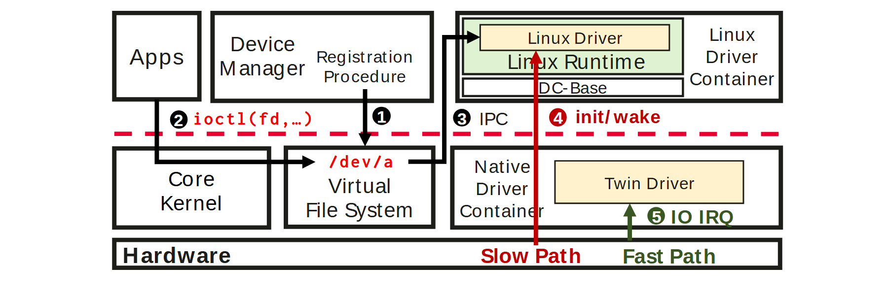

# VA-021 · 隔离边界下的常规调用与快速执行

模块横跨一条红色虚线边界，上方承载应用入口、注册和兼容环境，下方承载核心路由与本地执行。编号标出注册、请求转发和两条执行通道。红色长路径与绿色短路径展示职责分离，颜色本身不提供延迟测量。



## 适用范围

- 保留兼容环境同时下沉关键操作
- 需要解释注册与运行调用的不同路径

不适合：无法定义隔离或权限边界的普通业务图；只想比较快慢数值而没有执行结构。

## 阅读顺序

1. 辨认红色虚线两侧的环境及最底部硬件。
2. 从设备注册进入文件路由，再从应用请求进入相同入口。
3. 跟随转发连线进入右上兼容环境。
4. 对照红色初始化通道和绿色直接执行通道。

## 图形表达

**布局**：水平边界将上下环境切开，右侧两个执行容器上下对齐，共用底部长条。

**对象**：粗边矩形界定模块，兼容容器内部嵌套运行时与驱动；底部长条表示共享物理底座。

**连线**：黑色折线表示注册及转发；红色竖线为常规控制路径，绿色竖线为直接处理路径，号码对应操作步骤。

**配色**：淡黄填充两类处理器，浅绿表示运行环境，红绿用于路径类别，不混用于成功失败。

**文字**：无衬线模块名配等宽调用符号，路径说明与号码贴近相应箭头。

## 部件与复用

| 部件 | 含义 | 改造方法 |
|---|---|---|
| 入口与注册 (`application-registration`) | 应用调用和注册操作从不同入口进入。 | 分别替换配置期和运行期动作。 |
| 兼容环境 (`compatibility-container`) | 现有组件嵌套于运行时和外部容器。 | 改为实际兼容层，保留其依赖层级。 |
| 本地执行层 (`local-execution`) | 路由核心与快速处理模块并列。 | 按真实权限范围重新命名边界。 |
| 公共底座 (`hardware-base`) | 两条执行通道关联同一底层资源。 | 底座换成执行设备时同步更新通道终点。 |

## 改造步骤

1. 先定义虚线边界表达的隔离性质。
2. 为每个编号写清触发者和操作，删除无对应步骤的号码。
3. 调整模块时重接跨边界折线，不能只移动框。

## 新情景示例（假设）

可用于边缘设备的兼容控制与本地告警。

上层映射为旧平台接口和注册服务，下层映射为本地路由与告警处理器，底座映射为采集设备。

将初始化和实时事件分为两种明确通道；若没有权限隔离，应更换虚线含义及图例。

## 编辑入口

**入口**：运行 make_figure.py；example.json 为配置，labels.json 查文字键，asset.json 查部件。使用 --parts 导出独立矢量部件。

**配置可改**：labels 可改文字及字体；components 可设置 visible、dx/dy、attributes；elements 可按键改图元属性。移动量使用整图 viewBox 单位，重叠部件只选一个层级移动。

**需改代码**：增删节点、调整连接和重排结构须在 customize() 中处理；新增图元使用唯一 data-asset-key，并登记至相应部件 element_keys。配置不会自动排版。

**字体**：本图使用 Arimo-Bold.ttf、Arimo-Regular.ttf、Inconsolata-Bold.ttf。font_size 是图元局部坐标单位，受既有缩放影响，不等于纸面 pt；改字后检查实际字宽与最终阅读尺寸。

准备独立工作副本：

```text
python "<SKILL>/scripts/prepare_architecture.py" --id VA-021 --out figures/architecture
```

在工作副本运行：

```text
python make_figure.py --config example.json --out . --parts
python render_architecture.py fig.svg
```

## 本图检查

- 跨界箭头是否实际经过需要隔离的接口。
- 编号是否把注册与运行误排成每次都执行。
- 红绿路径名称是否有职责说明而非无依据的性能承诺。

部件图用于复用局部对象；跨边界的连接和共享容器仍需按新关系处理。示例名称、数值和曲线不是当前研究结果。

来源与许可见 [ATTRIBUTION.md](ATTRIBUTION.md)。
