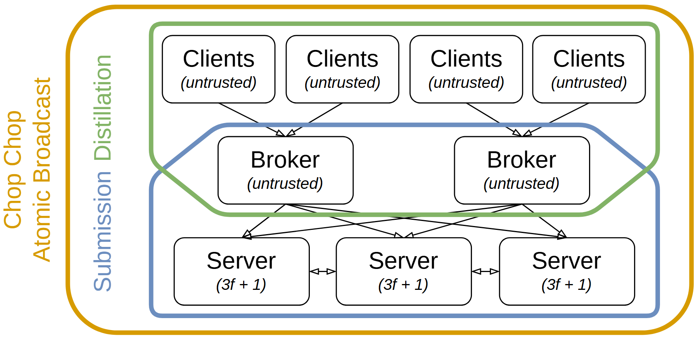

# VA-096 · 重叠职责域中的三层参与者

白底三层参与者构成向下的信息路径，绿色边界包住上游与中介，蓝色边界包住中介与服务层，中介因此同时属于两个职责域。金色外框表达整体范围。重叠轮廓是功能集合，不是普通网络连接；参与者框内的信任描述和数量公式属于具体系统假设，复用时必须重新确定。



## 适用范围

- 中间层同时参与上下两种协议或业务阶段
- 需要区分参与者层级与横跨层级的职责域

不适合：层级之间完全独立且没有共享参与者；只想画简单三层部署而不需要域边界。

## 阅读顺序

1. 从顶部多个请求方沿箭头进入中介
2. 查看中介到下方服务节点的扇出
3. 识别服务节点间横向通信
4. 再读绿色、蓝色及金色边界，确认中介位于两域交集

## 图形表达

**布局**：三排节点自上而下对齐，顶层较密、中层较少、底层横向互联，左侧竖排边界标签解释范围。

**对象**：节点用白底圆角矩形，外层彩色粗轮廓包围集合；边界采用折弯和圆角以避免切过节点正文。

**连线**：上游到中介和中介到服务层为定向细箭头，服务节点间为双向通信；彩色边界不是数据流线。

**配色**：绿色表示上半职责域，蓝色表示下半职责域，金色表示总体范围，节点本身保持中性避免重复编码。

**文字**：无衬线名称居中，属性说明用斜体次行；数量公式必须清晰分组，侧面竖排文字宜短。

## 部件与复用

| 部件 | 含义 | 改造方法 |
|---|---|---|
| 上游参与者层 (`clients`) | 多个独立请求来源接入中介。 | 改为真实来源类型，重新声明信任假设，不保留默认不可信标签。 |
| 共享中介层 (`brokers`) | 既接受上游输入又提交下游服务。 | 明确中介做筛选、汇总还是验证，不能借其位置推断安全能力。 |
| 下游服务层 (`servers`) | 服务节点接受提交并相互通信。 | 替换节点数量及容错公式；普通业务场景应去掉协议专用公式。 |
| 上半职责域 (`submission-domain`) | 绿色边界囊括请求方和中介。 | 重命名为实际跨层功能，移动整个域时注意它包含已有节点。 |
| 下半职责域 (`broadcast-domain`) | 蓝色边界囊括中介和服务节点。 | 维持中介交集，若职责不重叠应改用不相交分区而非保留造型。 |

## 改造步骤

1. 先列出参与者集合和每个功能域的成员，再调边界
2. 将信任标签与服务数量公式替换为当前场景的明确假设
3. 同时涉及两个域的中介只能移动一次，之后手动校正两个轮廓
4. 当下游无需互联时删除横向双箭头，不用它装饰对称性

## 新情景示例（假设）

可用于假设的区域公共数据上报平台。

顶部为各采集部门，中介为审核汇总站，下层为数据发布服务；绿色域为资料校验，蓝色域为发布提交。

删除不可信与容错数量公式，按业务需要保留或删除服务间同步；两个域交叠只表示汇总站同时履责。

## 编辑入口

**入口**：make_figure.py 读取 example.json 生成 fig.svg；加 --parts 导出部件，render_architecture.py 渲染预览及 PDF。

**配置可改**：labels 按 labels.json 对象键改字；components 支持 visible、dx/dy、attributes；elements 改对象属性。位移用图内坐标，连线不自动重布。

**需改代码**：增删模块、改连接和布局须修改 customize()。新对象须有唯一 data-asset-key 并登记部件归属；嵌套部件选一个层级平移，避免重复移动。

**字体**：当前完整字体为 Arimo-Italic, Arimo-Regular。font_size 是元素局部坐标单位，受缩放变换影响，不是纸面字号；改长标签后按最终版面宽度复核换行与字距。

准备独立工作副本：

```text
python "<SKILL>/scripts/prepare_architecture.py" --id VA-096 --out figures/architecture
```

在工作副本运行：

```text
python make_figure.py --config example.json --out . --parts
python render_architecture.py fig.svg
```

## 本图检查

- 中介是否确实位于两个功能边界之内
- 所有彩色边界是否避开文字且没有箭头头部
- 信任假设及数量公式是否仍适用于当前系统

部件图用于复用局部对象；跨边界的连接和共享容器仍需按新关系处理。示例名称、数值和曲线不是当前研究结果。

来源与许可见 [ATTRIBUTION.md](ATTRIBUTION.md)。
