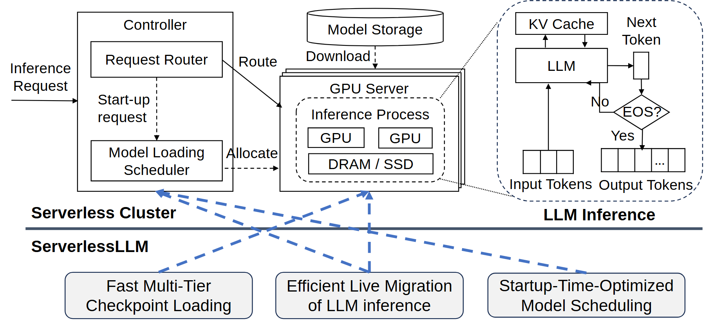

# VA-097 · 系统部署、执行循环与改进落点

上半部把请求控制、资源部署和单次执行机制连在一起：控制器决定直接路由还是启动资源，中央存储为执行节点提供内容，右侧展开迭代计算及终止判断。下半部单列方法改进，用蓝色虚线指向实际作用模块。这种构图可同时回答系统怎样运行、局部怎样工作、改进发生在哪里，但方法指向线不属于运行数据流。



## 适用范围

- 已有系统上增加多个明确改进点的论文总览
- 请求路由与冷启动并存且需要局部迭代机制展开的架构

不适合：改进点尚未对应具体模块的概念宣传图；没有终止循环却机械保留判断菱形的单次处理系统。

## 阅读顺序

1. 从左侧请求看直接路由和启动分支，区分两种触发。
2. 读中央存储到执行节点的加载关系及节点内资源。
3. 沿放大引线进入右侧循环，确认输入、状态缓存和终止条件。
4. 最后读底部改进项，通过蓝虚线逐一定位其作用区域。

## 图形表达

**布局**：上部左控制、中部署、右放大，底部三项改进横排；深色分隔线分开运行结构与解释性注释。

**对象**：存储圆柱、叠放服务器、迭代判断菱形分别表达保存、实例重复和条件分支；放大框使用虚线边界。

**连线**：黑色实虚线分别说明请求或启动加载等关系；点线表示放大对应；蓝虚线只指出改进落点，不能参与执行循环。

**配色**：主体近黑白，浅灰改进框和蓝色指向线承担强调；不需把每个运行模块再染成不同颜色。

**文字**：主区名称稍粗，内部功能名常规字；右侧小循环优先短标签，长改进名控制在两行。

## 部件与复用

| 部件 | 含义 | 改造方法 |
|---|---|---|
| 请求与启动控制 (`controller`) | 把已有执行实例路由与新资源启动分开 | 新任务无冷启动时删除下层调度支路，并更新方法指向。 |
| 存储和执行部署 (`storage-server`) | 持久内容加载到重复执行节点 | 替换资源和存储类型，节点叠片为示意而非真实数量。 |
| 局部迭代循环 (`execution-inset`) | 输入驱动计算，缓存保留状态，判断决定继续或输出 | 图中 No 回到计算、Yes 到输出；更改条件时必须相应重画分支。 |
| 改进项与作用位置 (`contribution-row`) | 多个设计点映射到一个或多个运行模块 | 只保留当前真正实现的改进，指针连接实际模块边缘而非附近空白。 |

## 改造步骤

1. 先确定请求、启动、加载三种关系及是否存在资源复用。
2. 将右侧展开换成当前算法的真实循环，重写终止条件和缓存内容。
3. 为每项改进明确作用模块与机制，再决定底部框数和指向边。
4. 拆开交叉的解释性指针，确认它们不与运行箭头共用方向或终点。

## 新情景示例（假设）

假设绘制按需启动的应急疏散仿真服务。

控制器路由仿真请求，模型仓库存储场景数据，计算节点执行仿真；右侧循环为状态推进、缓存更新和收敛判断。

终止条件改为达到仿真时域或收敛，输入输出格改为状态序列；底部仅标已实现的场景加载、状态迁移和实例选择优化。

## 编辑入口

**入口**：在工作副本修改 example.json，运行 python make_figure.py --config example.json --out output --parts；再通过 Vivid 的矢量渲染入口检查 SVG 与 PDF。

**配置可改**：labels 按 labels.json 的元素键改字；components 按本页部件 id 设置 visible、dx、dy 或 attributes；elements 修改指定矢量元素属性。重叠部件可能共享元素，避免对父区域和内部区域重复位移。

**需改代码**：执行循环、判断分支、改进数量与指针落点变化必须修改代码路径，部件平移后需要重新检查外部引线。这些接口不会自动重排，也不会随部件移动自动修复跨部件连线。

**字体**：本资产已记录的完整字形资源：Arimo-Bold.ttf, Arimo-Regular.ttf, Carlito-Regular.ttf。修改英文标签优先沿用对应字体族与字重；文字变长时调整框宽和换行，不靠整体缩小压入。其他语言须另选覆盖所需字符的字体并实查导出。

准备独立工作副本：

```text
python "<SKILL>/scripts/prepare_architecture.py" --id VA-097 --out figures/architecture
```

在工作副本运行：

```text
python make_figure.py --config example.json --out . --parts
python render_architecture.py fig.svg
```

## 本图检查

- 冷启动支路与已有实例路由是否分开，加载方向是否从存储到节点？
- 判断条件为真与为假各去哪里，缓存是否被误连成终止输出？
- 每条蓝虚线是否仅说明改进作用点，且不会被当作运行数据流？

部件图用于复用局部对象；跨边界的连接和共享容器仍需按新关系处理。示例名称、数值和曲线不是当前研究结果。

来源与许可见 [ATTRIBUTION.md](ATTRIBUTION.md)。
