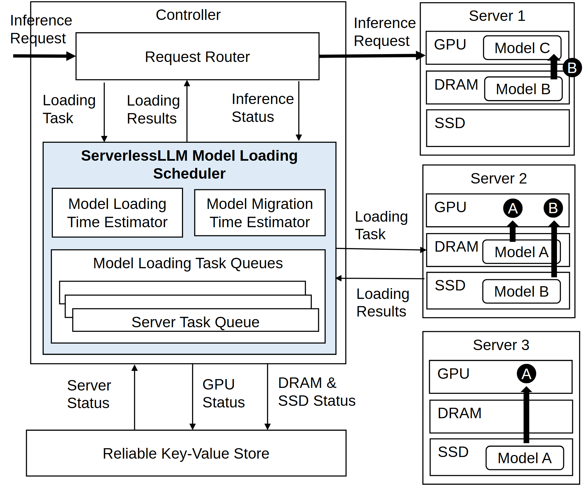

# VA-023 · 双成本估计驱动的分层资源调度

左侧控制器用两种成本估计决定如何把对象送到可执行位置，右侧多台节点显示对象当前处于不同存储层。图的核心不是服务器数量，而是请求路由、准备任务、状态回传与跨层搬移之间的关系。



## 适用范围

- 加载和迁移两种路线需要比较成本的任务启动系统
- 资源对象在多个节点、多个层级间转移的调度

不适合：只有请求负载均衡且不存在对象准备；需要精确显示传输持续时间的时序分析。

## 阅读顺序

1. 先看上方请求进入路由器并发往右侧节点。
2. 再读浅蓝调度区中的两个估计器和待执行队列。
3. 沿底部共享状态库返回的资源状态理解决策输入。
4. 最后逐个查看右侧对象位置和层间迁移箭头，区分当前状态与计划动作。

## 图形表达

**布局**：左侧宽控制区域与右侧窄节点列并排；共享状态库放在控制区下方。

**对象**：三层横格表示每台节点资源层，字母小卡片表示对象，叠片表示任务队列。

**连线**：细箭头连接请求、加载任务和状态消息；右侧粗竖箭头突出对象在层间转移。

**配色**：大部分区域白底黑线，仅浅蓝突出调度决策范围，不把节点颜色解释为优劣。

**文字**：无衬线正文，调度器标题加粗；估计器采用两行短名，右侧对象名保持很短。

## 部件与复用

| 部件 | 含义 | 改造方法 |
|---|---|---|
| 请求入口与路由 (`request-router`) | 接收执行请求并得到准备结果。 | 区分请求立即转发还是等待准备，补上实际分支条件。 |
| 双成本估计器 (`cost-estimators`) | 分别估计本地准备与跨节点搬移的时间。 | 替换成可比较的两个指标，单位和评价对象必须一致。 |
| 准备任务队列 (`task-queues`) | 按服务节点组织待执行对象准备任务。 | 明确队列项是对象、请求还是操作，不能混用。 |
| 共享状态库 (`status-store`) | 保存节点及不同资源层的可用状态。 | 列出实际参与调度的状态，不用泛化的状态箭头掩盖缺项。 |
| 分层执行节点 (`resource-tier-nodes`) | 三个示例节点展示对象的不同驻留位置和迁移动作。 | 重画层级名称、对象驻留和转移；字母对应表应同步更新。 |

## 改造步骤

1. 先区分请求路径与对象准备路径，确定哪个步骤会阻塞启动。
2. 两种估计应使用相同目标，必要时把时间改为统一综合代价。
3. 按实际资源重画右侧层级，去掉无意义的硬件层名。
4. 减少节点时同时移除对应任务箭头与队列项，不只隐藏服务器框。

## 新情景示例（假设）

可用于多仓冷链订单的货物准备与跨仓调拨选择。

路由器对应订单分配；估计器比较本仓拣货与跨仓调拨；节点层级对应库存、暂存和装车区。

把层间粗箭头改成货物搬运，新增仓间调拨通路，并用订单与货物的不同符号区分两类对象。此处不声称调度收益。

## 编辑入口

**入口**：以 make_figure.py 为入口，example.json 存修改参数；labels.json 定位文字键，asset.json 定位部件。运行后查看整图和独立部件。

**配置可改**：labels 改文字及字体；components 改显示、dx/dy 和属性；elements 改对象属性。位移采用整图 viewBox 单位，父子部件重叠时只选一个层级移动。

**需改代码**：增加节点、层级或改变对象搬移关系需编辑 customize() 的几何及连线。仅改标签不会生成新的调度策略。

**字体**：采用 Arimo Regular 与 Bold；右侧狭窄资源格优先用短标签并在正文定义。 font_size 是元素局部单位，受变换影响，不等于纸面字号。

准备独立工作副本：

```text
python "<SKILL>/scripts/prepare_architecture.py" --id VA-023 --out figures/architecture
```

在工作副本运行：

```text
python make_figure.py --config example.json --out . --parts
python render_architecture.py fig.svg
```

## 本图检查

- 粗迁移箭头的起点是否真的有对应对象。
- 状态库输出是否覆盖两个估计器所需输入。
- 路由请求与加载任务是否误连到相同资源层。

部件图用于复用局部对象；跨边界的连接和共享容器仍需按新关系处理。示例名称、数值和曲线不是当前研究结果。

来源与许可见 [ATTRIBUTION.md](ATTRIBUTION.md)。
