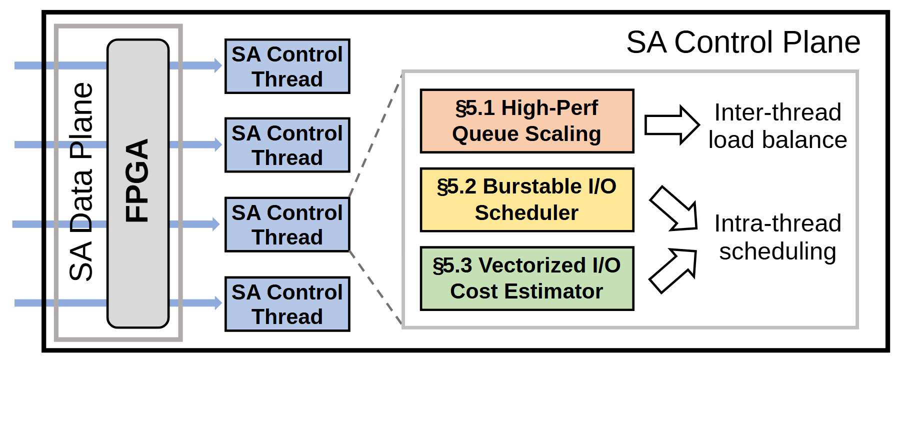

# VA-024 · 并行控制与策略作用范围展开图

左侧重复控制线程给出运行规模，右侧把一个控制逻辑展开成三项策略，并进一步标明策略作用于线程之间还是线程内部。虚线展开关系是解释视图，不是额外的数据传输。适合强调方法的作用层级，而不是展示复杂消息协议。



## 适用范围

- 并行执行系统的控制策略分解
- 需要区分资源间均衡与资源内排程

不适合：每个线程执行不同算法且无法共用展开框；需要表现精确时序或网络协议。

## 阅读顺序

1. 从左侧贯通执行平面进入并排的控制线程
2. 沿虚线定位右侧策略展开区
3. 分别读取三个彩色策略框
4. 跟随空心箭头识别跨线程与线程内两个作用尺度

## 图形表达

**布局**：宽幅单面板，左部用重复行强调并行，右部用放大区域强调方法细节。

**对象**：高窄圆角执行单元与小矩形线程配对，策略采用三个等宽彩色矩形，效果写在其右。

**连线**：蓝色实线表示左侧接口关系，灰色虚线标记展开，空心粗箭头表达作用而非字节流量。

**配色**：线程统一浅蓝，三项策略分别用橙、黄、绿区分；灰框只承担层级边界。

**文字**：策略标题加粗且控制为两行，作用描述用常规字重；移除与当前文档无关的章节编号。

## 部件与复用

| 部件 | 含义 | 改造方法 |
|---|---|---|
| 贯通执行平面 (`data-plane`) | 跨越多条输入行的共同执行资源。 | 可改为计算后端或生产线，不保留无对应硬件称谓。 |
| 并行控制实例 (`control-threads`) | 重复结构表示多个同职能控制线程。 | 按实际数目保留代表行，线程名称尽量等长。 |
| 三类策略 (`strategy-blocks`) | 队列调节、突发排程和成本估计的展开位置。 | 只填实际拥有的机制，减少策略时重新均分高度。 |
| 作用范围说明 (`scheduling-effects`) | 把策略连接到跨实例均衡或实例内部排序。 | 逐项确认作用尺度；同一策略有双作用时增加明确分叉。 |

## 改造步骤

1. 先确定运行结构与解释性展开的区别，给虚线关系保留说明
2. 清除章节号，并把三项策略改成当前方法的可验证名称
3. 核对左侧输入方向，不能从展开箭头倒推实际控制协议
4. 改行数或策略数时同步调整展开框和箭头落点

## 新情景示例（假设）

可用于假设的医院多窗口服务调度方案。

左侧是叫号平台及窗口控制器；右侧依次为队列分流、急诊插队规则和服务时长估计。

将跨线程改为跨窗口均衡，将线程内改为窗口内排序；去掉硬件名称，保留解释性展开。

## 编辑入口

**入口**：make_figure.py 读取 example.json 生成 fig.svg；加 --parts 导出部件，render_architecture.py 渲染预览及 PDF。

**配置可改**：labels 按 labels.json 对象键改字；components 支持 visible、dx/dy、attributes；elements 改对象属性。位移用图内坐标，连线不自动重布。

**需改代码**：增删模块、改连接和布局须修改 customize()。新对象须有唯一 data-asset-key 并登记部件归属；嵌套部件选一个层级平移，避免重复移动。

**字体**：当前完整字体为 Arimo-Bold, Arimo-Regular。font_size 是元素局部坐标单位，受缩放变换影响，不是纸面字号；改长标签后按最终版面宽度复核换行与字距。

准备独立工作副本：

```text
python "<SKILL>/scripts/prepare_architecture.py" --id VA-024 --out figures/architecture
```

在工作副本运行：

```text
python make_figure.py --config example.json --out . --parts
python render_architecture.py fig.svg
```

## 本图检查

- 虚线展开是否被错误写成通信链路
- 每项策略是否连接到正确作用尺度
- 线程行、左侧输入箭头和框间距是否一一对应

部件图用于复用局部对象；跨边界的连接和共享容器仍需按新关系处理。示例名称、数值和曲线不是当前研究结果。

来源与许可见 [ATTRIBUTION.md](ATTRIBUTION.md)。
