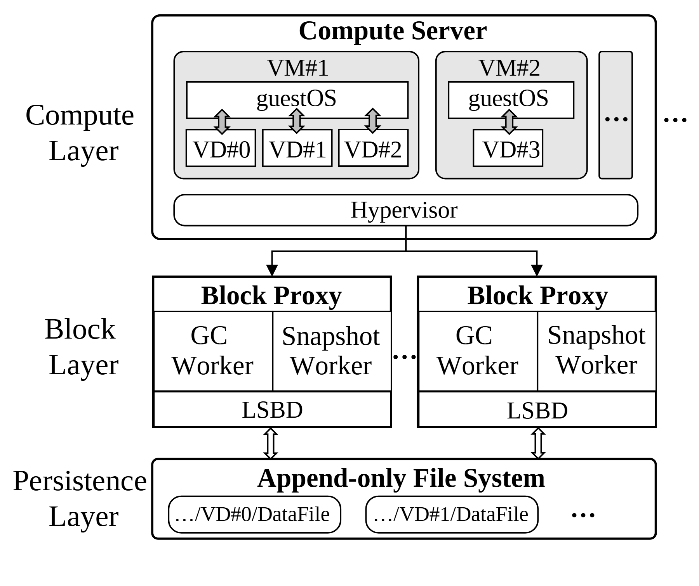

# VA-163 · 计算代理持久化三层嵌套架构

计算服务器中嵌套虚拟机和虚拟磁盘，中层重复部署代理，每个代理内含工作者与日志设备，下层由一个持久化系统承接。左侧统一层名与内部包含关系配合，适合展示服务层级和实例结构。



## 适用范围

- 计算、服务代理与持久化三层架构
- 同一层中多个实例具有相同内部职责的系统

不适合：跨层关系高度网状的网络；以时间变化或因果关系为主的说明。

## 阅读顺序

1. 沿左侧Compute、Block、Persistence三个层名向下。
2. 读计算服务器中的两个VM及其虚拟盘，最后到共享Hypervisor。
3. 沿分叉箭头到两个结构相同的Block Proxy。
4. 读代理内部GC/Snapshot和LSBD，再沿双向关系到文件系统。

## 图形表达

**布局**：纵向三层，左侧专栏放层名；中层两个代理并排，上下均为整宽容器。

**对象**：圆角服务器/VM/文件系统与矩形代理表格组合，灰色填充标示VM内部边界。

**连线**：计算层通过分叉单向箭头连接代理，代理与下层间用双向空心箭头；包含关系主要靠容器表达。

**配色**：黑白灰单色构图，强调层级与边框而非依赖颜色区分职责。

**文字**：容器名称加粗，内部组件常规字重，VM和VD编号要求清晰；层名分两行。

## 部件与复用

| 部件 | 含义 | 改造方法 |
|---|---|---|
| 计算服务层 (`compute-tier`) | 服务器内VM、虚拟盘与Hypervisor的嵌套 | 可扩展VM实例，需同步重排磁盘与连线 |
| 左代理实例 (`proxy-left`) | 工作者职责和底层日志设备组合 | 复用为一个完整代理实例而非拆成孤立格 |
| 右代理实例 (`proxy-right`) | 与左代理相同的并行实例 | 增减实例时同步修改上层分叉 |
| 共享持久化层 (`persistence-tier`) | 多个虚拟盘的数据文件共享一个后端系统 | 改变存储类型时更新文件胶囊和双向关系 |

## 改造步骤

1. 先确定三层名称与边界，区分实例包含与调用关系。
2. 替换计算层的内部对象时保留一个展开实例和必要的重复示意。
3. 中间代理个数与上方分叉支路一起改；省略号不代表已绘制连接。
4. 黑白打印可保留；如加颜色，应以层或职责为统一编码，不能每格随机上色。

## 新情景示例（假设）

假设展示多团队仿真平台。

VM为团队工作区，代理为任务服务，GC/Snapshot为清理与检查点，文件系统为结果存储。

按真实关系替换虚拟盘与日志设备，并决定后端是单一共享服务还是分布式实例。

## 编辑入口

**入口**：make_figure.py 运行本图构建与 customize 入口；example.json 提供实例配置，labels.json 定位文字键，asset.json 定义部件及 element_keys。运行 python make_figure.py --config example.json --out . --parts。

**配置可改**：labels、components 可改文字、配色、显隐和位移；配置不自动重排、延长连线或重新计算容器。

**需改代码**：结构变化在 customize(root, context) 中编辑；新增对象赋予唯一 data-asset-key 并补入所属部件的 element_keys。跨区域连线保留在整图时，移动部件后须显式重接；重叠部件不可重复平移同一元素。

**字体**：印刷预览为衬线字体，标题加粗；源文件含多套Times子集，直接浏览的回退字形不应作为最终字体标准。 最终字体文件以构建映射为准；局部 font_size 是源坐标中的字号，不等于论文纸面 pt，换字后须检查实际宽度。本批构建已确认并嵌入完整字体：Tinos-Bold.ttf, Tinos-Regular.ttf。映射可能改变原字形和字宽，需按实际论文尺寸复核。

准备独立工作副本：

```text
python "<SKILL>/scripts/prepare_architecture.py" --id VA-163 --out figures/architecture
```

在工作副本运行：

```text
python make_figure.py --config example.json --out . --parts
python render_architecture.py fig.svg
```

## 本图检查

- 每个虚拟盘归属清晰且编号无重复。
- 两个代理内部结构与实际职责一致。
- 单向分发和双向存储交互没有混用。
- 左侧层名与大容器边界保持足够空隙。

部件图用于复用局部对象；跨边界的连接和共享容器仍需按新关系处理。示例名称、数值和曲线不是当前研究结果。

来源与许可见 [ATTRIBUTION.md](ATTRIBUTION.md)。
