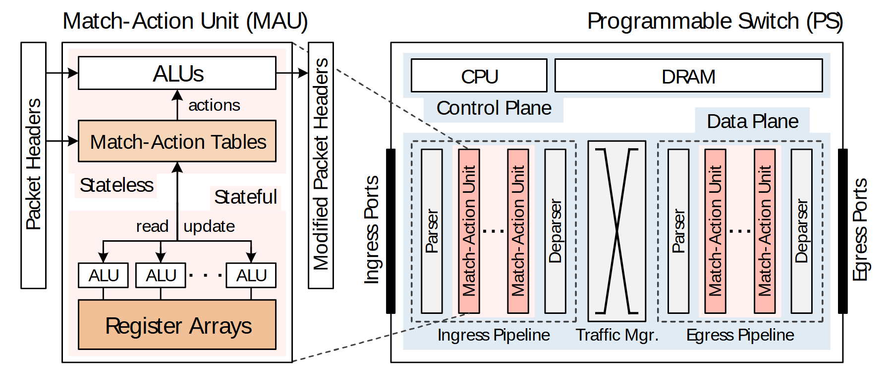

# VA-164 · 重复流水单元的局部放大与设备总览

左侧把一个匹配动作单元放大，展示表、算术单元和寄存器；右侧把同类单元缩小放入入口与出口两条流水线。斜向虚线将局部与整体关联，适合说明大量重复模块中一个模块的内部机制。



## 适用范围

- 重复流水单元的内部构成与整机位置联合展示
- 单个处理模块放大并关联其部署上下文

不适合：没有重复子结构的短流程；需要精确通信方向而又不准备补充箭头的网络图。

## 阅读顺序

1. 先读左侧输入包头、表、ALU与寄存器的局部关系。
2. 沿两条斜虚线定位右侧入口流水线中的对应单元。
3. 读右上控制平面的CPU和DRAM。
4. 读右下入口流水、流量管理器和出口流水，最后定位外侧端口。

## 图形表达

**布局**：左侧单元占约三分之一宽度，右侧整机占余下空间；右侧上控下数，两条流水线夹着流量管理器。

**对象**：表与寄存器用横条，ALU用重复小框，流水单元用竖条，虚线框圈定入口和出口流水。

**连线**：左侧实线箭头表示表、动作与寄存器关系；斜虚线仅为放大关联，右侧多数为位置关系，不能自动解释成已绘制的数据流箭头。

**配色**：右侧淡蓝底表示控制/数据平面，粉红竖条突出重复匹配动作单元；左侧两种橙色区分表和寄存器但没有独立图例。

**文字**：轻型无衬线文字，竖条标签旋转90度；整体标题在顶端，部件标签密集。

## 部件与复用

| 部件 | 含义 | 改造方法 |
|---|---|---|
| 展开处理单元 (`expanded-unit`) | 从包头输入到ALU、动作表及寄存器的内部结构 | 改模块类型时重建内部操作和读写关系 |
| 控制平面 (`control-plane`) | CPU与DRAM的横向上层控制区域 | 替换为控制服务与状态存储时保持上层角色 |
| 入口流水线 (`ingress-pipeline`) | 解析、多个匹配动作单元与反解析的链状部署 | 增减重复单元须重排竖条并改变放大锚点 |
| 流量管理中心 (`traffic-manager`) | 入口与出口之间的集中调度位置 | 替换为路由或交换模块时说明连接语义 |
| 出口流水线 (`egress-pipeline`) | 输出前第二组解析和处理单元 | 与入口组统一重复单元形态 |

## 改造步骤

1. 选择真正具有代表性的重复单元在左侧展开，别把无关模块硬连为放大关系。
2. 改写表、动作和寄存器职责，并核对所有内部箭头。
3. 右侧原本主要是布局示意；新场景需要数据流方向时应补画明确箭头。
4. 为橙色深浅或其他新颜色给出解释；竖排标签太长时改为编号加图注。

## 新情景示例（假设）

假设展示流式数据清洗平台。

左侧为规则执行单元，右侧入口与出口流水线为接收清洗和输出整理，流量管理器为队列调度。

把寄存器改为状态缓存，并补充从入口到出口的实际数据流方向与反馈关系。

## 编辑入口

**入口**：make_figure.py 运行本图构建与 customize 入口；example.json 提供实例配置，labels.json 定位文字键，asset.json 定义部件及 element_keys。运行 python make_figure.py --config example.json --out . --parts。

**配置可改**：labels、components 可改文字、配色、显隐和位移；配置不自动重排、延长连线或重新计算容器。

**需改代码**：结构变化在 customize(root, context) 中编辑；新增对象赋予唯一 data-asset-key 并补入所属部件的 element_keys。跨区域连线保留在整图时，移动部件后须显式重接；重叠部件不可重复平移同一元素。

**字体**：源标为Segoe UI Light子集，细字在缩小时容易变淡；旋转标签与普通标签应保持同一字体族和合理字重。 最终字体文件以构建映射为准；局部 font_size 是源坐标中的字号，不等于论文纸面 pt，换字后须检查实际宽度。本批构建已确认并嵌入完整字体：Arimo-Regular.ttf。映射可能改变原字形和字宽，需按实际论文尺寸复核。

准备独立工作副本：

```text
python "<SKILL>/scripts/prepare_architecture.py" --id VA-164 --out figures/architecture
```

在工作副本运行：

```text
python make_figure.py --config example.json --out . --parts
python render_architecture.py fig.svg
```

## 本图检查

- 斜虚线确实指向与左侧同类的重复单元。
- 入口和出口竖条数量与实际流程一致。
- 控制平面没有被误读为数据流水的一个步骤。
- 两种橙色有明确含义或改为一种色；旋转标签未越界。

部件图用于复用局部对象；跨边界的连接和共享容器仍需按新关系处理。示例名称、数值和曲线不是当前研究结果。

来源与许可见 [ATTRIBUTION.md](ATTRIBUTION.md)。
