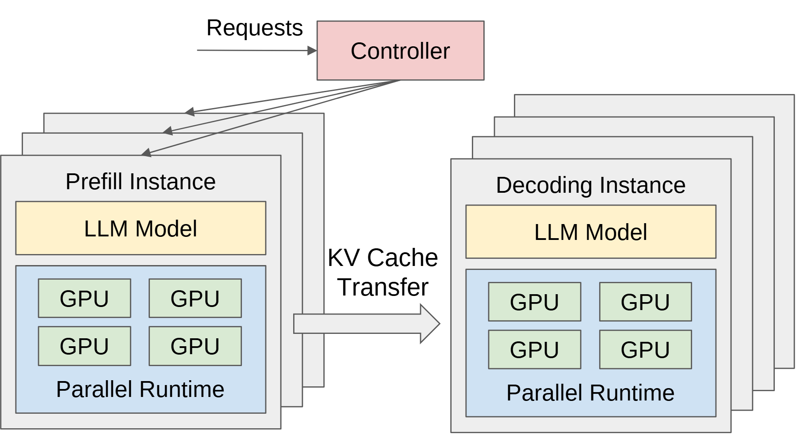

# VA-061 · 双阶段实例池与中间状态交接

两个独立实例池左右对置，前面的代表卡片展示模型与内部并行资源，后面的叠片表示更多同类实例。两池之间的宽箭头承载中间状态交接，顶部控制器向第一池分发请求。画面强调两阶段可独立组织，但不直接给出扩缩容策略。



## 适用范围

- 前后阶段使用独立工作池并传递状态
- 需要同时表达池级复制和实例内并行

不适合：两个模块只是同一实例内的顺序步骤；中间产物是无状态消息且不需强调迁移成本。

## 阅读顺序

1. 从顶部请求进入公共控制器。
2. 顺分发线进入左侧第一阶段实例。
3. 读取实例卡内模型及四个计算单元的包含关系。
4. 沿宽箭头到右侧池，注意两边叠片表达的独立规模。

## 图形表达

**布局**：左右对称实例池占主体，控制器位于左上；中间留出足够空白承载状态箭头和标签。

**对象**：多层矩形叠片表示实例集合，内部浅色大框表示并行运行环境，小矩形表示计算资源。

**连线**：细箭头表示请求分配，粗空心箭头表示阶段间状态交接；预览没有画出控制器直接到右池的连接。

**配色**：粉色突出控制器，黄色突出模型，蓝色标出运行环境，绿色表示内部计算单元，灰色为实例边界。

**文字**：常规无衬线字重，状态标签在两池之间分行；池名与模型名须保持层级而不争夺字号。

## 部件与复用

| 部件 | 含义 | 改造方法 |
|---|---|---|
| 请求分配器 (`controller`) | 请求先进入统一入口。 | 如要调度两池，显式补画第二组连接。 |
| 第一工作池 (`first-pool`) | 多个实例承载前半阶段计算。 | 调整叠片数量不自动改变实际调度逻辑。 |
| 第二工作池 (`second-pool`) | 后半阶段由独立实例处理。 | 按新运行条件调整内部资源数量。 |
| 状态交接 (`state-transfer`) | 第一阶段产物进入第二阶段。 | 写明状态类型、方向及必要的关联键。 |

## 改造步骤

1. 先明确两池拆分的是阶段还是模型副本。
2. 定义跨池传递的状态和接收方匹配规则。
3. 改变内部计算单元数量时重排实例框，避免只改数量标签。

## 新情景示例（假设）

可用于遥感影像预处理与目标分析。

左池映射为图像预处理，右池映射为目标分析，宽箭头映射为特征块及影像索引交接。

将模型标题改为各阶段算法，补充结果出口；若控制器负责两池则补上相应分发线。

## 编辑入口

**入口**：运行 make_figure.py；example.json 为配置，labels.json 查文字键，asset.json 查部件。使用 --parts 导出独立矢量部件。

**配置可改**：labels 可改文字及字体；components 可设置 visible、dx/dy、attributes；elements 可按键改图元属性。移动量使用整图 viewBox 单位，重叠部件只选一个层级移动。

**需改代码**：增删节点、调整连接和重排结构须在 customize() 中处理；新增图元使用唯一 data-asset-key，并登记至相应部件 element_keys。配置不会自动排版。

**字体**：本图使用 Arimo-Regular.ttf。font_size 是图元局部坐标单位，受既有缩放影响，不等于纸面 pt；改字后检查实际字宽与最终阅读尺寸。

准备独立工作副本：

```text
python "<SKILL>/scripts/prepare_architecture.py" --id VA-061 --out figures/architecture
```

在工作副本运行：

```text
python make_figure.py --config example.json --out . --parts
python render_architecture.py fig.svg
```

## 本图检查

- 两池的阶段名称是否与状态箭头方向一致。
- 叠片表示实例数、内部小框表示计算单元是否容易区分。
- 新增调度线是否穿过状态标签或模型名称。

部件图用于复用局部对象；跨边界的连接和共享容器仍需按新关系处理。示例名称、数值和曲线不是当前研究结果。

来源与许可见 [ATTRIBUTION.md](ATTRIBUTION.md)。
