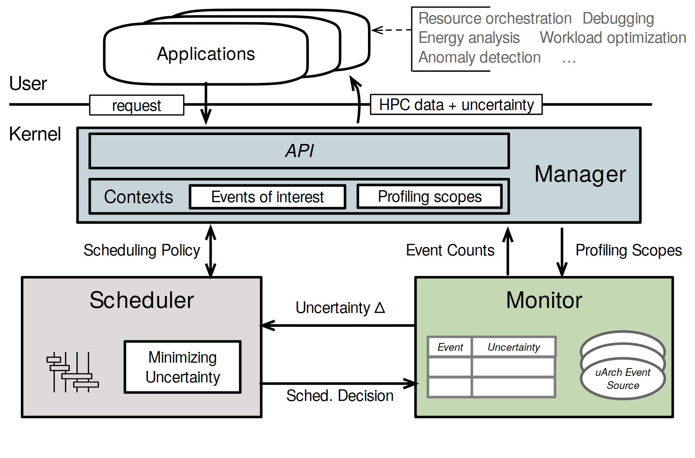

# VA-098 · 统一管理下的调度与监测反馈

上层应用通过管理接口设定观测需求，下层调度器和监测器互相交换决策与不确定性。监测器内部保留事件表和数据源，管理器内保留上下文与观测范围，使反馈有明确对象而非抽象的双向箭头。



## 适用范围

- 观测质量影响调度的闭环系统
- 需要同时表达管理配置与运行反馈的架构

不适合：监测仅记录日志而不影响控制；无法定义不确定性量的装饰性反馈图。

## 阅读顺序

1. 从应用请求进入统一管理接口。
2. 读取上下文、关注事件和观测范围。
3. 下移至调度与监测双核心。
4. 沿两个方向分别读决策和不确定性，再看返回应用的数据。

## 图形表达

**布局**：顶部应用叠层，中间管理横条，下部左右两大核心；两核心之间留空间写反馈标签。

**对象**：管理区用嵌套条目，监测区用表格与圆柱源，调度区用小调节图标。

**连线**：应用请求和结果分开；两核心之间的上下两条水平箭头必须分清方向。

**配色**：蓝灰表示管理、浅灰表示调度、浅绿表示监测，色块绑定角色而非数值。

**文字**：接口名简短，反馈量可用符号但须定义；右上用途列表是应用场景注释。

## 部件与复用

| 部件 | 含义 | 改造方法 |
|---|---|---|
| 应用及用途 (`applications`) | 发出观测请求并消费结果。 | 用途列表应是本场景的真实需求。 |
| 管理接口和上下文 (`manager`) | 保存观测对象、范围与请求配置。 | 明确范围是时间、代码区间还是空间区域。 |
| 调度决策 (`scheduler`) | 利用观测质量选择调度动作。 | 把最小不确定性换成真实优化目标。 |
| 监测与事件源 (`monitor`) | 采集计数并估计观测质量。 | 表中填写实际指标，不把误差等同置信区间。 |
| 双向反馈 (`feedback`) | 向调度器报告质量，向监测器下发决策。 | 分别命名两个载荷，不能只写双向交互。 |

## 改造步骤

1. 定义不确定性的量纲、计算方式和调度使用方式。
2. 若实际目标是成本或覆盖率，应修改目标框和全部反馈标签。
3. 监测表可以扩展指标，但需增加框高并检查下方边界。

## 新情景示例（假设）

假设用于环境传感器自适应采样。

应用请求区域观测，管理器保存站点和时间窗，监测器估计数据缺失与误差，调度器决定采样频率。

将硬件事件源改成传感器流，表格改为站点与误差，返回结果包含观测值及质量标记。

## 编辑入口

**入口**：以 make_figure.py 为入口，先复制 example.json 作为当前情景配置；labels.json 定位标签，asset.json 定位部件。

**配置可改**：labels 可改文字和文字样式，components 可做显隐、平移和局部样式调整；elements 可定位矢量元素。配置只作用于已有几何，不会自动解决布局冲突。

**需改代码**：增加监测对象、反馈回路或管理子模块需重画矢量元素和标签；配置不会自动重新估计表格高度。

**字体**：当前替换字体为 texgyreheros-italic、texgyreheros-regular。改字后检查字宽、基线及 PDF 字体嵌入；原图的逐字定位不保证能容纳更长名称。

准备独立工作副本：

```text
python "<SKILL>/scripts/prepare_architecture.py" --id VA-098 --out figures/architecture
```

在工作副本运行：

```text
python make_figure.py --config example.json --out . --parts
python render_architecture.py fig.svg
```

## 本图检查

- 监测到调度的箭头确实携带质量而非决策。
- 管理器设定的观测范围在监测端有对应。
- 不确定性符号及表格字段采用同一定义。

部件图用于复用局部对象；跨边界的连接和共享容器仍需按新关系处理。示例名称、数值和曲线不是当前研究结果。

来源与许可见 [ATTRIBUTION.md](ATTRIBUTION.md)。
