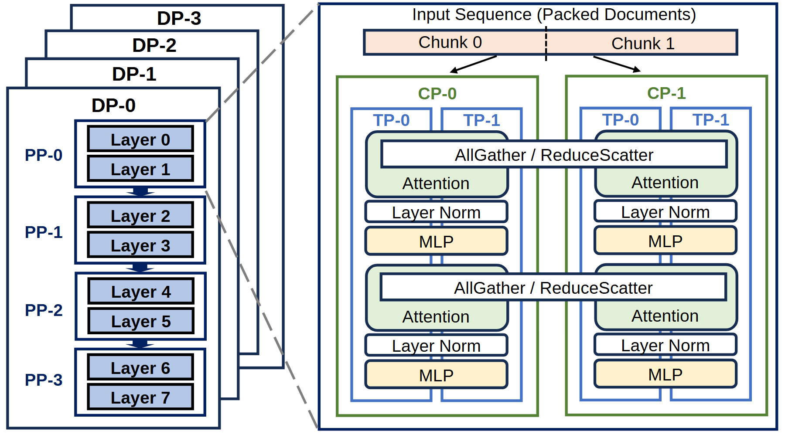

# VA-165 · 多维并行层级与单阶段展开图

左侧以错位叠片表示数据并行副本，前景副本包含四个流水阶段；右侧把一个阶段展开成两个上下文组与张量子组。两条跨组通信横条把左右分组联系起来，适合在一张图中解释分配层级与组内计算。



## 适用范围

- 展示总体分区及其中一个分区的内部协作
- 解释多种并行维度的嵌套关系

不适合：只有单一路径且没有层级展开的流程；需要精确设备网络或时序的部署图。

## 阅读顺序

1. 先读左侧四张 DP 叠片，前景展示 PP-0 至 PP-3。
2. 沿虚线从 PP-0 区域进入右侧展开面板。
3. 从顶部输入切片进入 CP-0、CP-1，再辨认各自 TP 子组。
4. 按两层 Attention、Layer Norm、MLP 阅读，横跨两组的通信条作为共享操作。

## 图形表达

**布局**：左窄右宽，总览叠片与展开面板并排；右侧保留两列两层的重复节奏。

**对象**：直角嵌套框表示分组，圆角块表示注意力与前馈操作，输入是一条分割带。

**连线**：灰色虚线只表示放大关系；顶部黑箭头分配输入，跨列通信条不是普通左右箭头。

**配色**：深蓝框为主轮廓，绿色 CP 边框、蓝色 TP 边框区分层级；注意力浅绿，MLP 浅黄，输入浅橙。

**文字**：组名和层号加粗，操作名常规字重；四重层级会明显压缩小字号。

## 部件与复用

| 部件 | 含义 | 改造方法 |
|---|---|---|
| 副本与流水阶段 (`replica-overview`) | 四个副本叠片及前景四阶段 | 改变副本数时重画偏移轮廓，改变阶段数时重排层号。 |
| 输入切片带 (`input-split`) | 序列一分为二并送往两个上下文组 | 按目标输入分区数重画分隔与分配箭头。 |
| 第一组计算与同步 (`layer-one`) | 两侧注意力、归一化与前馈块及共享同步条 | 整体替换一层算法，并保持两侧计算对称性。 |
| 第二组计算与同步 (`layer-two`) | 重复的第二层计算及同步 | 需要更多层时扩高容器并按相同步距复制。 |

## 改造步骤

1. 先确定哪些维度是副本、阶段和组内切分，避免把物理设备直接当作层号。
2. 保留 CP、TP 共享容器在整图；移动计算部件时同步修改容器高度和虚线落点。
3. 新增通信原语时重画跨组横条，不能只改成新的文字而保留错误范围。
4. 最终按实际论文列宽检查最小操作文字。

## 新情景示例（假设）

假设的分区气象模拟流程

DP 映射为独立情景，PP 映射为时间阶段，CP 映射为空间分区，TP 映射为变量计算组。

若只有一个空间分区，应删除另一列和跨组通信条，改成单列局部计算。

## 编辑入口

**入口**：运行 make_figure.py；example.json 保存本场景配置，labels.json 提供文字定位键，asset.json 保存部件及成员定义。使用 --parts 同时导出部件。

**配置可改**：通过 labels 改文字，通过 components 改配色、显隐与位移；配置不会按文字长度自动重排，需复查本图的间距和连接。

**需改代码**：增删结构、调整连线或重排布局需在 customize(root, context) 中编辑 SVG。新增元素须有 data-asset-key，并加入对应部件的 element_keys；共享线框保留整图时不可随多个部件重复移动。

**字体**：无衬线文字为主，DP/PP/CP/TP 与 Layer 标签加粗。 局部 font_size 使用源坐标尺度，不等于论文纸面 pt。本批构建已确认并嵌入完整字体：Arimo-Bold.ttf, Arimo-Regular.ttf。映射可能改变原字形和字宽，需按实际论文尺寸复核。

准备独立工作副本：

```text
python "<SKILL>/scripts/prepare_architecture.py" --id VA-165 --out figures/architecture
```

在工作副本运行：

```text
python make_figure.py --config example.json --out . --parts
python render_architecture.py fig.svg
```

## 本图检查

- 虚线是否准确指向展开的阶段。
- 跨组同步是否覆盖实际参与组。
- 两层重复结构的标签与数量是否一致。
- 组名、操作名在缩版后是否仍可读。

部件图用于复用局部对象；跨边界的连接和共享容器仍需按新关系处理。示例名称、数值和曲线不是当前研究结果。

来源与许可见 [ATTRIBUTION.md](ATTRIBUTION.md)。
