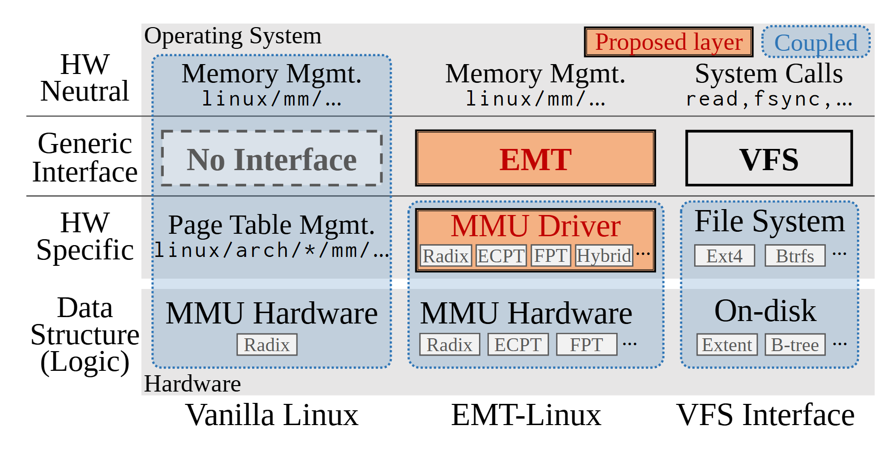

# VA-166 · 共享层级轴的三方案接口对照

三个方案按硬件中立层、通用接口、硬件专属层与数据结构四行对齐。中列用橙色突出新增接口，蓝色虚点框显示耦合范围；左列的虚线空框明确表达没有接口。其价值在于用相同坐标比较架构分层。



## 适用范围

- 对比旧系统、新增抽象层与已有类比方案
- 说明解耦前后接口位于哪一层

不适合：需要箭头表达执行顺序的流程；各方案层级无法一一对应的对比。

## 阅读顺序

1. 先读左侧四个公共行标签。
2. 读左列整体耦合栈及 No Interface。
3. 读中列橙色 EMT 和 MMU Driver，比较蓝色耦合框范围。
4. 读右列 VFS 类比并对照上下行。

## 图形表达

**布局**：左侧窄行标题栏加三列方案，共用水平分隔线，底部给方案名。

**对象**：实体矩形表示接口，虚线灰框表示结构缺位，蓝色圆角虚点框标示耦合范围。

**连线**：没有方向箭头，关系依赖严格的行列对齐与包围范围；不能给分隔线附会数据流。

**配色**：橙色表示新增层，淡蓝色虚点区域表示耦合；灰白底保持比较中立。

**文字**：方案名与接口名突出，路径和硬件实例使用较小文字；源印刷图正文呈衬线，路径呈等宽角色。

## 部件与复用

| 部件 | 含义 | 改造方法 |
|---|---|---|
| 四层公共比较轴 (`row-axis`) | 所有方案共用的层级语义 | 更换行业时先统一每行含义，保持跨列一致。 |
| 紧耦合基线列 (`baseline-stack`) | 从中立代码贯穿到硬件的耦合范围及接口缺位 | 可替换为旧流程，保留缺位框明确缺少的抽象。 |
| 新增接口方案列 (`proposed-stack`) | 新接口与可替换驱动之间的分层 | 新增候选实现时同步扩宽驱动行与下层框。 |
| 已有接口类比列 (`analogy-stack`) | 以成熟接口栈解释新设计 | 替换类比对象时必须与公共行轴逐项对应。 |
| 新增与耦合图例 (`encoding-key`) | 橙色提出层与蓝色耦合两种视觉语义 | 图例与全部区域同时换色，不能混用含义。 |

## 改造步骤

1. 先写四行的统一比较口径，再填三个方案。
2. 只在真正缺少接口的位置使用虚线空框。
3. 耦合范围变化需要重画包围框，不能只移动接口矩形。
4. 公共灰底与分隔线留整图，整列移动须同步调整列宽和底部标题。

## 新情景示例（假设）

假设的多厂商传感平台改造

左列为厂商绑定采集栈，中列为统一适配接口，右列为已有设备驱动框架。

将硬件实例替换为传感器类型，并按实际耦合边界重新绘制蓝框。

## 编辑入口

**入口**：运行 make_figure.py；example.json 保存本场景配置，labels.json 提供文字定位键，asset.json 保存部件及成员定义。使用 --parts 同时导出部件。

**配置可改**：通过 labels 改文字，通过 components 改配色、显隐与位移；配置不会按文字长度自动重排，需复查本图的间距和连接。

**需改代码**：增删结构、调整连线或重排布局需在 customize(root, context) 中编辑 SVG。新增元素须有 data-asset-key，并加入对应部件的 element_keys；共享线框保留整图时不可随多个部件重复移动。

**字体**：原印刷预览为衬线正文和等宽路径，浏览器直接打开源 SVG 会回退；须检查路径字符宽度与字体映射。 局部 font_size 使用源坐标尺度，不等于论文纸面 pt。本批构建已确认并嵌入完整字体：Inconsolata-Regular.ttf, Tinos-Bold.ttf, Tinos-Regular.ttf。映射可能改变原字形和字宽，需按实际论文尺寸复核。

准备独立工作副本：

```text
python "<SKILL>/scripts/prepare_architecture.py" --id VA-166 --out figures/architecture
```

在工作副本运行：

```text
python make_figure.py --config example.json --out . --parts
python render_architecture.py fig.svg
```

## 本图检查

- 三列同一行是否含义相同。
- No Interface 是否确实表达缺位而非未实现。
- 橙色是否只用于本次新增层。
- 路径与小实例标签是否溢出窄格。

部件图用于复用局部对象；跨边界的连接和共享容器仍需按新关系处理。示例名称、数值和曲线不是当前研究结果。

来源与许可见 [ATTRIBUTION.md](ATTRIBUTION.md)。
