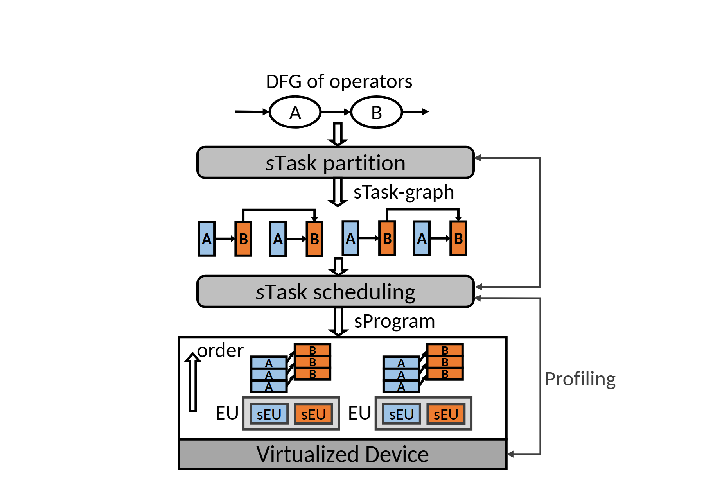

# VA-062 · 任务细分到分层执行的反馈编排

顶部简单依赖图经过任务细分变成多段有色子任务，再由调度模块映射到底部设备层次。右侧性能反馈向上回接，说明切分与调度可以根据执行观测调整。蓝橙身份贯穿子任务和执行单元，使抽象变换与实际映射在一张竖向图中可追踪。



## 适用范围

- 编译调度到异构执行的过程
- 有任务拆分和运行反馈的分层系统

不适合：只比较算法输出指标；没有依赖关系的功能菜单。

## 阅读顺序

1. 阅读顶端任务依赖及两个算子类别
2. 经过分区模块检查子任务图的依赖保持
3. 由排程模块向下读执行单元层次
4. 沿右侧反馈线回到调度或分区入口

## 图形表达

**布局**：主流程居中向下，任务图夹在两条灰色处理条之间；设备放在底部大框，反馈绕右侧边缘。

**对象**：椭圆是粗粒度输入算子，窄色块是拆分子任务，嵌套矩形表示设备、执行组和子单元。

**连线**：向下箭头携带变换产物，右侧折返线携带剖析结果；设备内部向上order箭头只表达示例顺序。

**配色**：蓝色和橙色维持两类任务的身份，灰色用于编排阶段与容器，颜色不意味着优劣。

**文字**：无衬线标签适合短模块名，A/B类别字母应在每个微小任务块中保持可辨，不能漏字。

## 部件与复用

| 部件 | 含义 | 改造方法 |
|---|---|---|
| 输入依赖关系 (`input-dag`) | 待细分的任务类别和先后依赖。 | 用实际任务名和边替换，类别多于两种时扩展颜色图例。 |
| 任务细分器 (`partition`) | 决定粗粒度任务如何拆为可调度单元。 | 写明真实分割依据，不能仅改模块名却保留不适用的拆分。 |
| 细粒度任务图 (`task-chain`) | 保留依赖的子任务序列与交叉连接。 | 重画依赖边；串行示例不可冒充任意并行拓扑。 |
| 排程决策器 (`scheduler`) | 将细任务分派到设备资源。 | 替换策略并明确其输入是依赖图而非原始任务文本。 |
| 分层执行资源 (`device-map`) | 显示设备中的执行组及内部异构单元。 | 按真实硬件或团队层级调整组数及子单元数量。 |
| 运行反馈通道 (`profiling-loop`) | 把执行观测回传给上层编排。 | 只保留确实使用观测的反馈端点，并标明反馈数据类型。 |

## 改造步骤

1. 逐级建立输入任务、子任务、执行单元之间的对应关系
2. 任务数变化须重连子任务边和设备队列，不只复制色块
3. 明确反馈影响切分还是调度，避免画成无条件双反馈
4. 新增图元要分配唯一键并登记部件，保证拆件导出完整

## 新情景示例（假设）

可用于多工位装配任务的自适应排程。

输入为装配工序依赖，细分器生成工作包，执行组为生产单元，内部资源为人工与机械工位。

将性能反馈改为工时和队列观测，按真实前置约束重画子任务图，并删除不能调整的切分反馈。

## 编辑入口

**入口**：make_figure.py 读取 example.json；labels.json 查文字键，asset.json 查部件键；输出 SVG，可用配套渲染脚本导出 PDF。

**配置可改**：labels 修改文字及字体属性；components 可设 visible、dx/dy、attributes；elements 修改单个对象属性。平移使用图的坐标单位，重叠部件不要同时平移。

**需改代码**：改变模块数量、连接关系或分栏布局须编辑 customize()，不会自动布线。新对象需唯一 data-asset-key，并加入对应部件 element_keys，才会随部件导出。

**字体**：本图映射字体：Carlito-Bold.ttf, Carlito-Italic.ttf, Carlito-Regular.ttf。沿用完整字体覆盖新字符；font_size 是元素局部单位，不是纸面 pt。改长标签后检查字宽、裁切及最终 PDF。

准备独立工作副本：

```text
python "<SKILL>/scripts/prepare_architecture.py" --id VA-062 --out figures/architecture
```

在工作副本运行：

```text
python make_figure.py --config example.json --out . --parts
python render_architecture.py fig.svg
```

## 本图检查

- 细分后有没有遗漏原任务依赖
- 颜色类别是否对应实际可执行资源
- 反馈箭头终点是否与策略使用的数据一致

部件图用于复用局部对象；跨边界的连接和共享容器仍需按新关系处理。示例名称、数值和曲线不是当前研究结果。

来源与许可见 [ATTRIBUTION.md](ATTRIBUTION.md)。
