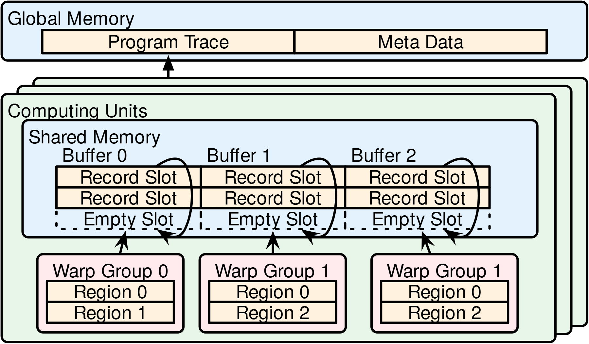

# VA-167 · 多工作组私有记录缓冲与统一汇出

计算单元以叠片重复表示，前景单元中三个工作组分别写入自己的记录槽列，随后整体送往全局记录与元数据区。缓冲占用、空位和写入关系都可见，适合解释局部采集后统一归档的结构。



## 适用范围

- 并行工作组各自记录事件后集中汇总
- 按生产者分配互不重叠的日志缓冲

不适合：需要全局共享队列争用关系的设计；必须呈现严格时间轴的跟踪结果。

## 阅读顺序

1. 从底部三个工作组及 Region 子块开始。
2. 沿各自箭头看上方对应 Buffer 列。
3. 辨别实线记录槽与虚线 Empty Slot。
4. 从前景计算单元沿向上箭头读全局 Program Trace 和 Meta Data。

## 图形表达

**布局**：上方单一全局区，下方计算单元叠片；前景内部缓冲在上、三个工作组在下。

**对象**：圆角大框区分存储域，规则小格表示记录槽，空槽下缘使用虚线。

**连线**：每个工作组的写入箭头与弧线对应一列缓冲；跨层向上箭头表示汇出，不能理解为逐条实时复制。

**配色**：全局和共享存储浅蓝，计算单元浅绿，工作组浅粉，记录格浅黄。

**文字**：域名较大，Buffer 与 Warp Group 次级，Region 与槽标签较小。

## 部件与复用

| 部件 | 含义 | 改造方法 |
|---|---|---|
| 全局记录与元数据区 (`global-output`) | 最终记录载荷和重建辅助信息的双格容器 | 可改为数据与索引，但需说明元数据的实际用途。 |
| 三列共享内存缓冲 (`shared-buffers`) | 三个互不重叠的槽列与空位 | 改变列数时同步增加对应工作组和写入线。 |
| 第一工作组 (`worker-zero`) | Region 0 与 Region 1 构成第一个记录生产者 | 替换为独立任务组及其局部阶段。 |
| 第二工作组 (`worker-one`) | 第二个记录生产者与两个区域 | 保持其缓冲列独占，避免与相邻列合并。 |
| 第三工作组 (`worker-last`) | 右侧第三个工作组示例 | 原文字重复为 Warp Group 1，迁移时按新语义校正名称。 |

## 改造步骤

1. 先确定生产者数量与每组缓冲容量，再调整列数。
2. 原图第二、第三组均写 Warp Group 1；不能据此推断为同一实体，新场景须明确是否重命名。
3. 共用计算单元框与全局汇出线保持整图；改变工作组位置时重连弧线与写入箭头。
4. 空槽必须与真实记录槽使用不同线型。

## 新情景示例（假设）

假设的并行仿真事件记录器

工作组映射为仿真分区，Region 映射为步骤，Global Memory 映射为统一事件档案。

若加入第四分区，需新增第四缓冲列并扩大共享内存框，不能复用现有写入线。

## 编辑入口

**入口**：运行 make_figure.py；example.json 保存本场景配置，labels.json 提供文字定位键，asset.json 保存部件及成员定义。使用 --parts 同时导出部件。

**配置可改**：通过 labels 改文字，通过 components 改配色、显隐与位移；配置不会按文字长度自动重排，需复查本图的间距和连接。

**需改代码**：增删结构、调整连线或重排布局需在 customize(root, context) 中编辑 SVG。新增元素须有 data-asset-key，并加入对应部件的 element_keys；共享线框保留整图时不可随多个部件重复移动。

**字体**：全部为无衬线；存储域标题较大且靠左，工作组标题居中。 局部 font_size 使用源坐标尺度，不等于论文纸面 pt。本批构建已确认并嵌入完整字体：texgyreheros-regular.otf。映射可能改变原字形和字宽，需按实际论文尺寸复核。

准备独立工作副本：

```text
python "<SKILL>/scripts/prepare_architecture.py" --id VA-167 --out figures/architecture
```

在工作副本运行：

```text
python make_figure.py --config example.json --out . --parts
python render_architecture.py fig.svg
```

## 本图检查

- 工作组与缓冲列是否一一对应。
- 重复组名是否已按场景处理。
- 弧线是否穿过相邻列或文字。
- 全局区两格是否仍分别表示记录与辅助信息。

部件图用于复用局部对象；跨边界的连接和共享容器仍需按新关系处理。示例名称、数值和曲线不是当前研究结果。

来源与许可见 [ATTRIBUTION.md](ATTRIBUTION.md)。
