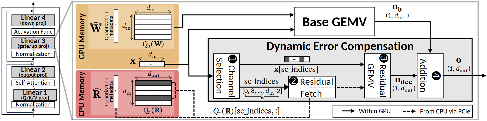

# VA-168 · 基线路径与动态补偿支路汇合

左侧网络层堆栈标明被展开的线性层；右侧将 GPU 基础权重计算与 CPU 残差读取分开，并经四步补偿支路在加法处汇合。黑实线与黑虚线区分设备内路径与跨 PCIe 读取，可复用其主路加修正量的组合方式。



## 适用范围

- 基础模型输出与稀疏修正项相加
- 说明快速主路和低频远端数据支路

不适合：两个模型输出仅并排比较而不融合；全部计算都在同一位置且没有存储边界的简单流程。

## 阅读顺序

1. 先看左侧线性层位置及放大连线。
2. 读 GPU Memory 的基础权重和输入进入 Base GEMV。
3. 从步骤 1 通道筛选到步骤 2 残差获取，再到步骤 3 残差计算。
4. 步骤 4 将修正输出与基础输出相加，最后读右下线型图例。

## 图形表达

**布局**：极宽横图，左侧窄网络栈，左中上下两种存储，右侧基础计算在上、补偿流水在下。

**对象**：权重与残差用带行格的矩阵图标，四步补偿用窄矩形算子，灰色大框聚合支路。

**连线**：实线表示 GPU 内流转，虚线表示 CPU 经 PCIe 的残差读取；基础输出绕过补偿步骤在右端相加。

**配色**：GPU 存储橙黄、CPU 存储粉红、补偿区浅灰，主要计算框白色。

**文字**：主算子名称加粗，矩阵变量为数学字形，步骤号为黑圆白字；横向宽度限制小下标。

## 部件与复用

| 部件 | 含义 | 改造方法 |
|---|---|---|
| 网络层定位栈 (`model-stack`) | 展示展开算子在模型中的位置 | 可替换为被解释的子过程列表，放大线需另行重连。 |
| 快速存储与基础权重 (`fast-memory`) | 基础权重矩阵、量化元数据和输入向量 | 改变矩阵尺寸时同步更新维度箭头与符号。 |
| 远端残差存储 (`residual-memory`) | 按选中行读取的残差矩阵 | 保留被选行高亮，并重画虚线路径的端点。 |
| 基础矩阵向量计算 (`base-operator`) | 主路低成本计算算子 | 替换为基线预测器时调整输入输出变量。 |
| 四步动态补偿链 (`correction-chain`) | 筛选、取残差、计算和相加的支路 | 删除某步需重编号并连通主路输出，不可仅隐藏框。 |
| 设备内与跨设备线型图例 (`line-key`) | 实线与虚线的传输含义 | 换硬件时同步修改图例和全部读取线。 |

## 改造步骤

1. 先明确基础输出与修正输出是否具有可相加的同维度。
2. 把筛选规则、残差存储位置和数据读取粒度改成实际设计。
3. 主路输出和补偿输出应共同进入加法，而非串联两次计算。
4. 已有数学子集编码据原预览校正；迁移时仍需逐个核对 d_in、d_out、Q_b、Q_r 与输出下标的含义和间距。

## 新情景示例（假设）

假设的低成本需求预测加异常修正模型

Base GEMV 映射为基础预测，残差存储映射为异常案例库，筛选映射为相关因素筛选。

若修正采用加权融合，需把 Addition 改画为带权融合并加入权重输入，重新标注输出单位。

## 编辑入口

**入口**：运行 make_figure.py；example.json 保存本场景配置，labels.json 提供文字定位键，asset.json 保存部件及成员定义。使用 --parts 同时导出部件。

**配置可改**：通过 labels 改文字，通过 components 改配色、显隐与位移；配置不会按文字长度自动重排，需复查本图的间距和连接。

**需改代码**：增删结构、调整连线或重排布局需在 customize(root, context) 中编辑 SVG。新增元素须有 data-asset-key，并加入对应部件的 element_keys；共享线框保留整图时不可随多个部件重复移动。

**字体**：正文无衬线，数学变量使用 STIX Two Math，圈号使用 DejaVu Sans；W/R 帽据预览重绘为矢量装饰，变量正文保持可编辑文字。局部 font_size 使用源坐标尺度，不等于论文纸面 pt。本批构建已确认并嵌入完整字体：Carlito-Bold.ttf, Carlito-Regular.ttf, DejaVuSans.ttf, STIXTwoMath-Regular.ttf。映射可能改变原字形和字宽，需按实际论文尺寸复核。

准备独立工作副本：

```text
python "<SKILL>/scripts/prepare_architecture.py" --id VA-168 --out figures/architecture
```

在工作副本运行：

```text
python make_figure.py --config example.json --out . --parts
python render_architecture.py fig.svg
```

## 本图检查

- 基础输出与修正输出是否同维同单位。
- 虚线路径是否仅用于跨设备数据。
- 四个步骤号是否连续且与箭头一致。
- d_in、d_out 和量化符号是否仍存在乱码或错位。

部件图用于复用局部对象；跨边界的连接和共享容器仍需按新关系处理。示例名称、数值和曲线不是当前研究结果。

来源与许可见 [ATTRIBUTION.md](ATTRIBUTION.md)。
