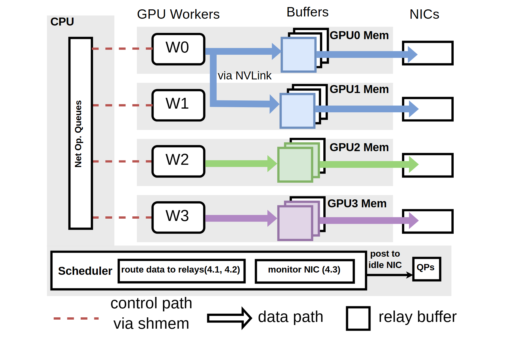

# VA-025 · 跨行借用资源的控制与传输架构

用四条水平资源行展示执行者、缓冲区和出口。最上方蓝色流跨入第二行，表现一个繁忙执行者借用另一行资源；下方两条流独立通过各自出口，形成直观对照。左侧控制队列与底部调度栏解释资源选择，虚实和粗细分开控制信号与实际传输。可迁移价值是“业务身份不等于所在资源行”，而非固定四个执行者。



## 适用范围

- 负载分流、备用出口借用或跨资源中继
- 需要并置控制通道与实际传输路径的调度机制

不适合：所有任务严格绑定单一固定资源的体系；没有缓冲或中继语义的纯组织层级图。

## 阅读顺序

1. 按列识别控制端、工作者、中继缓冲和输出端。
2. 先跟踪第一行蓝色路径，看它如何同时使用第一、第二行资源。
3. 再跟踪下方独立路径作为对比，最后读调度栏及图例。

## 图形表达

**布局**：主体采用四条浅灰行带和三列对象；左侧竖条覆盖多行，底部调度条与主体同宽。

**对象**：缓冲区用层叠小方片表示多实例；出口用简洁空框，避免与缓冲图标混淆。

**连线**：细红虚线为控制；粗彩箭头为传输。蓝色分叉线跨行时保持直角，接入缓冲而不是第二行工作者。

**配色**：蓝色表示同一条业务流，即使它跨越两行；绿紫表示其他独立流，不能按资源行随意换色。

**文字**：列名在上方，短节点编号置于框内；底栏较密，长调度逻辑应压成两个短功能块。

## 部件与复用

| 部件 | 含义 | 改造方法 |
|---|---|---|
| 控制操作队列 (`control-queue`) | 统一控制端向工作者发出操作通知 | 改写通知类型；仅保留有实际控制关系的虚线。 |
| 共享传输双行 (`shared-relay-rows`) | 一条流同时走本行和借用行的出口 | 标记哪行主动发送、哪行提供空闲资源，避免误画第二个数据源。 |
| 独立传输行 (`independent-relays`) | 无跨行借用的两个对照通道 | 可删减重复行，但维持对象列对齐和路径身份。 |
| 调度决策栏 (`scheduler-bar`) | 选择中继并监测出口可用性 | 改变选择依据时更新子框；不能用监测箭头代替实际发送。 |
| 路径与缓冲图例 (`path-legend`) | 解释控制线、传输箭头和层叠方片 | 补充颜色含义，使读者知道蓝色跨行仍是同一条流。 |

## 改造步骤

1. 列出执行者与可借用资源的映射，选择一例跨行及一例独立通道。
2. 逐条替换控制虚线和传输实线，尤其检查分叉是否指向中继。
3. 把调度条件缩成两个短块，额外策略细节放正文。
4. 同步重写图例并检查粗箭头没有遮住缓冲边缘或出口标签。

## 新情景示例（假设）

假设绘制多产线共享包装出口的调度系统。

工作者对应产线，缓冲区对应待包装区，出口对应包装机；蓝色表示同一产线的订单被分到两台机器。

删除硬件互联名称，改为允许的转运通道；若物料不能跨行移动则不能保留蓝色分叉。

## 编辑入口

**入口**：在工作副本修改 example.json，运行 python make_figure.py --config example.json --out output --parts；再通过 Vivid 的矢量渲染入口检查 SVG 与 PDF。

**配置可改**：labels 按 labels.json 的元素键改字；components 按本页部件 id 设置 visible、dx、dy 或 attributes；elements 修改指定矢量元素属性。重叠部件可能共享元素，避免对父区域和内部区域重复位移。

**需改代码**：行数、借用目标或缓冲层数变化需要代码调整；跨行路径不能仅随一个部件平移。这些接口不会自动重排，也不会随部件移动自动修复跨部件连线。

**字体**：本资产已记录的完整字形资源：Arimo-Bold.ttf, Arimo-Regular.ttf。修改英文标签优先沿用对应字体族与字重；文字变长时调整框宽和换行，不靠整体缩小压入。其他语言须另选覆盖所需字符的字体并实查导出。

准备独立工作副本：

```text
python "<SKILL>/scripts/prepare_architecture.py" --id VA-025 --out figures/architecture
```

在工作副本运行：

```text
python make_figure.py --config example.json --out . --parts
python render_architecture.py fig.svg
```

## 本图检查

- 借用行是否没有额外生成同色业务，来源保持唯一？
- 红虚线是否始终表示指令而非真实运输？
- 图例中的层叠方片与主体缓冲是否一致，且出口未误用为存储？

部件图用于复用局部对象；跨边界的连接和共享容器仍需按新关系处理。示例名称、数值和曲线不是当前研究结果。

来源与许可见 [ATTRIBUTION.md](ATTRIBUTION.md)。
