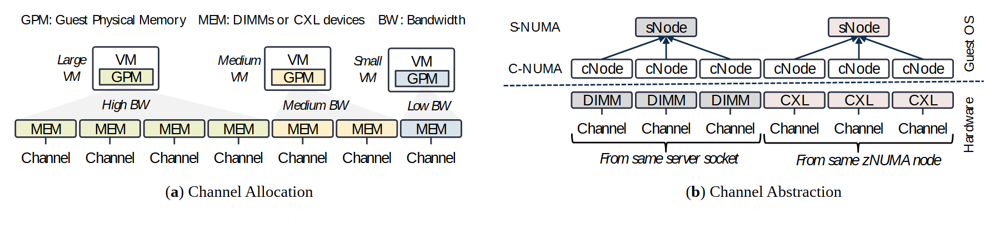

# VA-169 · 按带宽分配通道与两级节点抽象

左面板用三个虚拟机的分配扇区解释不同带宽需求对应不同数量的内存通道；右面板把硬件通道映射为细粒度 cNode，再归入粗粒度 sNode。两面板分别解释资源如何分配与如何呈现给上层。



## 适用范围

- 展示资源分配策略及上层抽象视图
- 解释物理单元到两级逻辑节点的映射

不适合：按时间调度资源的甘特图；无法形成清晰分组的任意网络拓扑。

## 阅读顺序

1. 先读顶部 GPM、MEM、BW 缩写。
2. 读左侧 Large、Medium、Small VM 与高、中、低带宽通道分配。
3. 转到右侧从 DIMM/CXL 硬件向上读 cNode。
4. 再看 cNode 如何分属两个 sNode，并读底部分组括号。

## 图形表达

**布局**：横向双面板，左边以三组分配扇区并列，右边以硬件行、细节点行、粗节点行构成树。

**对象**：虚拟机和内存均为小矩形，浅色扇形区域表示分配，括号说明硬件来源分组。

**连线**：右侧细节点向粗节点连线，硬件与通道一一垂直对应；横向虚线区分 Guest OS 与 Hardware。

**配色**：左侧淡黄、浅粉、浅蓝区分不同分配组；右侧 DIMM 和 CXL 以淡色区分，不表示性能大小。

**文字**：缩写和通道标签密集，面板题注在底部；斜体文字说明 VM 大小、带宽及硬件来源。

## 部件与复用

| 部件 | 含义 | 改造方法 |
|---|---|---|
| 资源缩写图例 (`abbreviation-key`) | 解释 GPM、MEM、BW | 更换行业时去掉无用缩写并保留必要定义。 |
| 三种带宽通道分配 (`allocation-view`) | 不同虚拟机需求对应的通道集合 | 改变分配数量需重画内存格、通道标签和扇区边界。 |
| 两级逻辑节点树 (`logical-nodes`) | 细 cNode 归属粗 sNode 的映射 | 合并或拆分粗节点时重连全部归属边。 |
| 物理通道与来源括号 (`physical-channels`) | DIMM/CXL 各通道及同源分组 | 增加硬件类型须更新括号说明并保持与 cNode 对齐。 |

## 改造步骤

1. 同时定义资源容量和带宽需求，不从 VM 图标大小推断数值。
2. 每个硬件通道对应一个细节点，上层归组依实际硬件来源决定。
3. 两面板的分配示意与抽象树不应被误认为逐列相同对象。
4. 增减通道时需要代码重排矩形、垂线和括号，配置不会自动树布局。

## 新情景示例（假设）

假设的仓储机器人通信资源分配

VM 映射为任务组，通道映射为通信链路，cNode 映射为链路端点，sNode 映射为控制域。

控制域不按硬件插槽分组时，应改写底部归组括号并重连上层节点。

## 编辑入口

**入口**：运行 make_figure.py；example.json 保存本场景配置，labels.json 提供文字定位键，asset.json 保存部件及成员定义。使用 --parts 同时导出部件。

**配置可改**：通过 labels 改文字，通过 components 改配色、显隐与位移；配置不会按文字长度自动重排，需复查本图的间距和连接。

**需改代码**：增删结构、调整连线或重排布局需在 customize(root, context) 中编辑 SVG。新增元素须有 data-asset-key，并加入对应部件的 element_keys；共享线框保留整图时不可随多个部件重复移动。

**字体**：无衬线小字号为主，局部说明使用斜体；右侧纵向层级标签旋转显示。 局部 font_size 使用源坐标尺度，不等于论文纸面 pt。本批构建已确认并嵌入完整字体：Arimo-Italic.ttf, Arimo-Regular.ttf, Tinos-Bold.ttf, Tinos-Regular.ttf。映射可能改变原字形和字宽，需按实际论文尺寸复核。

准备独立工作副本：

```text
python "<SKILL>/scripts/prepare_architecture.py" --id VA-169 --out figures/architecture
```

在工作副本运行：

```text
python make_figure.py --config example.json --out . --parts
python render_architecture.py fig.svg
```

## 本图检查

- 每个硬件通道是否只有一个对应细节点。
- 带宽标签是否与通道数量的叙述一致且没有冒充量化结果。
- Guest OS/Hardware 边界是否正确。
- 面板标题、底部括号和小字是否相互遮挡。

部件图用于复用局部对象；跨边界的连接和共享容器仍需按新关系处理。示例名称、数值和曲线不是当前研究结果。

来源与许可见 [ATTRIBUTION.md](ATTRIBUTION.md)。
