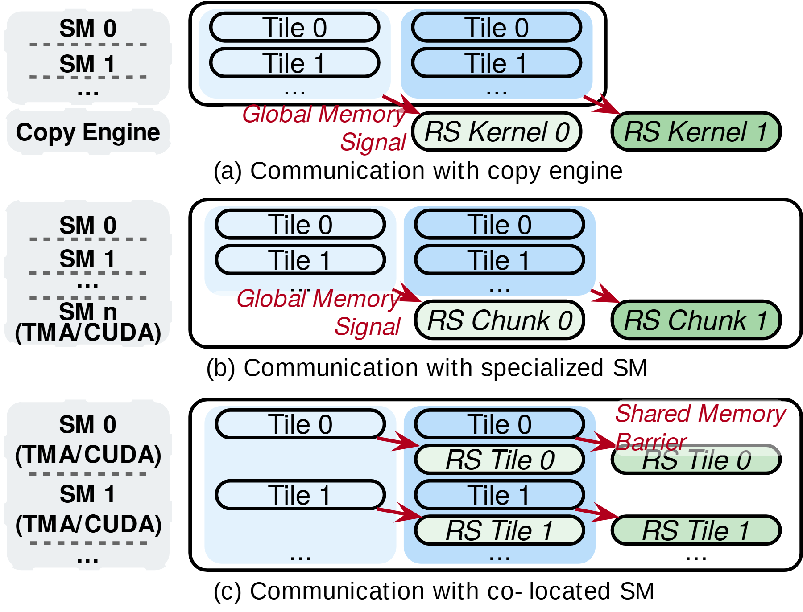

# VA-170 · 三种计算通信协作粒度对照

三行使用相同计算 Tile 作为参照，依次比较拷贝引擎、专用 SM 与共置 SM 的通信方式。左侧资源分配侧栏与右侧执行粒度配对，红色信号箭头和绿色通信任务突出方案差异。



## 适用范围

- 对照相同逻辑任务的多种执行后端
- 比较集中通信和细粒度计算通信交错

不适合：需要定量证明重叠收益的性能图；只有单个后端的完整系统架构。

## 阅读顺序

1. 按三行依次读左侧 SM 与通信资源配置。
2. 第一行读独立 Copy Engine 下的 RS Kernel。
3. 第二行读专用 SM 执行的 RS Chunk。
4. 第三行按 Tile 行读同址 RS Tile，并区分共享内存屏障与全局信号。

## 图形表达

**布局**：三行比较，每行左侧灰色资源侧栏，右侧圆角执行框；第三行进一步拆为两条 Tile 行。

**对象**：蓝色圆角条表示计算 Tile，绿色圆角条表示通信任务，浅蓝背景将重复批次分组。

**连线**：红箭头连接计算结束与后续通信；前两行文字说明 Global Memory Signal，第三行说明 Shared Memory Barrier。

**配色**：蓝色计算、绿色通信、红色同步、灰色资源侧栏四类作用固定。

**文字**：左侧资源名加粗，通信任务与信号文字偏斜体；每行底部有方案题注。

## 部件与复用

| 部件 | 含义 | 改造方法 |
|---|---|---|
| 拷贝引擎方案 (`copy-engine-row`) | 资源独立的整核通信路径 | 更换独立通信设备时更新侧栏与同步方式。 |
| 专用计算单元方案 (`dedicated-sm-row`) | 保留专用 SM 做分块通信 | 按实际专用资源数调整左侧列表及绿色任务粒度。 |
| 共置计算单元方案 (`colocated-sm-row`) | 计算与通信在每个 Tile 粒度交错 | 增减 Tile 行时同步复制对应计算条、通信条和红箭头。 |

## 改造步骤

1. 先保持三种方案处理相同逻辑工作量，再改变资源分工。
2. 绿色条的 Kernel、Chunk、Tile 是粒度差异，不是可以随意替换的同义词。
3. 若新增耗时轴需重新设计，本图横向长度不是测得时间。
4. 第三行红字屏障说明已靠近绿色条，改字后优先修正该重叠区域。

## 新情景示例（假设）

假设的图像批处理执行后端比较

蓝色 Tile 映射为图像块处理，绿色任务映射为结果收集；三行分别是专用传输引擎、专用线程和处理线程内联。

若内联方案每两块才同步，需改第三行红箭头和通信条数量，不能仍逐块标示。

## 编辑入口

**入口**：运行 make_figure.py；example.json 保存本场景配置，labels.json 提供文字定位键，asset.json 保存部件及成员定义。使用 --parts 同时导出部件。

**配置可改**：通过 labels 改文字，通过 components 改配色、显隐与位移；配置不会按文字长度自动重排，需复查本图的间距和连接。

**需改代码**：增删结构、调整连线或重排布局需在 customize(root, context) 中编辑 SVG。新增元素须有 data-asset-key，并加入对应部件的 element_keys；共享线框保留整图时不可随多个部件重复移动。

**字体**：无衬线文本，黑粗侧栏、斜体绿色任务和红斜体同步说明形成层次。 局部 font_size 使用源坐标尺度，不等于论文纸面 pt。本批构建已确认并嵌入完整字体：Arimo-Regular.ttf, texgyreheros-bold.otf, texgyreheros-italic.otf, texgyreheros-regular.otf。映射可能改变原字形和字宽，需按实际论文尺寸复核。

准备独立工作副本：

```text
python "<SKILL>/scripts/prepare_architecture.py" --id VA-170 --out figures/architecture
```

在工作副本运行：

```text
python make_figure.py --config example.json --out . --parts
python render_architecture.py fig.svg
```

## 本图检查

- 三行是否仍使用一致的输入与计算任务。
- 同步机制是否准确而非只换方案名。
- 第三行 Shared Memory Barrier 是否遮挡 RS Tile。
- 图注是否避免把示意长度解释为速度。

部件图用于复用局部对象；跨边界的连接和共享容器仍需按新关系处理。示例名称、数值和曲线不是当前研究结果。

来源与许可见 [ATTRIBUTION.md](ATTRIBUTION.md)。
