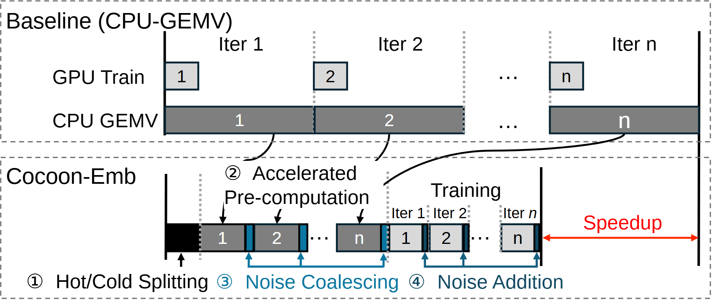

# VA-063 · 预计算前移与迭代耗时对照

上下两条时间组织展示一种优化思路：基准在每轮重复昂贵准备，改进方案把可提前计算的工作移到正式迭代前，再以较短操作补入各轮。右侧红色区间标识完成时间差，必须区分机制示意与测量时长。



## 适用范围

- 重复任务可拆成预处理和在线增量部分
- 需要解释优化如何改变执行顺序及完成时刻

不适合：没有可前移步骤，只比较平均吞吐量；任务之间无法使用同一时间基准的对比。

## 阅读顺序

1. 先读上方基准的两条资源行，查看每轮等待关系。
2. 读下方最左的分离步骤和预计算段。
3. 沿下方各迭代观察短蓝块何时并入主执行。
4. 最后核对两条完成竖线之间的红色区间。

## 图形表达

**布局**：上下两框共用横向时间方向；上方分资源行，下方串接预处理与迭代。

**对象**：矩形时段表示工作，窄蓝块标注附加操作；省略号压缩中间多轮，不表示空闲。

**连线**：竖虚线标轮界，弯曲指引把基准工作联系到前移步骤；红色双箭头量出两次完成的水平差。

**配色**：灰块表示主执行，浅灰短块表示另一资源上的训练，黑块表示初始拆分，蓝色强调优化新增的预处理或补入动作。

**文字**：无衬线短标签配圈号步骤，蓝色注释与箭头同色；长步骤名置于时间轴下方。

## 部件与复用

| 部件 | 含义 | 改造方法 |
|---|---|---|
| 基准时间组织 (`baseline-timeline`) | 准备阶段反复占据每轮执行前的时间。 | 将时段及依赖改为本任务基准，示意图需明示非按比例。 |
| 前置准备 (`precomputation`) | 把可预先完成的工作集中到正式迭代前。 | 列出成立条件，不能前移依赖当前轮输出的计算。 |
| 改进迭代序列 (`overlapped-training`) | 每轮使用预先准备结果并执行短增量操作。 | 重新画增量与主操作先后关系，避免暗示未经实现的重叠。 |
| 完成时间差 (`time-saved`) | 红色区间对比两种执行组织的结束点。 | 没有实测时改为机制示意，不能标未经验证的加速倍数。 |

## 改造步骤

1. 统一两条轴的起点、单位和工作量，包含预处理成本。
2. 先确认可以跨轮复用的信息，再决定前置块的范围。
3. 省略中间轮次时上下使用相同规则，避免视觉夸大时间差。
4. 若优化只转移了成本而非减少总时间，应重画红色比较区间。

## 新情景示例（假设）

可用于滚动配送中预计算静态路段代价、在线更新拥堵的执行说明。

基准每轮重算全部路段；下方先准备静态部分，再逐轮补入拥堵修正并求解。

为预计算添加数据有效期，在动态更新超出范围时画重算分支，红色区间在取得计时结果后再定尺寸。仅为潜在用途。

## 编辑入口

**入口**：以 make_figure.py 为入口，example.json 存修改参数；labels.json 定位文字键，asset.json 定位部件。运行后查看整图和独立部件。

**配置可改**：labels 改文字及字体；components 改显示、dx/dy 和属性；elements 改对象属性。位移采用整图 viewBox 单位，父子部件重叠时只选一个层级移动。

**需改代码**：改变时段长度、轮次或新增重算分支需改 customize() 中矩形与边界线，代码不根据计时数据自动排时间轴。

**字体**：采用 Arimo Regular/Italic 与 DejaVu Sans 符号；圈号若更换字体需核对字形和基线。 font_size 是元素局部单位，受变换影响，不等于纸面字号。

准备独立工作副本：

```text
python "<SKILL>/scripts/prepare_architecture.py" --id VA-063 --out figures/architecture
```

在工作副本运行：

```text
python make_figure.py --config example.json --out . --parts
python render_architecture.py fig.svg
```

## 本图检查

- 时间差是否包含首次准备和全部迭代成本。
- 下方前置操作是否依赖尚未产生的在线信息。
- 所有灰块、蓝块及圈号是否在说明中一一对应。

部件图用于复用局部对象；跨边界的连接和共享容器仍需按新关系处理。示例名称、数值和曲线不是当前研究结果。

来源与许可见 [ATTRIBUTION.md](ATTRIBUTION.md)。
