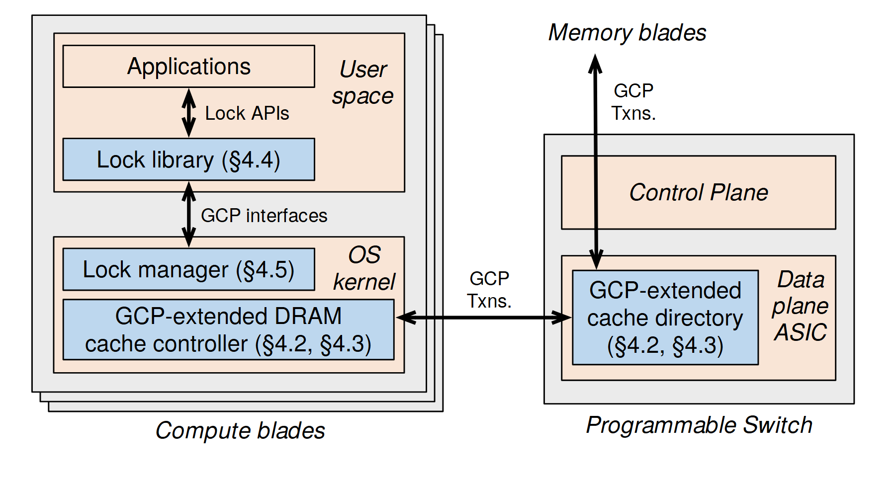

# VA-172 · 计算节点与可编程交换机协同控制

左侧计算节点分为用户空间和内核，右侧交换机分为控制平面与数据平面；蓝色功能模块沿 API、接口与事务联系起来，远端存储只以顶部外部端点出现。适合说明软件模块跨部署边界的协同。



## 适用范围

- 端侧软件与网络设备数据平面共同实现控制
- 需要同时解释执行位置与接口边界

不适合：要求展开全部远端存储内部结构；纯业务流程且不关心用户态、内核态或设备层级。

## 阅读顺序

1. 先读左侧计算节点叠片代表多个节点。
2. 从应用经 Lock APIs 到库，再经 GCP interfaces 到内核。
3. 沿双向 GCP Txns. 看缓存控制器与交换机目录交互。
4. 读右侧控制/数据平面分层和向上连接的 Memory blades。

## 图形表达

**布局**：左右两种部署域，左侧叠片包含上下软件层，右侧单机包含上下平面；远端存储是框外端点。

**对象**：灰色设备外框、浅橙层级区、蓝色功能矩形；叠片表示重复节点而非时间。

**连线**：API、接口和缓存事务均用双向箭头；右侧纵向事务线连接目录与外部存储，穿越控制平面区域不等于由控制平面转发。

**配色**：灰色部署容器、浅橙执行层、蓝色本图功能块，颜色不表示测量值。

**文字**：层级标签采用斜体，模块名常规无衬线，较长缓存控制器名字分两行。

## 部件与复用

| 部件 | 含义 | 改造方法 |
|---|---|---|
| 用户空间应用与库 (`user-space`) | 应用、锁 API 与库的调用层 | 更换 API 时同步改双向箭头说明。 |
| 内核控制功能 (`kernel-space`) | 锁管理器和扩展缓存控制器 | 可替换端侧驱动和协议模块，但保留执行边界。 |
| 交换机控制与数据平面 (`switch-planes`) | 上控制平面与下蓝色目录块的设备分层 | 若控制平面参与协议需显式新增边，不能凭位置推断。 |
| 远端存储与事务端点 (`remote-endpoint`) | 只展示远端存储名字和纵向事务连接 | 需要细化远端结构时应新建容器并重排右侧空间。 |

## 改造步骤

1. 先按真实部署把模块放入用户态、内核态和交换机平面。
2. 保留跨设备协议名，但把原节号更新为新论文引用。
3. 外部 Memory blades 未展开，不能据图宣称其内部设计。
4. 右侧纵向线和目录块有交叠范围，独立移动部件后必须复核连线，不把共享线重复平移。

## 新情景示例（假设）

假设的分布式任务锁服务

库映射为任务锁客户端，内核控制器映射为本地状态代理，交换机目录映射为共享状态表。

若共享状态位于服务器而非交换机，必须改设备容器和上下平面结构，不能只换标题。

## 编辑入口

**入口**：运行 make_figure.py；example.json 保存本场景配置，labels.json 提供文字定位键，asset.json 保存部件及成员定义。使用 --parts 同时导出部件。

**配置可改**：通过 labels 改文字，通过 components 改配色、显隐与位移；配置不会按文字长度自动重排，需复查本图的间距和连接。

**需改代码**：增删结构、调整连线或重排布局需在 customize(root, context) 中编辑 SVG。新增元素须有 data-asset-key，并加入对应部件的 element_keys；共享线框保留整图时不可随多个部件重复移动。

**字体**：无衬线正文加斜体层级标签；长模块名与节号占据两行，缩版后需检查。 局部 font_size 使用源坐标尺度，不等于论文纸面 pt。本批构建已确认并嵌入完整字体：texgyreheros-italic.otf, texgyreheros-regular.otf。映射可能改变原字形和字宽，需按实际论文尺寸复核。

准备独立工作副本：

```text
python "<SKILL>/scripts/prepare_architecture.py" --id VA-172 --out figures/architecture
```

在工作副本运行：

```text
python make_figure.py --config example.json --out . --parts
python render_architecture.py fig.svg
```

## 本图检查

- 所有模块是否处于实际执行域。
- 双向箭头是否与真实协议方向一致。
- 穿过控制平面的线是否被错误解释为连接该平面。
- 远端存储端点和节号是否有足够说明。

部件图用于复用局部对象；跨边界的连接和共享容器仍需按新关系处理。示例名称、数值和曲线不是当前研究结果。

来源与许可见 [ATTRIBUTION.md](ATTRIBUTION.md)。
