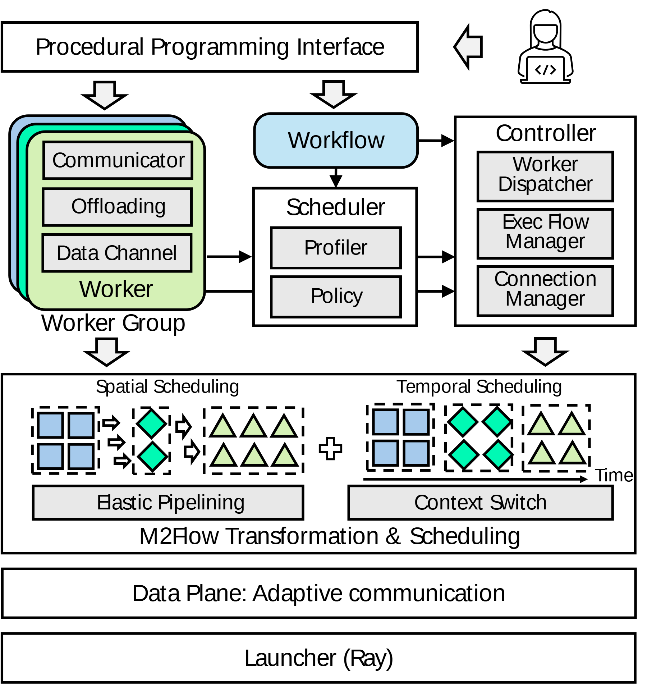

# VA-099 · 工作者封装与时空调度展开

顶部程序入口产生工作者集合与工作流，中部分析策略和控制器协作，下部用两种小图把抽象调度展开为资源分配与时间安排，最底通信和启动层提供运行基础。叠片表示多个同型工作者，小图中不同形状表示工作者类别，两者共同避免把系统只画成大方框。



## 适用范围

- 具有多个工作者类型和统一执行编排的平台
- 需要同时说明空间资源分配与时间复用的调度

不适合：没有可重复任务对象的串行算法；只有时间甘特图、没有系统控制层的结果展示。

## 阅读顺序

1. 顶部读用户程序入口，区分工作者定义与工作流。
2. 中部从工作者观测进入策略，再到执行控制器。
3. 下部并列看空间编排和时间切换，两者联合形成执行计划。
4. 最底核对通信服务与启动服务支撑什么。

## 图形表达

**布局**：顶部单条入口，中部三列决策结构，下部宽面板展开调度，再用两条底座收束。

**对象**：错位圆角叠卡表示多个工作者；方形、菱形、三角形表示任务类别；虚线框按同类或资源分组。

**连线**：空心大箭头跨层传递抽象流程，细箭头交代策略和控制依赖；时间轴只属于右侧小图。

**配色**：浅绿工作者、浅蓝工作流、浅灰内部管理块；小形状颜色跨空间图和时间图保持类别一致。

**文字**：内部管理项使用短行；最小符号旁保留类别图例，时间轴标签不能和宽面板标题挤在一起。

## 部件与复用

| 部件 | 含义 | 改造方法 |
|---|---|---|
| 程序入口 (`program-interface`) | 用户表达任务与执行工作流。 | 换为真实配置接口，不必保留代码人物图标。 |
| 工作者封装 (`worker-group`) | 同型任务封装通信、卸载和数据通路。 | 保留真正共有的能力，删去新场景没有的卸载。 |
| 工作流与策略 (`workflow-policy`) | 分析运行特征并决定执行方式。 | 分清依赖描述与调度决策，不把两者合名。 |
| 执行控制器 (`controller`) | 负责派发、执行流程与连接管理。 | 按实际职责拆分内部条目。 |
| 时空编排示意 (`spatiotemporal`) | 任务类别在资源和时间两个维度重新排列。 | 用同一组任务重画两图；加号表示联合考虑而非数值相加。 |
| 运行基础层 (`runtime-base`) | 提供通信和启动能力。 | 换成真实运行平台，保留层级依赖。 |

## 改造步骤

1. 先定义工作者类别及形状图例，再画空间和时间安排。
2. 用具体实例校对同一任务是否在两个调度视图中都可追踪。
3. 删去无实际职责的管理项，把控制器保持为可解释的执行组织。

## 新情景示例（假设）

假设展示机器人仓库任务编排。

工作者为搬运、拣选、质检任务，空间图显示区域分派，时间图显示机器人任务切换。

通信底座改为消息网络，启动层改为任务运行服务；重新画合法依赖与资源冲突。

## 编辑入口

**入口**：以 make_figure.py 为入口，example.json 提供编辑配置，labels.json 用于查文字键，asset.json 对应下列部件。

**配置可改**：labels 改指定文字与字号；components 可显隐、平移和改属性；elements 修改单个矢量对象。平移保留固定几何，不会自动重新布线。

**需改代码**：改变工作者类型、内部能力或时空计划时需重画重复形状、虚线分组及时间轴。 必须在 customize() 中处理新增矢量对象及连接，不能只扩大文字框。

**字体**：当前字体映射使用 Arimo-Regular.ttf；换标签后按最终插入宽度检查字宽、上下标和边界，不直接继承小字号。

准备独立工作副本：

```text
python "<SKILL>/scripts/prepare_architecture.py" --id VA-099 --out figures/architecture
```

在工作副本运行：

```text
python make_figure.py --config example.json --out . --parts
python render_architecture.py fig.svg
```

## 本图检查

- 三类形状在空间和时间图中是否始终同义。
- 工作流到策略和控制器的两条依赖是否都真实存在。
- 时间图是否把同一资源上的冲突任务画成重叠而未说明。

部件图用于复用局部对象；跨边界的连接和共享容器仍需按新关系处理。示例名称、数值和曲线不是当前研究结果。

来源与许可见 [ATTRIBUTION.md](ATTRIBUTION.md)。
