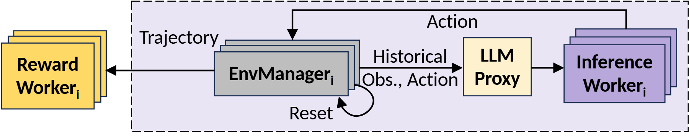

# VA-064 · 异步评价与决策执行闭环

横向结构把环境管理、决策代理与推理实例放在同一浅紫边界内，完成的轨迹从左侧送往独立评价池。上方长回线把动作送回环境，环境下方还有独立重置环。重复叠片表示并行实例，不表示必须等待所有实例同步完成；但仅凭这张图也不能证明系统已经实现异步无阻塞。



## 适用范围

- 环境交互、策略推理与轨迹评价分离的系统
- 需要表现多个环境和推理资源池的交互

不适合：没有状态反馈的一次性批量预测；将评价分数直接作为动作而没有决策环节。

## 阅读顺序

1. 从中间环境实例读取历史观测与动作输出
2. 沿水平路径经代理进入右侧推理池
3. 沿顶部动作回线返回环境，并识别局部重置环
4. 最后跟随左向轨迹箭头到独立评价池

## 图形表达

**布局**：主流程水平排布，外部评价放左侧，主循环顶部留走线空间，下方给环境重置弧留白。

**对象**：叠放矩形分别代表环境、推理和评价副本；代理保持单框以强调统一接口，不据此认定单点部署。

**连线**：观测请求向右，动作沿顶部向左返回，完成轨迹单独向评价池输出；重置弧只连接环境自身。

**配色**：黄色评价池、灰色环境、浅黄代理、紫色推理池按职责编码，浅紫底色限定主交互范围。

**文字**：标题多用粗无衬线，边标签用较轻字重；历史信息标签容易较长，需保留代理前的水平间距。

## 部件与复用

| 部件 | 含义 | 改造方法 |
|---|---|---|
| 轨迹评价池 (`reward-workers`) | 接收完成轨迹并进行评价的并行工作器。 | 定义评价输入与评分标准，若同步等待分数须补充返回路径。 |
| 环境管理副本 (`environment`) | 维护环境状态并触发重置的实例集合。 | 标明重置条件，区分模拟环境和真实设备，后者未必可直接重置。 |
| 决策代理 (`decision-proxy`) | 将环境请求分派给推理资源。 | 替换为真实路由或批处理接口，不把无计算的代理写成预测模型。 |
| 推理工作池 (`inference-workers`) | 根据历史信息生成下一步动作。 | 声明模型或求解器类型，副本数量只用示意叠片表达。 |
| 动作回传 (`action-feedback`) | 推理输出返回环境并形成闭环。 | 标明动作粒度和约束检查位置，必要时加入执行安全过滤。 |

## 改造步骤

1. 先确定轨迹结束与环境重置条件，避免两者混同
2. 分别命名请求、动作和轨迹，不让三条路径都叫数据
3. 评价若影响下一轮策略更新，需要额外画真实更新通路
4. 增加代理或资源池时手工更新顶部长回线与分组边界

## 新情景示例（假设）

可用于假设的配送机器人仿真策略评估。

环境池模拟路网与车辆，代理分派决策请求，推理池给出下一动作，评价池计算完成行程的时间和能耗。

将语言模型代理改为策略接口；若动作先经约束校验，在回线加校验节点；不把仿真重置映射成真实车辆重置。

## 编辑入口

**入口**：make_figure.py 读取 example.json 生成 fig.svg；加 --parts 导出部件，render_architecture.py 渲染预览及 PDF。

**配置可改**：labels 按 labels.json 对象键改字；components 支持 visible、dx/dy、attributes；elements 改对象属性。位移用图内坐标，连线不自动重布。

**需改代码**：增删模块、改连接和布局须修改 customize()。新对象须有唯一 data-asset-key 并登记部件归属；嵌套部件选一个层级平移，避免重复移动。

**字体**：当前完整字体为 Arimo-Bold, Carlito-Bold, Carlito-Regular。font_size 是元素局部坐标单位，受缩放变换影响，不是纸面字号；改长标签后按最终版面宽度复核换行与字距。

准备独立工作副本：

```text
python "<SKILL>/scripts/prepare_architecture.py" --id VA-064 --out figures/architecture
```

在工作副本运行：

```text
python make_figure.py --config example.json --out . --parts
python render_architecture.py fig.svg
```

## 本图检查

- 顶部返回箭头是否确实终止在环境而非评价池
- 重置环是否只作用于允许重置的状态
- 评价是否需要返回结果，若需要是否缺少对应通路

部件图用于复用局部对象；跨边界的连接和共享容器仍需按新关系处理。示例名称、数值和曲线不是当前研究结果。

来源与许可见 [ATTRIBUTION.md](ATTRIBUTION.md)。
