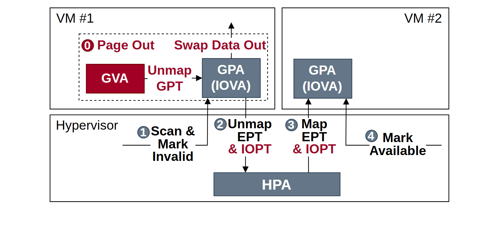

# VA-173 · 跨虚拟机资源回收与重新映射

上方两个虚拟机共享下方管理层，左侧先释放映射，管理层围绕同一个物理页执行失效、解除映射、重建映射与可用标记，最终交给右侧虚拟机。图中路径呈先下后上的转移，适合说明所有权切换。



## 适用范围

- 资源从一租户安全回收后转交另一租户
- 上下两层共同参与映射变更的局部流程

不适合：需要展示所有虚拟化组件的系统总览；数据内容原样迁移但所有权不变的复制图。

## 阅读顺序

1. 读左侧 VM #1 中步骤 0 Page Out。
2. 看 GVA 解除 GPT 后对应 GPA，再读下方步骤 1 标失效。
3. 步骤 2 解除 EPT/IOPT 到共同 HPA，步骤 3 从 HPA 建立新映射。
4. 步骤 4 标记可用并进入 VM #2 的 GPA。

## 图形表达

**布局**：上方左右两个租户框，下方横跨两者的管理层，中央底部一个共享 HPA。

**对象**：灰蓝地址矩形与细线容器区分地址对象和执行域，红色 GVA 与文字突出释放操作。

**连线**：左边先下行至 HPA，右边上行至新 GPA；失效和可用标记各有独立折线，步骤号定义操作顺序。

**配色**：深红用于释放和 IOPT 提示，灰蓝用于 GPA/HPA 和步骤圈，背景白色。

**文字**：步骤说明较粗，地址名白字居中；多行 EPT/IOPT 标签密集。

## 部件与复用

| 部件 | 含义 | 改造方法 |
|---|---|---|
| 源虚拟机页回收 (`source-vm`) | VM #1 的 Page Out、GVA、GPA 与 GPT 解除 | 改为其他资源时明确释放对象及数据去向。 |
| 目标虚拟机地址 (`target-vm`) | VM #2 接受的新 GPA | 可换成新租户，但必须同时重连向上两条映射/可用路径。 |
| 失效扫描步骤 (`invalidate-step`) | 步骤 1 扫描并标记旧资源失效 | 更换检查机制时保留其在重分配前的位置。 |
| 共享物理页与双向映射操作 (`remap-core`) | 步骤 2、3 围绕同一个 HPA 解映射和重映射 | 需要多个物理资源时复制资源块并明确每条映射对应关系。 |
| 可用标记步骤 (`available-step`) | 步骤 4 将新分配标记可用 | 若新机制需要确认返回，显式增加确认边。 |

## 改造步骤

1. 先确定回收的是物理资源、逻辑映射还是数据内容，避免把它们混称搬运。
2. 保留同一个 HPA 的共享身份，不能为两租户各画一份导致含义变成复制。
3. 步骤 0–4 应按真实操作重新编号。
4. 地址框和跨层箭头须一起调整；管理层外框保留整图。

## 新情景示例（假设）

假设的容器共享缓冲池再分配

VM 映射为容器，GPA 映射为容器句柄，HPA 映射为共享缓冲区，EPT/IOPT 映射为访问授权。

若不涉及二级页表，应重写并重画映射操作，而不是继续保留 GPT 等硬件术语。

## 编辑入口

**入口**：运行 make_figure.py；example.json 保存本场景配置，labels.json 提供文字定位键，asset.json 保存部件及成员定义。使用 --parts 同时导出部件。

**配置可改**：通过 labels 改文字，通过 components 改配色、显隐与位移；配置不会按文字长度自动重排，需复查本图的间距和连接。

**需改代码**：增删结构、调整连线或重排布局需在 customize(root, context) 中编辑 SVG。新增元素须有 data-asset-key，并加入对应部件的 element_keys；共享线框保留整图时不可随多个部件重复移动。

**字体**：无衬线、粗步骤说明与白色地址标签，灰蓝编号圈较小；应保留字体对比。 局部 font_size 使用源坐标尺度，不等于论文纸面 pt。本批构建已确认并嵌入完整字体：Arimo-Bold.ttf, Arimo-Regular.ttf。映射可能改变原字形和字宽，需按实际论文尺寸复核。

准备独立工作副本：

```text
python "<SKILL>/scripts/prepare_architecture.py" --id VA-173 --out figures/architecture
```

在工作副本运行：

```text
python make_figure.py --config example.json --out . --parts
python render_architecture.py fig.svg
```

## 本图检查

- 回收与再分配是否指向同一物理资源。
- 失效是否在新租户获准使用前完成。
- 步骤号与路径方向是否一致。
- 红色说明和灰蓝地址框是否保持清晰对比。

部件图用于复用局部对象；跨边界的连接和共享容器仍需按新关系处理。示例名称、数值和曲线不是当前研究结果。

来源与许可见 [ATTRIBUTION.md](ATTRIBUTION.md)。
