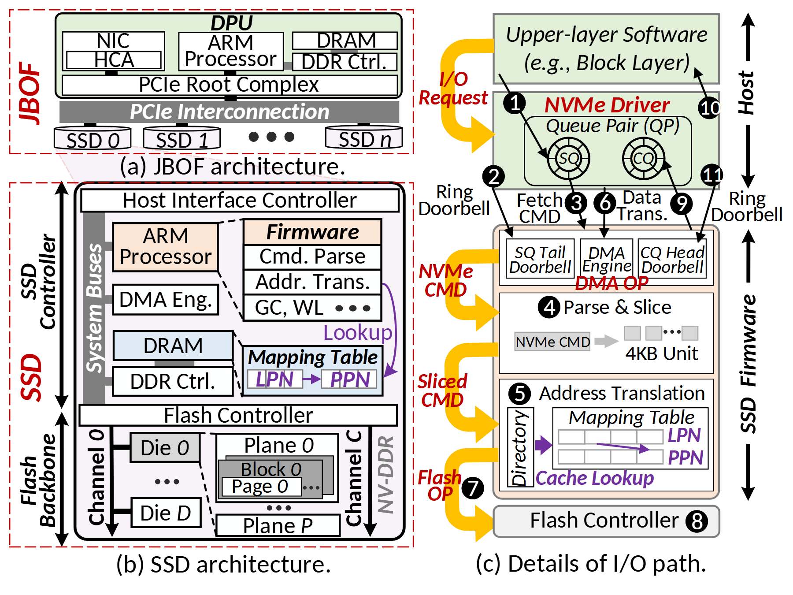

# VA-174 · 存储系统层级与完整请求往返展开

左上展示主机侧聚合多个 SSD，左下展开一个 SSD 的控制器与闪存层级，右侧展示驱动到固件的请求与完成路径。黄色粗弯箭头串联处理阶段，黑色编号细线跟踪控制与数据往返，紫色突出地址查找。



## 适用范围

- 同时解释设备部署、单设备结构与请求处理
- 需要把静态结构和有编号的往返路径联系起来

不适合：单栏很小尺寸且不允许拆分的简图；仅需一个抽象请求箭头的高层总览。

## 阅读顺序

1. 读左上 DPU、PCIe 互连与多个 SSD。
2. 在左下展开 Host Interface、处理器、映射表与闪存层级。
3. 转右侧，从上层软件和 NVMe Driver 的 SQ 提交开始，沿步骤 1–8 到闪存处理。
4. 再沿 CQ 方向读步骤 9–11 的完成返回，不把路径停在 Flash OP。

## 图形表达

**布局**：左侧上小下大两个结构面板，右侧全高请求面板；红虚线区分设备范围，右侧 Host/SSD Firmware 双域。

**对象**：设备和控制器用嵌套矩形，SSD 用短圆柱，SQ/CQ 用环形队列，映射表为网格，闪存为多级子框。

**连线**：黄色粗弯箭头表示阶段推进，黑色细箭头带 1–11 编号表达提交和完成，紫色箭头表示地址查找；三种线不可混为一种。

**配色**：淡绿为主机/驱动，浅橙为处理与固件，蓝色为 DRAM，紫色为地址映射，黄色为主路径，红色为设备范围与流程强调。

**文字**：密集无衬线，多处斜体模块名与红色粗斜体流程名；小格与步骤号在缩版后易读性较差。

## 部件与复用

| 部件 | 含义 | 改造方法 |
|---|---|---|
| 多盘存储设备总览 (`device-overview`) | DPU、PCIe 互连和多 SSD 的上层连接 | 改变设备数时重新排布短圆柱及互连端口。 |
| 单盘控制器与映射表 (`ssd-controller`) | 接口、ARM、DMA、固件、DRAM 及地址映射关系 | 替换控制器组件时保持固件执行位置与查表边一致。 |
| 闪存物理层级 (`flash-hierarchy`) | 通道、Die、Plane、Block、Page 的层级 | 迁移其他设备时用真实层级替换，必要时整体重画。 |
| 主机驱动与队列对 (`host-queues`) | 上层软件及驱动 SQ/CQ 形成提交与完成双通道 | 改协议时重画队列和完成返回端点。 |
| 固件请求处理与地址转换 (`firmware-path`) | 门铃、DMA、解析切分与地址查找的处理区 | 删除阶段时重连黄色推进路径及黑色编号线。 |
| 闪存执行端点 (`flash-completion`) | 右侧 Flash Controller 及步骤 8 | 替换底层执行端后检查完成返回是否仍连接 CQ。 |

## 改造步骤

1. 先确定需要保留的三种尺度，若排版空间不足可拆成三张相互引用的图。
2. 完整流程实际编号到 11，包含 CQ 和完成通知；不得照抄只到 7 的简化描述。
3. 把黄色阶段流、黑色控制数据流和紫色查表流分别迁移。
4. 跨部件连线、红色大范围框和面板题注留整图；新增部件后人工更新连接与编号。

## 新情景示例（假设）

假设的分布式推理设备请求路径

左上映射为多加速器节点，左下映射为单加速器内部，右侧映射为提交队列、调度、执行和完成队列。

闪存层级应整体换成实际计算/存储层级；DMA 与地址映射只有真实存在时保留。

## 编辑入口

**入口**：运行 make_figure.py；example.json 保存本场景配置，labels.json 提供文字定位键，asset.json 保存部件及成员定义。使用 --parts 同时导出部件。

**配置可改**：通过 labels 改文字，通过 components 改配色、显隐与位移；配置不会按文字长度自动重排，需复查本图的间距和连接。

**需改代码**：增删结构、调整连线或重排布局需在 customize(root, context) 中编辑 SVG。新增元素须有 data-asset-key，并加入对应部件的 element_keys；共享线框保留整图时不可随多个部件重复移动。

**字体**：原源为 Calibri 系列含粗体和斜体；浏览器源渲染回退后若干字形更拥挤，需映射后核对密集小格。 局部 font_size 使用源坐标尺度，不等于论文纸面 pt。本批构建已确认并嵌入完整字体：Carlito-Bold.ttf, Carlito-BoldItalic.ttf, Carlito-Italic.ttf, Carlito-Regular.ttf。映射可能改变原字形和字宽，需按实际论文尺寸复核。

准备独立工作副本：

```text
python "<SKILL>/scripts/prepare_architecture.py" --id VA-174 --out figures/architecture
```

在工作副本运行：

```text
python make_figure.py --config example.json --out . --parts
python render_architecture.py fig.svg
```

## 本图检查

- 三个面板的设备与模块是否能对应。
- 步骤 1–11 是否包含完整提交、执行和完成路径。
- SQ 与 CQ 的方向是否混淆。
- 细小地址表、步骤号和红色侧标题在目标列宽下是否可读。
- 不同线型及颜色是否仍各有唯一作用。

部件图用于复用局部对象；跨边界的连接和共享容器仍需按新关系处理。示例名称、数值和曲线不是当前研究结果。

来源与许可见 [ATTRIBUTION.md](ATTRIBUTION.md)。
