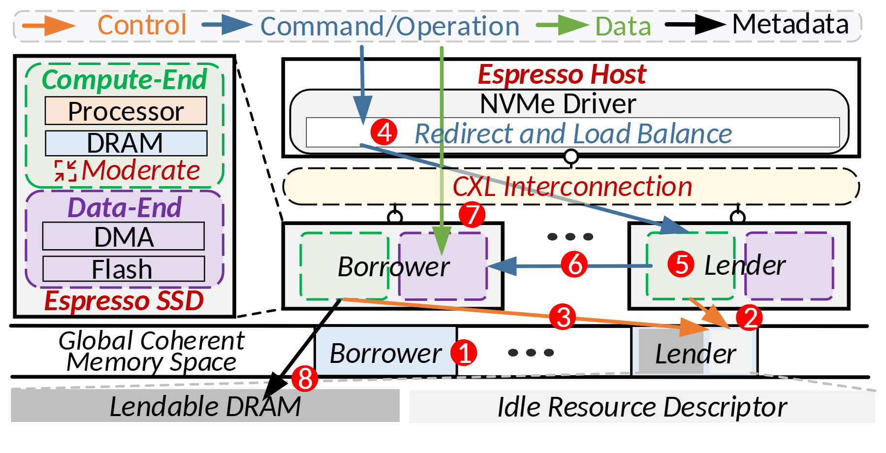

# VA-175 · 主机、借用节点与共享内存的分层协议图

左侧窄栏拆解单个设备的计算端和数据端，右侧由主机、互连、借用/出借设备及共享内存组成四层。红色步骤号覆盖多类流，适合把设备组成和资源借用协议放在同一图内。



## 适用范围

- 两个对等节点借用计算或内存且数据路径仍需单独标示
- 主机驱动协调设备资源池的分层系统

不适合：只需单一路径的简短流程；没有共享地址空间却仍想沿用底部一致性内存标签。

## 阅读顺序

1. 先读顶端四类箭头图例，区分控制、命令、数据和元数据。
2. 左侧了解设备内部两层，再读右上主机与驱动。
3. 沿右侧借用者和出借者之间的红色编号追踪交互。
4. 最后读底部共享内存、可借出内存和空闲描述符。

## 图形表达

**布局**：窄左栏设备剖面配宽右栏系统分层；底部内存带横贯全图。

**对象**：虚线色块表示计算/数据端，矩形表示主机与驱动，浅色长条表示互连和内存。

**连线**：不同颜色箭头在层间跨越；步骤号是全图协议索引，不能按几何左右顺序理解。

**配色**：橙色控制、蓝色命令、绿色数据、黑色元数据；红色用于步骤号和部分强调文字，绿色/紫色区分设备两端。

**文字**：紧凑无衬线主体，角色名与若干层标题带斜体；红色步骤数字比模块文字醒目。

## 部件与复用

| 部件 | 含义 | 改造方法 |
|---|---|---|
| 四类流图例 (`flow-legend`) | 定义箭头颜色的含义 | 改流程类型时同时改所有同色连线与图例 |
| 设备组成剖面 (`device-cutaway`) | 单设备计算端和数据端的纵向分工 | 保留两层对齐，替换处理器、内存、传输和存储模块 |
| 主机与驱动 (`host-driver`) | 驱动在主机内做重定向和负载分配 | 主机职责改变时同步调整驱动输出箭头 |
| 互连层 (`interconnect`) | 主机和设备之间的横向共享互连 | 节点扩展需延长互连并重画各接入线 |
| 借用与出借节点 (`peer-devices`) | 两个设备角色对称但协议职责不同 | 两角色及编号需成组替换，不能仅交换标题 |
| 共享内存与描述符 (`shared-memory`) | 共享空间中的角色条目和可借出资源 | 保留共享带与描述符关系，修改资源实体及容量含义 |

## 改造步骤

1. 先明确新情景中借用者、出借者与资源目录是否真实存在。
2. 重写协议步骤及其箭头类型，再更新红色编号；不要只替换设备名。
3. 单设备内部结构放左侧，跨设备的资源流留在右侧全图。
4. 底部内存带与跨区连线属于共享结构，移动局部部件后需手工接回。

## 新情景示例（假设）

假设：边缘推理节点借用邻近节点的空闲缓存。

主机映射为调度服务，两个设备映射为繁忙/空闲节点，描述符映射为资源目录。

若节点只经网络共享缓存，应将一致性内存层改为目录服务并重画访问路径，不能保留 CXL 语义。

## 编辑入口

**入口**：make_figure.py 调用共享矢量运行库；example.json 保存实例配置，labels.json 列出可替换文本，asset.json 保存部件成员及边界。

**配置可改**：labels 可替换文字；components 可调整已登记部件的配色、显隐、位移。配置不会自动重排连线、容器或长标签。

**需改代码**：拓扑、对象数量及容器改变需在 customize(root, context) 编辑 SVG；新增对象须设置 data-asset-key，并将其加入相关部件 element_keys。跨区连线应随端点另行调整，避免重叠部件重复移动同一元素。

**字体**：观察到的字体层次见本图 typography；最终字体文件由构建映射提供。局部 font_size 是 SVG 坐标下的字号，不能直接当作论文纸面 pt；替换字体后检查实际字宽。本批构建已确认并嵌入完整字体：Carlito-BoldItalic.ttf, Carlito-Italic.ttf, Carlito-Regular.ttf。映射可能改变原字形和字宽，需按实际论文尺寸复核。

准备独立工作副本：

```text
python "<SKILL>/scripts/prepare_architecture.py" --id VA-175 --out figures/architecture
```

在工作副本运行：

```text
python make_figure.py --config example.json --out . --parts
python render_architecture.py fig.svg
```

## 本图检查

- 四类箭头颜色与图例一致。
- 步骤号 1–8 的起止对象及必要顺序与新协议一致。
- 底部细文字在论文尺寸仍可辨识。
- 主机、互连和内存边界不可被跨区线误读为单向步骤。

部件图用于复用局部对象；跨边界的连接和共享容器仍需按新关系处理。示例名称、数值和曲线不是当前研究结果。

来源与许可见 [ATTRIBUTION.md](ATTRIBUTION.md)。
