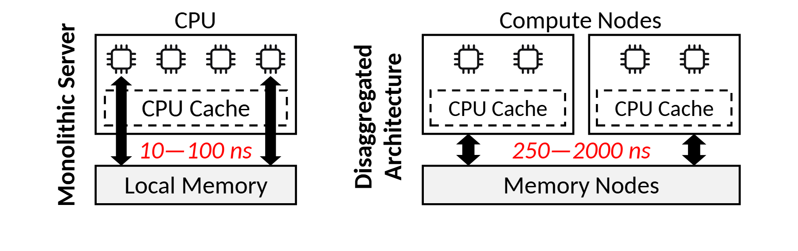

# VA-176 · 本地与解耦内存的双栏延迟对照

左栏用单个 CPU/缓存及本地内存表示集中式结构，右栏将两个计算节点并置在公共内存节点上方。两处红色延迟区间是视觉焦点，适合比较连接距离或资源归属带来的代价。



## 适用范围

- 同一资源在本地部署与远端解耦部署之间的结构比较
- 两个方案的连接方式相近、但访问成本不同的概念解释

不适合：多种指标需要同等展示的性能评测；时延区间没有测量或来源依据时作为结果图。

## 阅读顺序

1. 读左侧竖排方案名及 CPU 内部缓存。
2. 向下看本地内存与访问箭头旁的红色区间。
3. 转向右侧两个计算节点和公共内存节点。
4. 最后比较两边数值的单位、范围和适用口径。

## 图形表达

**布局**：横向双栏共享上下层高度，右栏用重复节点表达解耦后的多节点结构。

**对象**：芯片小符号位于计算盒顶部，虚线缓存嵌套在 CPU 内，实线长框表示内存。

**连线**：粗黑双向访问箭头连接计算侧与内存；图中没有跨方案箭头。

**配色**：主体黑白灰，只有延迟区间为红色，不能把红色解释为故障。

**文字**：无衬线标签，方案名竖排；红色数值带斜体，保持两边同等字号。

## 部件与复用

| 部件 | 含义 | 改造方法 |
|---|---|---|
| 本地计算与缓存 (`local-compute`) | 单节点 CPU 内含缓存的结构 | 更换计算对象时保留内嵌缓存层次 |
| 本地访问与内存 (`local-memory`) | 本地访问的连接和延迟区间 | 替换数值须连同单位与访问定义 |
| 解耦计算节点组 (`remote-compute`) | 两个重复计算节点共用下层资源 | 增加实例需扩展整栏，不能挤缩芯片符号 |
| 远端访问与内存 (`remote-memory`) | 公共内存节点和远端访问成本 | 改变连接方式时同步改箭头和红字 |

## 改造步骤

1. 首先使两种方案的工作负载和访问成本定义可比。
2. 保持上下对齐和统一 CPU/缓存符号，再改节点数量。
3. 用已核实的新数值替换两处红色区间；示例数值不是可沿用结论。
4. 方案竖排标题较长时改为栏顶标题并重新留白。

## 新情景示例（假设）

假设：比较本地特征缓存与集中式特征服务。

CPU 映射为推理进程，Local Memory 映射为本地缓存，Memory Nodes 映射为共享特征服务。

删除不成立的硬件缓存细节，加入真实网络边界，重新测量两种访问延迟。

## 编辑入口

**入口**：make_figure.py 调用共享矢量运行库；example.json 保存实例配置，labels.json 列出可替换文本，asset.json 保存部件成员及边界。

**配置可改**：labels 可替换文字；components 可调整已登记部件的配色、显隐、位移。配置不会自动重排连线、容器或长标签。

**需改代码**：拓扑、对象数量及容器改变需在 customize(root, context) 编辑 SVG；新增对象须设置 data-asset-key，并将其加入相关部件 element_keys。跨区连线应随端点另行调整，避免重叠部件重复移动同一元素。

**字体**：观察到的字体层次见本图 typography；最终字体文件由构建映射提供。局部 font_size 是 SVG 坐标下的字号，不能直接当作论文纸面 pt；替换字体后检查实际字宽。本批构建已确认并嵌入完整字体：Carlito-Bold.ttf, Carlito-Italic.ttf, Carlito-Regular.ttf。映射可能改变原字形和字宽，需按实际论文尺寸复核。

准备独立工作副本：

```text
python "<SKILL>/scripts/prepare_architecture.py" --id VA-176 --out figures/architecture
```

在工作副本运行：

```text
python make_figure.py --config example.json --out . --parts
python render_architecture.py fig.svg
```

## 本图检查

- 两边范围单位一致且有证据。
- 实例数量变化没有造成视觉面积误导。
- 双向箭头不与缓存框重叠。
- 竖排文字缩小后仍可读。

部件图用于复用局部对象；跨边界的连接和共享容器仍需按新关系处理。示例名称、数值和曲线不是当前研究结果。

来源与许可见 [ATTRIBUTION.md](ATTRIBUTION.md)。
