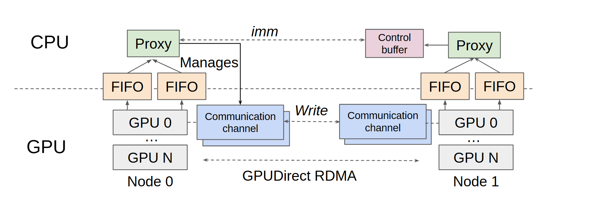

# VA-026 · 双节点控制代理与直接数据通道

以左右镜像节点表示协同通信，上层 CPU 代理通过队列处理轻量控制消息，下层设备通道承载数据。横向分层线将控制参与者与设备载荷路径分开，避免把代理画成所有数据都必须经过的中转站。



## 适用范围

- 控制与载荷分离的设备通信
- 两个对等节点之间的消息协调

不适合：节点关系高度不对称的网络；只需描述普通请求响应的业务接口。

## 阅读顺序

1. 先辨认上部控制层与下部设备层。
2. 由设备到 FIFO 再到代理读控制上报。
3. 观察代理对通信通道的管理。
4. 沿底部横向路径读实际数据传输。

## 图形表达

**布局**：两个节点左右对称，层边界贯穿全宽；中部留给跨节点链路。

**对象**：FIFO 成对并排；设备竖列和通道叠片表示多设备或缓冲结构。

**连线**：控制消息、通道写入和底层直接传输各有独立连线；不要用一条粗箭头吞并三种语义。

**配色**：代理浅绿、队列浅橙、数据通道浅蓝、控制缓冲粉色，色彩按对象类型重复。

**文字**：短标签居中，Write 等链路动词使用斜体；节点编号放在底部。

## 部件与复用

| 部件 | 含义 | 改造方法 |
|---|---|---|
| 左控制组 (`left-proxy`) | 本端代理与 FIFO 协调设备请求。 | 队列数应对应实际控制接口。 |
| 右控制组 (`right-proxy`) | 对端代理承接对应消息。 | 保持镜像只适用于职责对称的节点。 |
| 直接数据通道 (`direct-channel`) | 设备之间绕过代理搬运载荷。 | 改为真实传输接口并检查读写方向。 |
| 控制缓冲 (`control-buffer`) | 等待满足交付条件的控制消息。 | 只有真实存在缓冲条件时保留此对象。 |

## 改造步骤

1. 先分别写清控制消息和数据载荷的生产者与接收者。
2. 如迁移到非 GPU 系统，应同时修改 CPU/GPU 层名及底部传输名称。
3. 增加第三节点时重构成多列或拓扑图，不能简单复制到右侧。

## 新情景示例（假设）

假设用于两座边缘站点交换视频特征。

代理负责任务确认，FIFO 保存轻量指令，下层加速器间通道传递特征张量。

把设备列表改成实际加速单元，并按单向或双向传输重画通道箭头。

## 编辑入口

**入口**：以 make_figure.py 为入口，先复制 example.json 作为当前情景配置；labels.json 定位标签，asset.json 定位部件。

**配置可改**：labels 可改文字和文字样式，components 可做显隐、平移和局部样式调整；elements 可定位矢量元素。配置只作用于已有几何，不会自动解决布局冲突。

**需改代码**：增加设备层级、改变双向性或插入通信协议模块需改 customize() 和路径；现有几何不自动生成网络拓扑。

**字体**：当前替换字体为 Arimo-Italic、Arimo-Regular。改字后检查字宽、基线及 PDF 字体嵌入；原图的逐字定位不保证能容纳更长名称。

准备独立工作副本：

```text
python "<SKILL>/scripts/prepare_architecture.py" --id VA-026 --out figures/architecture
```

在工作副本运行：

```text
python make_figure.py --config example.json --out . --parts
python render_architecture.py fig.svg
```

## 本图检查

- 数据路径没有意外经过 CPU 代理。
- 控制缓冲的箭头方向与等待条件一致。
- 两侧 FIFO 到设备的对应关系无交叉误连。

部件图用于复用局部对象；跨边界的连接和共享容器仍需按新关系处理。示例名称、数值和曲线不是当前研究结果。

来源与许可见 [ATTRIBUTION.md](ATTRIBUTION.md)。
