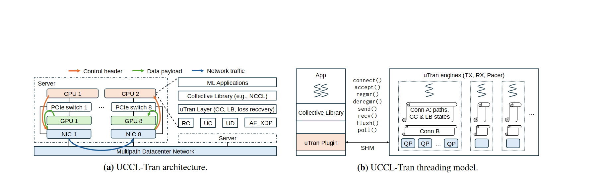

# VA-177 · 传输系统与线程模型的并列展开图

左面板把服务器硬件拓扑与软件栈并置，并以底部网络带收束；右面板从应用、集合通信库及插件展开到共享内存连接的传输引擎线程。可以同时解释部署位置和执行粒度。



## 适用范围

- 网络传输层的软件栈与线程实现需要一起交代
- 硬件通信路径和软件插件关系需相互对应的系统

不适合：仅展示一个算法的数据处理步骤；没有线程/连接状态区分的普通部署图。

## 阅读顺序

1. 先读左面板顶部三类流图例及两列硬件对象。
2. 沿左面板右侧软件栈自上而下读到传输原语和网络。
3. 转向右面板的应用、库和插件竖栈。
4. 沿共享内存和 API 列表读到引擎线程、连接状态和队列。

## 图形表达

**布局**：并排两个面板，下方带 (a)/(b) 标题；源画布上方有较大留白，部件坐标按完整画布登记。

**对象**：实线矩形为组件，虚线框为服务器或线程范围，波形符号表示线程执行，多个小队列体现连接状态。

**连线**：左面板用橙/绿/蓝线区分控制头、数据载荷和网络流；右面板的 SHM 横线连接插件与引擎池。

**配色**：淡橙 CPU/插件、淡绿 GPU、淡蓝 NIC/队列；颜色与层级作用相关，避免改为纯装饰渐变。

**文字**：极小无衬线组件字；面板说明为衬线文字，API 名称呈代码式竖列。

## 部件与复用

| 部件 | 含义 | 改造方法 |
|---|---|---|
| 物理服务器与网卡组 (`physical-server`) | 两套 CPU、交换器、GPU、NIC 构成服务器内路径 | 硬件数量改变需同步重接橙绿蓝路径 |
| 通信软件栈 (`software-stack`) | 应用、库、传输层与多种传输原语的层次 | 增删层时重新排布虚线服务器边界 |
| 多路径网络带 (`network-band`) | 连接物理及软件视角的公共网络 | 保留蓝色带和接入弧线，避免把弧线当顺序步骤 |
| 应用库插件竖栈 (`plugin-stack`) | 右面板的调用发起侧 | 保持应用/库/插件的上下嵌套关系 |
| 调用接口与共享内存桥 (`api-shm`) | 接口列表与到线程池的共享内存连接 | 新接口多时改字号或扩栏，不自动等距重排 |
| 传输引擎线程池 (`engine-pool`) | 线程负责连接路径、拥塞状态和队列对 | 改变线程和连接数需维护省略号及队列归属 |

## 改造步骤

1. 明确新图仍要同时表达硬件/软件和线程模型，再给两个面板命名。
2. 将左侧原语列表与右侧插件 API 分开修改，避免把层级关系写成调用顺序。
3. 增加引擎线程时同步扩展池边界、连接状态和队列对。
4. 上方白边可在输出裁切阶段整体裁去，但不得用裁切后坐标定义源 SVG 部件。

## 新情景示例（假设）

假设：分布式仿真引擎的高速通信服务。

应用映射为仿真任务，集合库为通信封装，插件为传输适配器，引擎为收发和节流线程。

按实际平台改硬件节点及传输原语；如果不经共享内存，须替换 SHM 桥和相关同步关系。

## 编辑入口

**入口**：make_figure.py 调用共享矢量运行库；example.json 保存实例配置，labels.json 列出可替换文本，asset.json 保存部件成员及边界。

**配置可改**：labels 可替换文字；components 可调整已登记部件的配色、显隐、位移。配置不会自动重排连线、容器或长标签。

**需改代码**：拓扑、对象数量及容器改变需在 customize(root, context) 编辑 SVG；新增对象须设置 data-asset-key，并将其加入相关部件 element_keys。跨区连线应随端点另行调整，避免重叠部件重复移动同一元素。

**字体**：观察到的字体层次见本图 typography；最终字体文件由构建映射提供。局部 font_size 是 SVG 坐标下的字号，不能直接当作论文纸面 pt；替换字体后检查实际字宽。本批构建已确认并嵌入完整字体：Arimo-Regular.ttf, Inconsolata-Regular.ttf, texgyretermes-bold.otf, texgyretermes-regular.otf。映射可能改变原字形和字宽，需按实际论文尺寸复核。

准备独立工作副本：

```text
python "<SKILL>/scripts/prepare_architecture.py" --id VA-177 --out figures/architecture
```

在工作副本运行：

```text
python make_figure.py --config example.json --out . --parts
python render_architecture.py fig.svg
```

## 本图检查

- 两个面板使用同一套传输对象名称。
- 线程边界没有吞入相邻 API 字列。
- 网络流和数据载荷的线色能区分。
- 裁切白边后确认面板标题与部件完整。

部件图用于复用局部对象；跨边界的连接和共享容器仍需按新关系处理。示例名称、数值和曲线不是当前研究结果。

来源与许可见 [ATTRIBUTION.md](ATTRIBUTION.md)。
