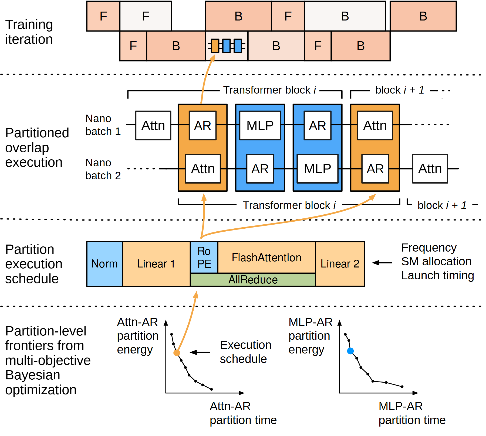

# VA-100 · 从整体日程到局部权衡的四层展开

四行依次呈现整体迭代、双批次重叠、单分区细日程以及时间—能耗权衡。跨行曲线把一个局部选择与宏观执行联系起来；底部小曲线是方案依据，不应被当作可直接继承的实验结果。



## 适用范围

- 分层解释并行调度与多目标方案选择
- 既要看整体时序又要看局部重叠细节的方法

不适合：没有真实时间关系的普通业务流程；没有计算数据却打算保留前沿曲线作为结果。

## 阅读顺序

1. 读顶部迭代块与被选中的局部时段。
2. 顺展开线进入两条批次的交错执行。
3. 继续到单分区日程，区分计算块与重叠通信。
4. 最后看两个时间—能耗前沿及高亮点如何对应选定日程。

## 图形表达

**布局**：四条横向层级由虚线分隔，左栏说明层级，右侧承担时序和曲线；下两层比例不同。

**对象**：时间矩形代表执行段，括号标重复块范围，小坐标系表达权衡；不同层的宽度不能直接跨层比较。

**连线**：橙色曲线连接展开对象，黑线用于时序关系和注释；不要把展开线读成实际通信。

**配色**：橙蓝区分两类分区并联系前沿高亮点；细日程还用绿色标通信，需有明确图例。

**文字**：左栏多行标签要短；算子缩写和坐标轴名承担技术信息，最终纸面需专门检查小字。

## 部件与复用

| 部件 | 含义 | 改造方法 |
|---|---|---|
| 整体迭代日程 (`iteration`) | 两行前向后向任务及局部选择。 | 改成真实宏观任务阶段；时间不按比例时标示意。 |
| 双批次重叠 (`overlap`) | 两批次内计算和通信交错及重复块范围。 | 按实际依赖重排，不能为紧凑而让有依赖的阶段重叠。 |
| 分区内部日程 (`kernel-schedule`) | 更细的算子与通信并行关系。 | 替换算子，标明资源分配、启动时刻及频率是否可决策。 |
| 局部权衡前沿 (`tradeoff-frontiers`) | 两类分区的时间与能耗候选。 | 以当前计算结果重绘曲线和高亮点；无结果则换为明确示意。 |

## 改造步骤

1. 建立宏观块到局部块的一一对应，再绘展开线。
2. 每一行独立注明时间尺度，不暗示所有横向距离同尺度。
3. 只保留实际采用的优化变量和通信重叠。
4. 前沿和选中点必须与最终日程参数对应，不能只改坐标名。

## 新情景示例（假设）

假设展示多机器生产的能耗调度。

顶层为生产批次，中层为加工与搬运重叠，细层为单工序设备动作，底层为工期—能耗候选。

重算工序依赖并改为真实加工时段；没有能耗实验时删除前沿数据，保留变量关系示意。

## 编辑入口

**入口**：运行 make_figure.py，以 example.json 为改造配置；labels.json 查文字键，--parts 同步导出部件。

**配置可改**：labels 改文字，components 改显示、位移及样式，elements 改单个矢量属性；只选一个部件层级移动，避免重叠归属使对象移动两次。

**需改代码**：这是可编辑矢量结构，未实现自动布局。增删模块、改变连接或重新排版，须在 customize() 中改真实对象并更新部件成员。

**字体**：使用随包完整映射字体；改字后核查换行、符号和最终纸面字号。font_size 是对象局部单位，不能直接当作 PDF 的磅值。

准备独立工作副本：

```text
python "<SKILL>/scripts/prepare_architecture.py" --id VA-100 --out figures/architecture
```

在工作副本运行：

```text
python make_figure.py --config example.json --out . --parts
python render_architecture.py fig.svg
```

## 本图检查

- 每条展开线是否指向同一个局部块的下层解释。
- 通信或搬运的重叠是否违背前置依赖。
- 两个前沿高亮点是否能追溯到所示日程及相同单位。

部件图用于复用局部对象；跨边界的连接和共享容器仍需按新关系处理。示例名称、数值和曲线不是当前研究结果。

来源与许可见 [ATTRIBUTION.md](ATTRIBUTION.md)。
