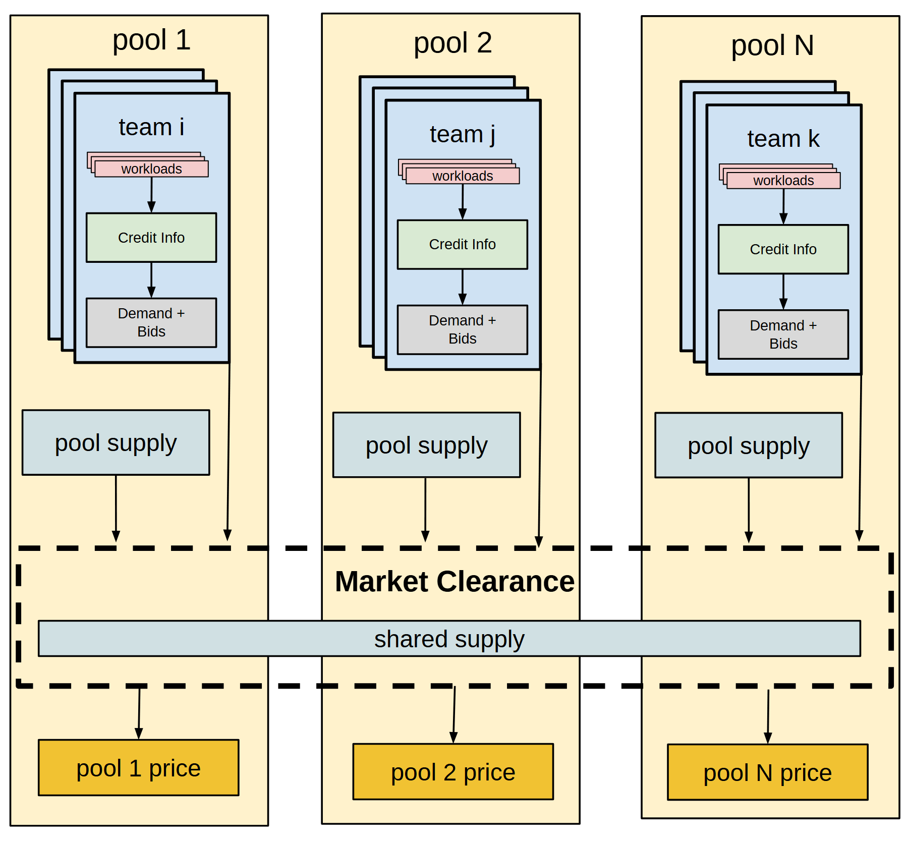

# VA-101 · 多资源池需求汇聚与共同清算

多个资源池以等宽竖列排列，每列内部有成组的需求方、预算信息和本池供给。横跨所有列的虚线清算带把局部供给和共享供给纳入共同决策，再向各列输出价格或分配结果。重复列说明并行参与，横带说明耦合关系。



## 适用范围

- 多群体竞争本地与共享资源
- 输入按群体分开、决策需要统一协调

不适合：各群体完全独立无共同约束；无价格含义却直接保留报价术语的分配任务。

## 阅读顺序

1. 先横向辨认三个资源池及省略的其他池。
2. 进入任一列，自上而下读取需求方、预算和申报。
3. 查看本池供给与申报如何进入横向清算区。
4. 读取共享供给条，再沿下行线查看分池输出。

## 图形表达

**布局**：三列等宽竖向泳道，清算区横向穿透各列，下方输出保持逐列对齐。

**对象**：叠片表示池内多个需求方，内部小框表示申报字段，长条表示跨池共享资源。

**连线**：细有向线把需求、池供给、共同清算和输出串接；清算虚线只标协作范围。

**配色**：淡黄表示资源池背景，浅蓝表示需求方和供给，粉色为工作负载，绿色为预算字段，灰色为报价，金黄突出结果。

**文字**：短字段分行置于窄列，清算标题加粗，输入输出同列对齐；池数增加时宜横向加宽。

## 部件与复用

| 部件 | 含义 | 改造方法 |
|---|---|---|
| 第一资源池 (`pool-one`) | 包含需求、专属供给及本池结果。 | 作为一列整体改写，保持内部流程。 |
| 第二资源池 (`pool-two`) | 平行参与但可能有不同供给条件。 | 不默认预算或需求与第一池相等。 |
| 其他资源池 (`pool-many`) | 最后一列代表更多同类参与者。 | 明确省略规则及最终编号。 |
| 共同清算区 (`market`) | 跨列共享供给与统一协调在此汇合。 | 替换为真实目标、约束和输出类型。 |
| 需求方卡片 (`team`) | 工作负载、预算和需求报价组成申报。 | 没有报价机制时替换整组字段。 |

## 改造步骤

1. 先确定本池供给与共享供给能否同时使用。
2. 定义报价、预算、价格的单位及彼此关系。
3. 增加资源池时扩展横带并重接逐池输出。

## 新情景示例（假设）

可用于区域公共算力分配。

每列映射为一个部门，需求方为项目组，预算为使用额度，横带为共享算力调度，底部输出为部门结算价格。

若模型只求配额不定价，应将报价与价格同时改为优先级和分配量，重写清算规则。

## 编辑入口

**入口**：运行 make_figure.py；example.json 为配置，labels.json 查文字键，asset.json 查部件。使用 --parts 导出独立矢量部件。

**配置可改**：labels 可改文字及字体；components 可设置 visible、dx/dy、attributes；elements 可按键改图元属性。移动量使用整图 viewBox 单位，重叠部件只选一个层级移动。

**需改代码**：增删节点、调整连接和重排结构须在 customize() 中处理；新增图元使用唯一 data-asset-key，并登记至相应部件 element_keys。配置不会自动排版。

**字体**：本图使用 Arimo-Bold.ttf、Arimo-Regular.ttf。font_size 是图元局部坐标单位，受既有缩放影响，不等于纸面 pt；改字后检查实际字宽与最终阅读尺寸。

准备独立工作副本：

```text
python "<SKILL>/scripts/prepare_architecture.py" --id VA-101 --out figures/architecture
```

在工作副本运行：

```text
python make_figure.py --config example.json --out . --parts
python render_architecture.py fig.svg
```

## 本图检查

- 各列专属供给是否与共享供给分开标示。
- 清算输出是否仍与各资源池一一对齐。
- 预算、报价与结果是否使用一致单位而非仅借用名词。

部件图用于复用局部对象；跨边界的连接和共享容器仍需按新关系处理。示例名称、数值和曲线不是当前研究结果。

来源与许可见 [ATTRIBUTION.md](ATTRIBUTION.md)。
