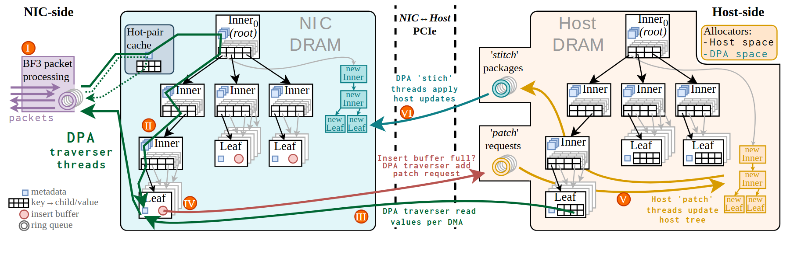

# VA-179 · 双端镜像索引与异步修补协议图

左右分别为网卡 DRAM 与主机 DRAM 的树形索引，中间 PCIe 虚线界面把读取、补丁请求和结构回传区分开。相似树形结构使读者可比较两侧副本，彩色跨界线强调读路径与异步维护路径。



## 适用范围

- 两个副本结构近似但执行职责不同的协同索引
- 快速读侧与后台更新侧通过补丁/回传协调

不适合：无镜像状态的纯请求响应系统；需要严谨显示每个树节点键值和完整平衡操作的算法证明。

## 阅读顺序

1. 左侧从包处理队列读到 DPA 遍历线程和网卡树。
2. 观察左侧热对缓存、内部节点和叶节点的图符。
3. 跨中间 PCIe 区分红色补丁请求、青色结构回传及绿色读取。
4. 在右侧主机树追踪橙色更新路径与新增节点。
5. 用左下图例确认元数据、键值、插入缓冲和环形队列。

## 图形表达

**布局**：两个大树形容器左右相对，中间留协议通道；左侧有输入列，右上有分配器图例。

**对象**：复合节点包含元数据小块、键值格子和缓冲圆点；环形多圈表示消息队列。

**连线**：黑色树边表示父子关系；绿色读路径、红色请求、青色回传和橙色主机更新跨越不同区域。

**配色**：网卡底色浅青、主机浅暖色；路径多色编码，橙色圆形罗马步骤标记嵌在路径附近。

**文字**：主体衬线混合少量等宽协议注释，容器 DRAM 名称以大号浅灰字弱化处理。

## 部件与复用

| 部件 | 含义 | 改造方法 |
|---|---|---|
| 包入口与遍历线程 (`packet-entry`) | 包队列分配到网卡遍历执行端 | 替换入口协议并维护通向树根的路径 |
| 网卡镜像索引 (`nic-tree`) | 包含热对缓存、内部节点与叶的快速读取副本 | 调整树拓扑应保持黑色父子边和绿色路径一致 |
| 跨端补丁与回传通道 (`exchange`) | PCIe 边界两侧交换维护请求和结构更新 | 协议线属于全图，单独移动此区需重接两侧端点 |
| 主机索引与新节点 (`host-tree`) | 主机维护的树和右边新建节点组 | 新增或删除节点需同时更新橙色维护线 |
| 索引节点图符说明 (`symbol-key`) | 元数据、键值格、插入缓冲和环形队列的图例 | 节点图符改变时同步改图例 |

## 改造步骤

1. 明确哪些状态在两端复制、哪些只在一端存在。
2. 先改两棵树的对应拓扑，再改补丁请求和回传包内容。
3. 读路径和更新路径须有独立线型/颜色，不要只保留五个文本箭头。
4. 跨区长线保留在整图；部件移动后必须重新布线并检查绕行。

## 新情景示例（假设）

假设：边缘缓存索引与中心索引的异步维护。

网卡侧映射为边缘快速查询，主机侧映射为中心维护，patch 为增量请求，stitch 为结构更新包。

如果网络有版本冲突，应加入版本检查和冲突分支，不能直接沿用硬件 PCIe 语义。

## 编辑入口

**入口**：make_figure.py 调用共享矢量运行库；example.json 保存实例配置，labels.json 列出可替换文本，asset.json 保存部件成员及边界。

**配置可改**：labels 可替换文字；components 可调整已登记部件的配色、显隐、位移。配置不会自动重排连线、容器或长标签。

**需改代码**：拓扑、对象数量及容器改变需在 customize(root, context) 编辑 SVG；新增对象须设置 data-asset-key，并将其加入相关部件 element_keys。跨区连线应随端点另行调整，避免重叠部件重复移动同一元素。

**字体**：观察到的字体层次见本图 typography；最终字体文件由构建映射提供。局部 font_size 是 SVG 坐标下的字号，不能直接当作论文纸面 pt；替换字体后检查实际字宽。本批构建已确认并嵌入完整字体：Arimo-Regular.ttf, Inconsolata-Bold.ttf, Inconsolata-Regular.ttf, Tinos-Bold.ttf, Tinos-BoldItalic.ttf, Tinos-Italic.ttf, Tinos-Regular.ttf。映射可能改变原字形和字宽，需按实际论文尺寸复核。

准备独立工作副本：

```text
python "<SKILL>/scripts/prepare_architecture.py" --id VA-179 --out figures/architecture
```

在工作副本运行：

```text
python make_figure.py --config example.json --out . --parts
python render_architecture.py fig.svg
```

## 本图检查

- 两树哪些节点应对应已明确。
- 红色请求与青色回传方向正确。
- 树格子和插入缓冲没有在导出部件时丢失。
- 小号协议注释与背景保持可读。

部件图用于复用局部对象；跨边界的连接和共享容器仍需按新关系处理。示例名称、数值和曲线不是当前研究结果。

来源与许可见 [ATTRIBUTION.md](ATTRIBUTION.md)。
