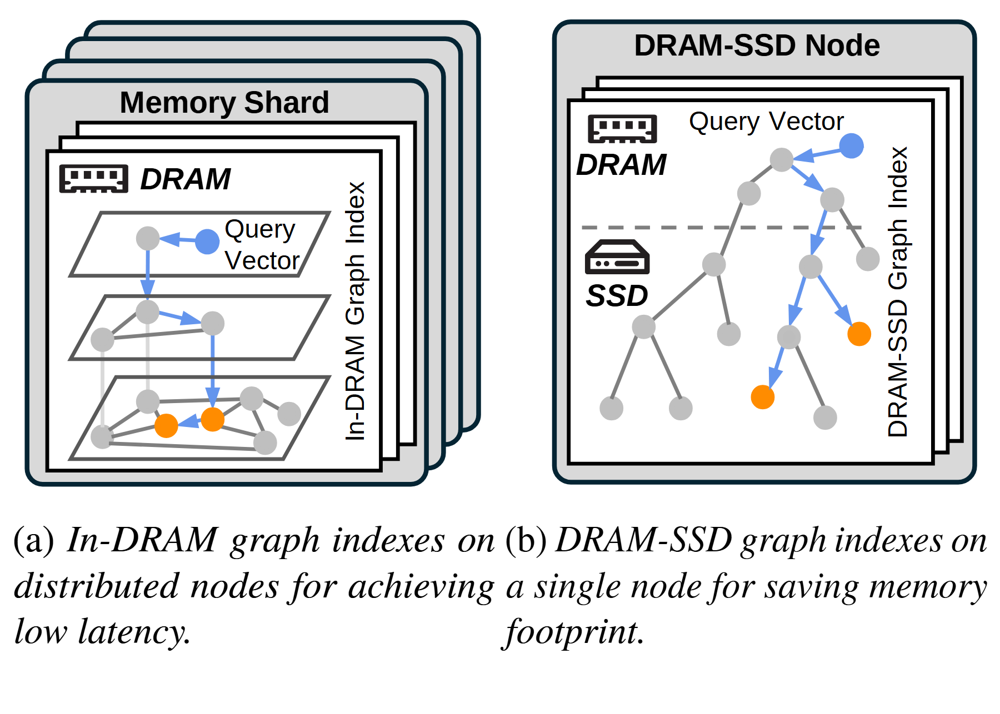

# VA-065 · 分片层级图与混合层级图的并列比较

左右用相同的节点、路径和容器词典比较两种图结构部署。左侧强调多个分片以及片内的逐层导航；右侧强调一个节点内的两类存储区域和跨区域搜索。蓝色标出本次示例查询路径，橙色标出结果候选，灰色是背景节点。此图适合对照结构差异；布局本身不能证明延迟或成本优劣。



## 适用范围

- 同类图索引在分布式与混合存储下的部署比较
- 需要保持同一查询语义而改变资源组织的方案对照

不适合：两种方案没有共同节点与查询含义的比较；必须给出准确网络拓扑或全部邻接边的设计图。

## 阅读顺序

1. 先读左边叠片，区分分片外壳与片内多个图层。
2. 沿蓝色箭头从查询入口逐层走向候选节点。
3. 再读右侧节点的上下资源区域，追踪对应查询穿越边界的路径。
4. 最后比较两边资源组织，性能差异留给有数据支持的正文。

## 图形表达

**布局**：双面板并排，两个外壳高度接近；左图通过倾斜平面表达层级，右图通过水平分界表达资源分层。

**对象**：圆点与连线都是图对象；左侧叠片表示多个分片，右侧内部片页属于节点内部，不能混称为同一扩展维度。

**连线**：灰线给出背景邻接，蓝箭头表现本次访问路径；右侧跨越虚线的边必须对应真实跨层读取。

**配色**：灰色为未强调节点，蓝色为查询相关对象，当前预览用橙色强调结果；以实际颜色为准同步编写图例。

**文字**：系统区域标题用无衬线粗体，面板说明用衬线斜体；长结论性句子应移到图注，避免压缩内部图。

## 部件与复用

| 部件 | 含义 | 改造方法 |
|---|---|---|
| 多分片层级网络 (`sharded-layers`) | 多个重复分片及片内分层图索引 | 叠片数量为示意，层数与分片数应分别定义。 |
| 逐层查询路径 (`hierarchical-path`) | 查询由上层导航到下层候选的访问路线 | 按真实搜索流程重画路径，不将蓝线直接当最短路。 |
| 混合资源节点 (`hybrid-node`) | 单个节点内分布在不同资源层的图对象 | 改写资源类型时同时调整边界和对应图标。 |
| 节点内访问路径 (`hybrid-search`) | 在混合区域图上追踪查询与候选 | 明确越界访问的含义；候选不是自动得到的最优或最终结果。 |

## 改造步骤

1. 确定两方案共享的图对象、查询输入和结果定义。
2. 分别定义分片、图层、存储层三种层级，避免用叠片重复表达不同含义。
3. 重画示例访问路线和结果候选，给蓝色与橙色补短图例。
4. 将性能表述替换为有来源的测量或中性结构说明，保持两面板缩放可比。

## 新情景示例（假设）

假设比较城市道路检索的分区内存图与冷热分层图。

左边分片对应城区，片内层级对应道路粒度；右边内存保存热点道路，外存保存完整路网。

硬件图标换为冷热层说明；跨城区查询需另补连接，不能把片内层间箭头当成跨城区通信。

## 编辑入口

**入口**：在工作副本修改 example.json，运行 python make_figure.py --config example.json --out output --parts；再通过 Vivid 的矢量渲染入口检查 SVG 与 PDF。

**配置可改**：labels 按 labels.json 的元素键改字；components 按本页部件 id 设置 visible、dx、dy 或 attributes；elements 修改指定矢量元素属性。重叠部件可能共享元素，避免对父区域和内部区域重复位移。

**需改代码**：增加图节点、改变层数或改查询路线需改写路径和层面几何，配置改字不会生成新的图搜索。这些接口不会自动重排，也不会随部件移动自动修复跨部件连线。

**字体**：本资产已记录的完整字形资源：Arimo-Bold.ttf, Arimo-BoldItalic.ttf, Arimo-Regular.ttf, texgyretermes-italic.otf, texgyretermes-regular.otf。修改英文标签优先沿用对应字体族与字重；文字变长时调整框宽和换行，不靠整体缩小压入。其他语言须另选覆盖所需字符的字体并实查导出。

准备独立工作副本：

```text
python "<SKILL>/scripts/prepare_architecture.py" --id VA-065 --out figures/architecture
```

在工作副本运行：

```text
python make_figure.py --config example.json --out . --parts
python render_architecture.py fig.svg
```

## 本图检查

- 左侧分片数和内部层数是否被混为一谈？
- 蓝色路径与橙色候选在两边是否有相同语义，是否补了图例？
- 右侧虚线是否正确界定资源层，跨层访问有无被遗漏？

部件图用于复用局部对象；跨边界的连接和共享容器仍需按新关系处理。示例名称、数值和曲线不是当前研究结果。

来源与许可见 [ATTRIBUTION.md](ATTRIBUTION.md)。
