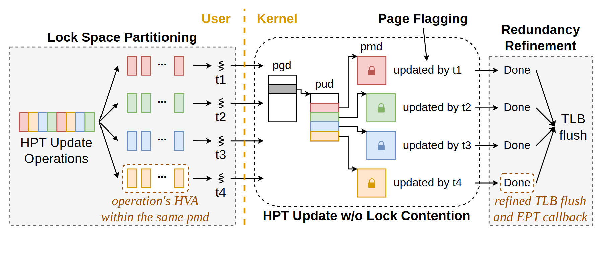

# VA-180 · 分区并发更新与统一刷新流程

左侧将更新操作按颜色分给线程，中间跨用户/内核边界进入页表层级，右侧把多个 Done 汇总为一次刷新。它突出并发分工和终结操作合并，属于局部机制流程。



## 适用范围

- 任务按互不冲突分区并行执行后统一收尾
- 页表或分层索引的更新路径需要配合线程归属解释

不适合：没有分区独立性证据却声称无竞争；完整操作系统或完整内存管理器架构。

## 阅读顺序

1. 左侧观察更新操作与线程的颜色配对。
2. 越过 User/Kernel 分界读 pgd、pud 到不同 pmd 分支。
3. 跟踪每条分支的线程更新说明。
4. 右侧将各 Done 合并到最终 TLB flush。

## 图形表达

**布局**：三段从左到右：分区、页标记、冗余收敛；中段层级节点较窄，右侧仅保留收尾汇聚。

**对象**：小彩块表示操作/条目，格状长方体表示页表层级，虚线框与竖线划分阶段和执行空间。

**连线**：左侧细箭头分派任务，中央扇出到多分支，右侧折线收束到刷新。

**配色**：四种柔和色关联操作和线程；灰黑框架承载页表关系，浅金字注明合并后的效果。

**文字**：小无衬线主字，部分技术说明带斜体；pgd/pud/pmd 和线程编号需保持精确拼写。

## 部件与复用

| 部件 | 含义 | 改造方法 |
|---|---|---|
| 更新操作与线程分区 (`partition`) | 把输入更新分到多个线程且限定同一分区关系 | 线程数改变须同时改操作块和所有分支颜色 |
| 页表分支与标记 (`page-hierarchy`) | 多级页表中按线程分别更新的区域 | 层级改变需要重接父子连线和对应标记 |
| 完成汇聚与刷新 (`completion`) | 各分支完成后执行统一刷新和回调 | 终结操作增加时要表达依赖，不能仅追加文字 |

## 改造步骤

1. 把并行分区的不重叠条件写入新任务事实。
2. 保持各线程在输入、页表分支和完成端的颜色一致。
3. 若存在共享锁或依赖，补画同步点并删除无竞争表述。
4. 本图为局部优化机制，放入总架构时用明确的子模块边界。
5. 用户/内核分界属于全图共享关系，不单独导出为部件；移动分区或页表后手工维护分界与跨界连线。

## 新情景示例（假设）

假设：分片索引批量更新后统一提交。

HPT 操作映射为分片写入，页表层级映射为索引目录，TLB flush 映射为全局版本发布。

改掉页表专用名；若各分片提交并不独立，应加入屏障和失败重试。

## 编辑入口

**入口**：make_figure.py 调用共享矢量运行库；example.json 保存实例配置，labels.json 列出可替换文本，asset.json 保存部件成员及边界。

**配置可改**：labels 可替换文字；components 可调整已登记部件的配色、显隐、位移。配置不会自动重排连线、容器或长标签。

**需改代码**：拓扑、对象数量及容器改变需在 customize(root, context) 编辑 SVG；新增对象须设置 data-asset-key，并将其加入相关部件 element_keys。跨区连线应随端点另行调整，避免重叠部件重复移动同一元素。

**字体**：观察到的字体层次见本图 typography；最终字体文件由构建映射提供。局部 font_size 是 SVG 坐标下的字号，不能直接当作论文纸面 pt；替换字体后检查实际字宽。本批构建已确认并嵌入完整字体：Arimo-Bold.ttf, Arimo-Regular.ttf, Tinos-Italic.ttf。映射可能改变原字形和字宽，需按实际论文尺寸复核。

准备独立工作副本：

```text
python "<SKILL>/scripts/prepare_architecture.py" --id VA-180 --out figures/architecture
```

在工作副本运行：

```text
python make_figure.py --config example.json --out . --parts
python render_architecture.py fig.svg
```

## 本图检查

- 线程颜色贯穿所有阶段。
- 用户/内核边界的跨越关系正确。
- 汇聚只在所有必要完成条件满足后发生。
- 无锁或无竞争声明具有新场景依据。

部件图用于复用局部对象；跨边界的连接和共享容器仍需按新关系处理。示例名称、数值和曲线不是当前研究结果。

来源与许可见 [ATTRIBUTION.md](ATTRIBUTION.md)。
