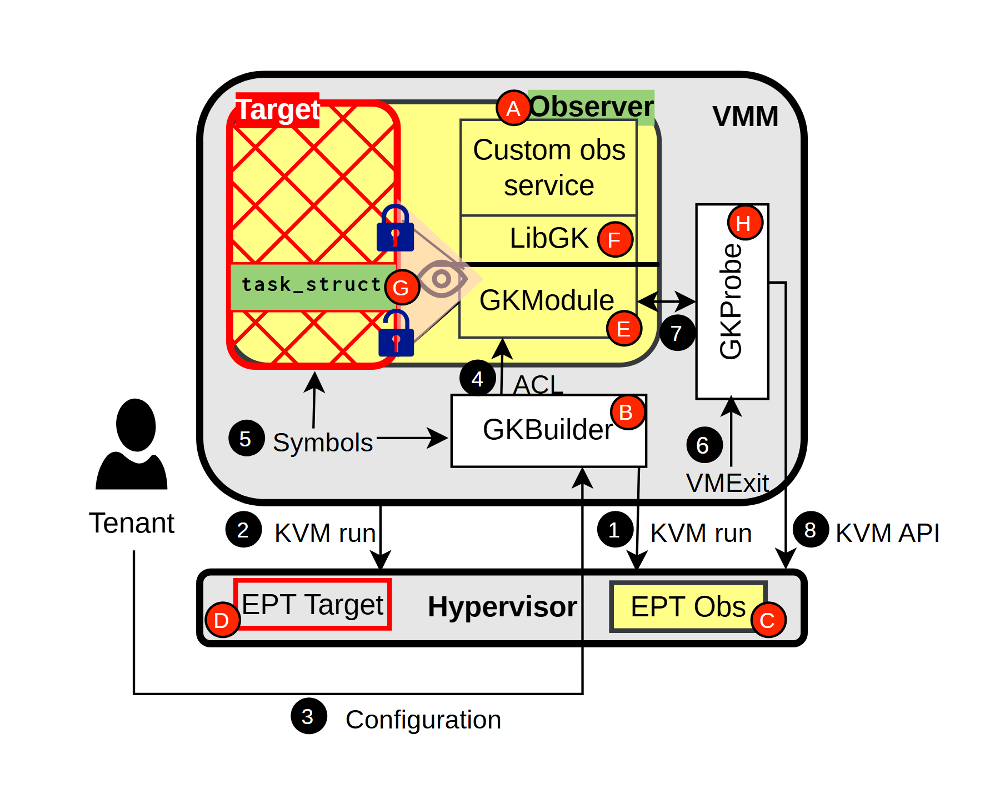

# VA-181 · 隔离目标与观察者的虚拟化控制图

上部 VMM 大容器包住目标、观察者和构建/探测模块，下部 Hypervisor 条带含两个 EPT 槽。红字母标识对象，黑数字标识操作；交叉网纹和锁符号突出目标隔离与受控观察。



## 适用范围

- 把观察/管理功能隔离在专用环境中的虚拟化架构
- 需要同时表达控制步骤、访问权限和组件归属

不适合：没有隔离边界的普通监控看板；必须逐条展示安全协议状态机的形式化说明。

## 阅读顺序

1. 先看 VMM 与下方 Hypervisor 两层边界。
2. 比较红边 Target 与右侧 Observer 的模块组成。
3. 阅读中下部 GKBuilder 和右侧 GKProbe 的连接。
4. 沿黑色数字追踪 Tenant、KVM run、配置与 VMExit。
5. 红色字母用于对象定位，应与黑色步骤分开解释。

## 图形表达

**布局**：大圆角 VMM 容器在上，狭长 Hypervisor 在下，Tenant 位于左外侧，回路从下方绕行。

**对象**：红色交叉填充表示目标区域，浅黄块表示观察者服务，锁和圆环符号辅助显示受控访问。

**连线**：控制箭头穿过 VMM 和 Hypervisor；水平/竖直折线交错，步骤数字标在路径附近。

**配色**：灰色边界、浅黄观察模块、红色目标及字母标记、黑色步骤号，颜色既区分角色也强调隔离。

**文字**：无衬线主体；对象名称与 API 保持大小写；红圆字母和黑圆数字要独立编号。

## 部件与复用

| 部件 | 含义 | 改造方法 |
|---|---|---|
| 受隔离的目标区域 (`target`) | 目标及任务结构示例以锁与红色交叉网纹强调访问控制 | 迁移时重写目标对象，不把纹理解释为性能或错误 |
| 观察者服务栈 (`observer`) | 服务、库和内核模块构成观察者环境 | 修改层数时维护上下职责及授权入口 |
| 构建与符号配置区 (`builder`) | 构建器接收配置和符号信息后建立观察关系 | 配置箭头与对象标签需要同步 |
| 探测和退出处理 (`probe`) | 探测器处理右侧访问与退出路径 | 竖向名称加长时需要增宽部件 |
| 双 EPT 槽与监控层 (`hypervisor`) | 目标和观察者在 Hypervisor 中的两套映射位置 | 改变映射方案须同时修改上下连接 |
| 租户配置入口 (`tenant-config`) | 外部租户是配置控制的发起者 | 此部件不含整条下方配置折线，移动后另行接回 |

## 改造步骤

1. 先确定新情景中目标与观察者的隔离方式和权限授予实体。
2. 重写红字母对象索引和黑数字流程索引，两者不可混为一个列表。
3. 权限通道改变时同步调整锁、ACL 和 EPT 槽，不仅替换名词。
4. 外围配置折线和 VMM 容器留作全图结构，部件移动后手工重连。

## 新情景示例（假设）

假设：沙箱内的独立诊断代理。

Target 映射为业务沙箱，Observer 映射为诊断沙箱，Builder 为部署控制器，Probe 为受控事件桥。

若平台不是 KVM，应改控制 API 和地址映射结构；保留隔离边界但重做底层实现。

## 编辑入口

**入口**：make_figure.py 调用共享矢量运行库；example.json 保存实例配置，labels.json 列出可替换文本，asset.json 保存部件成员及边界。

**配置可改**：labels 可替换文字；components 可调整已登记部件的配色、显隐、位移。配置不会自动重排连线、容器或长标签。

**需改代码**：拓扑、对象数量及容器改变需在 customize(root, context) 编辑 SVG；新增对象须设置 data-asset-key，并将其加入相关部件 element_keys。跨区连线应随端点另行调整，避免重叠部件重复移动同一元素。

**字体**：观察到的字体层次见本图 typography；最终字体文件由构建映射提供。局部 font_size 是 SVG 坐标下的字号，不能直接当作论文纸面 pt；替换字体后检查实际字宽。本批构建已确认并嵌入完整字体：Arimo-Bold.ttf, Arimo-Regular.ttf, Inconsolata-Bold.ttf。映射可能改变原字形和字宽，需按实际论文尺寸复核。

准备独立工作副本：

```text
python "<SKILL>/scripts/prepare_architecture.py" --id VA-181 --out figures/architecture
```

在工作副本运行：

```text
python make_figure.py --config example.json --out . --parts
python render_architecture.py fig.svg
```

## 本图检查

- 每个字母只标识一个对象。
- 黑色操作数字与真实调用顺序一致。
- 锁符号与 ACL 的授权方向有依据。
- 竖排探测器文字和下方配置回路线没有截断。

部件图用于复用局部对象；跨边界的连接和共享容器仍需按新关系处理。示例名称、数值和曲线不是当前研究结果。

来源与许可见 [ATTRIBUTION.md](ATTRIBUTION.md)。
