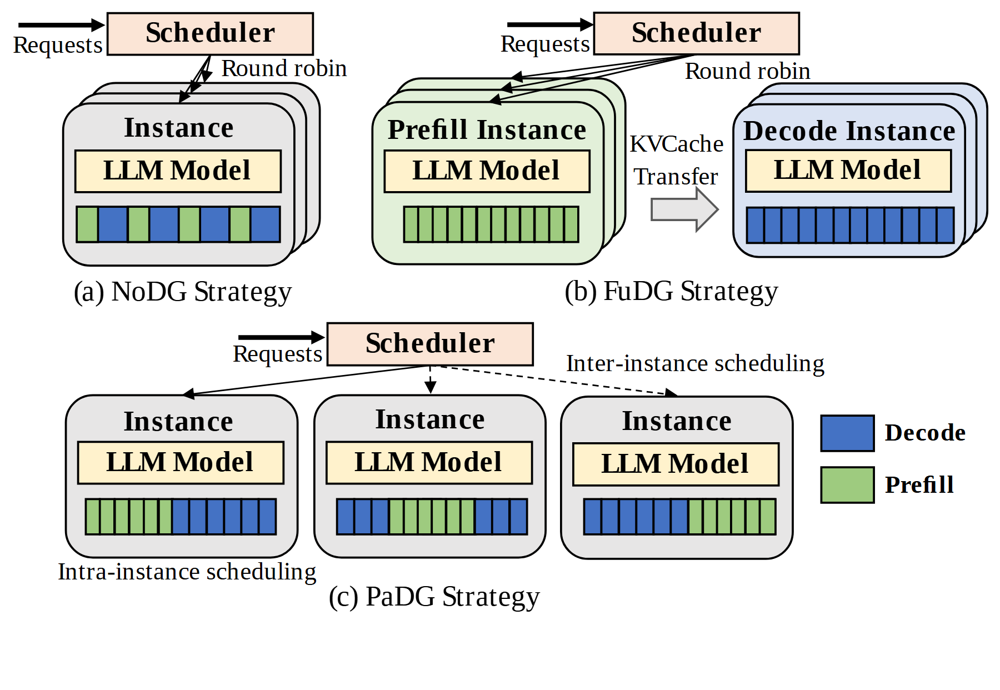

# VA-182 · 同置、全分离与时分复用的三方案对照

上排两种部署方式、下排一种混合方案，共用调度器、实例和模型块图符。蓝绿小条展示两种工作阶段的放置差异，较少文字即可比较同置、完全分离和实例内时分复用。



## 适用范围

- 两个阶段的工作负载可同置、分离或时分处理的部署比较
- 调度既有实例间层次又有实例内层次的设计说明

不适合：想用条块长度直接表达精确吞吐或时长；三种方案服务语义本来不同而无法公平对比。

## 阅读顺序

1. 先读右下角蓝色 Decode 与绿色 Prefill 图例。
2. 左上观察同一实例内交错的蓝绿块。
3. 右上观察分离实例及其 KV Cache Transfer。
4. 下方读实例间调度弧线，再看各实例内不同的蓝绿分段。

## 图形表达

**布局**：上二下一的三面板布局，底部方案较宽以容纳三个实例。

**对象**：叠片圆角框表示实例组，矩形模型条位于实例顶部，彩色小条表示阶段工作。

**连线**：调度器到实例有分派箭头；完全分离方案包含横向缓存传输；底部用弧线表明实例间调度。

**配色**：蓝色为 Decode，绿色为 Prefill，调度器淡粉、模型淡黄、实例浅灰；这些颜色在三个面板保持一致。

**文字**：衬线为主，Instance 与模型名称加粗，面板标题带 (a)/(b)/(c)，传输注释较小。

## 部件与复用

| 部件 | 含义 | 改造方法 |
|---|---|---|
| 同置实例方案 (`colocated`) | 一个实例中两类工作交错共存 | 保留蓝绿交错，改实例个数需同步调整叠片 |
| 全分离实例方案 (`disaggregated`) | 两阶段放到不同实例并交换中间状态 | 修改中间状态标签时核对实际传输方向 |
| 时分复用实例组 (`time-multiplexed`) | 三个实例在各自内部时分承载两阶段工作 | 条块只作示意，真正时间轴需另建刻度 |
| 两阶段共享图例 (`phase-legend`) | 蓝绿在所有方案中含义一致 | 阶段名称与色块一同改 |

## 改造步骤

1. 先定义两类阶段及需要传递的状态。
2. 让三个面板使用一致实例图符和负载含义，避免只改变配色。
3. 完全分离方案保留真实的状态传输代价或路径。
4. 需要表达调度周期时另添明确时间轴；现有蓝绿条不能当实验数据。

## 新情景示例（假设）

假设：视频解码与目标检测的三种部署。

Prefill 映射为视频解码，Decode 映射为目标检测，缓存传输映射为帧缓冲传送。

根据实际数据方向重画分离路径；下方时分方案若不成立应移除，不能机械保留三方案。

## 编辑入口

**入口**：make_figure.py 调用共享矢量运行库；example.json 保存实例配置，labels.json 列出可替换文本，asset.json 保存部件成员及边界。

**配置可改**：labels 可替换文字；components 可调整已登记部件的配色、显隐、位移。配置不会自动重排连线、容器或长标签。

**需改代码**：拓扑、对象数量及容器改变需在 customize(root, context) 编辑 SVG；新增对象须设置 data-asset-key，并将其加入相关部件 element_keys。跨区连线应随端点另行调整，避免重叠部件重复移动同一元素。

**字体**：观察到的字体层次见本图 typography；最终字体文件由构建映射提供。局部 font_size 是 SVG 坐标下的字号，不能直接当作论文纸面 pt；替换字体后检查实际字宽。本批构建已确认并嵌入完整字体：Tinos-Bold.ttf, Tinos-Regular.ttf。映射可能改变原字形和字宽，需按实际论文尺寸复核。

准备独立工作副本：

```text
python "<SKILL>/scripts/prepare_architecture.py" --id VA-182 --out figures/architecture
```

在工作副本运行：

```text
python make_figure.py --config example.json --out . --parts
python render_architecture.py fig.svg
```

## 本图检查

- 三面板阶段颜色完全一致。
- 分离实例间的状态传送方向正确。
- 实例条块没有被误写成定量性能。
- 下方实例间和实例内调度文字与弧线不相混。

部件图用于复用局部对象；跨边界的连接和共享容器仍需按新关系处理。示例名称、数值和曲线不是当前研究结果。

来源与许可见 [ATTRIBUTION.md](ATTRIBUTION.md)。
