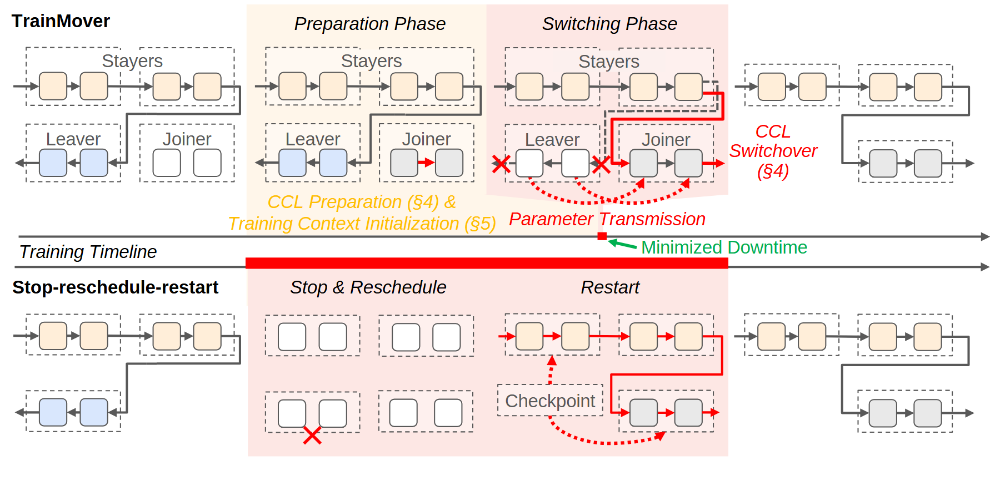

# VA-066 · 后台准备与停机重启的迁移对照

在同一横向时间方向上比较两种迁移策略。上半部让保留节点继续工作、加入节点后台准备，到切换点才传输状态；下半部展示停止、重排和恢复。节点角色、迁移阶段和停机长度是三个不同编码维度。



## 适用范围

- 在线迁移与停止重启比较
- 需要说明准备可与正常运行重叠的过程

不适合：没有共同时间参照的方案对比；用示意长度证明实测加速比。

## 阅读顺序

1. 先读迁移前保留、离开和加入三类节点。
2. 沿上行进入后台准备，再进入切换阶段。
3. 关注状态传输和离开节点的退出标记。
4. 沿下行读停止与恢复路径，最后比较共同时间线。

## 图形表达

**布局**：上、下两行对照共享从左到右的时间方向，中间用时间轴隔开。

**对象**：小方块串联为节点计算链，虚线组框表示节点角色；红叉表示退出，圆弧虚线表示状态传输。

**连线**：常规计算用黑箭头，迁移用红箭头，底部长条标出停止时段而非网络链路。

**配色**：浅黄背景标准备，浅粉标切换或重启，绿线强调较短停机；颜色不能兼作吞吐量。

**文字**：阶段名用斜体，时间注释靠轴；保留节点等角色名反复出现但字号保持一致。

## 部件与复用

| 部件 | 含义 | 改造方法 |
|---|---|---|
| 迁移前角色 (`before-migration`) | 区分继续工作、退出和加入的节点。 | 填入实际角色，不把加入节点提前画成运行。 |
| 后台准备 (`background-prepare`) | 正常工作持续时准备新节点上下文。 | 标明可并行准备的状态，不能假设所有数据都提前就绪。 |
| 切换动作 (`hot-switch`) | 传输必要状态并改变连接。 | 更新红线起终点和退出叉号。 |
| 停机基线 (`baseline-stop-restart`) | 停止后重排，再从检查点恢复。 | 使用本次真实基线，不能人为添加额外阶段。 |
| 共同时间参照 (`shared-timeline`) | 对照运行和不可用区间。 | 如非按比例，必须明确示意。 |

## 改造步骤

1. 先确定切换点前后哪些节点仍可完成业务。
2. 时间条使用实测值才可解释为耗时差；否则只表示阶段顺序。
3. 删改节点时同时处理所有状态传输线和计算链。

## 新情景示例（假设）

假设用于在线交通预测服务扩容。

保留节点继续处理时间窗，新增节点装载模型状态，旧节点在窗口边界移交任务。

将训练参数改成预测状态；基线设为停止服务后重新装载，检查点图标改为模型快照。

## 编辑入口

**入口**：以 make_figure.py 为入口，先复制 example.json 作为当前情景配置；labels.json 定位标签，asset.json 定位部件。

**配置可改**：labels 可改文字和文字样式，components 可做显隐、平移和局部样式调整；elements 可定位矢量元素。配置只作用于已有几何，不会自动解决布局冲突。

**需改代码**：节点数量、阶段长度与切换关系变化需同时修改多处重复图元；共享引擎不依据时间值自动重建时间轴。

**字体**：当前替换字体为 Arimo-Bold、Arimo-Italic、Arimo-Regular。改字后检查字宽、基线及 PDF 字体嵌入；原图的逐字定位不保证能容纳更长名称。

准备独立工作副本：

```text
python "<SKILL>/scripts/prepare_architecture.py" --id VA-066 --out figures/architecture
```

在工作副本运行：

```text
python make_figure.py --config example.json --out . --parts
python render_architecture.py fig.svg
```

## 本图检查

- 同一节点跨阶段身份与颜色一致。
- 后台准备时没有把新节点画成已经接管。
- 两方案停机区间采用相同起止定义。

部件图用于复用局部对象；跨边界的连接和共享容器仍需按新关系处理。示例名称、数值和曲线不是当前研究结果。

来源与许可见 [ATTRIBUTION.md](ATTRIBUTION.md)。
