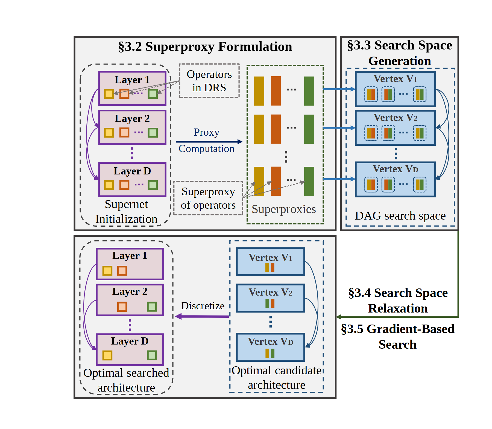

# VA-067 · 候选编码到搜索再离散化的闭环

上左将分层候选转成统一特征，上右形成带备选项的图搜索空间，随后在下右获得选择结果，再向左还原为原层级方案。重复的小色块贯穿转换，说明各表示携带同一类候选信息。阅读沿折返路径进行，不是把四个象限当独立方法对比。



## 适用范围

- 有候选编码、可微或连续搜索和离散输出的设计方法
- 层级对象需要转成图再映射回去的方案探索

不适合：只做一次枚举且没有中间表示；把彩色小方块当装饰的通用项目流程。

## 阅读顺序

1. 左上从多层候选进入条状代理特征。
2. 沿右箭头读图搜索空间及顶点内备选项。
3. 向下看松弛和搜索后的候选图。
4. 最后向左离散化，回到单一的分层方案。

## 图形表达

**布局**：四区折回，左侧始终表示原始层级，右侧表示图形式；中央留转换箭头而不硬塞总框。

**对象**：紫色层框含多个彩色小方块，条状特征保留类别颜色，蓝色顶点框用连边组成搜索图。

**连线**：主箭头描述表示法转换，图内弯边描述可选依赖；省略号表示重复层，不表示未知步骤。

**配色**：紫与蓝区分两种表示，内部黄橙绿等小块对应候选类别；相同类别跨四区保持颜色一致。

**文字**：阶段标题较密，应移除章节号并用短语；顶点索引与层索引要保持可追踪对应。

## 部件与复用

| 部件 | 含义 | 改造方法 |
|---|---|---|
| 分层备选集合 (`candidate-layers`) | 每个层级保留多种可选对象。 | 改为新任务决策项与选项，不直接沿用网络层含义。 |
| 代理特征编码 (`proxy-features`) | 把候选转成可比较的条状特征。 | 解释每列特征含义，颜色不能替代量纲。 |
| 图搜索空间 (`search-space`) | 顶点保留选项，连边定义合法组合。 | 按新任务可行约束重建边。 |
| 搜索后候选图 (`relaxed-candidate`) | 保留较少选项的连续或中间解。 | 标明是权重还是已选择对象，避免与最终离散解混淆。 |
| 离散方案 (`discrete-solution`) | 将图中的选择还原成原始层级。 | 每层显示允许的最终选项数。 |

## 改造步骤

1. 先建立候选类别图例，再让同一颜色贯穿编码、搜索和输出。
2. 定义图顶点与原层级之间的映射，不能只凭位置相近表示对应。
3. 没有松弛过程时改中间阶段名称，并替换相关搜索箭头文字。

## 新情景示例（假设）

假设搜索多阶段水处理工艺组合。

层为工艺阶段，小方块为可选设备，特征条为成本和处理能力，图边为兼容性。

把网络层标号改工艺阶段；若用离散优化，删除松弛术语，保留候选图到工艺方案的回映。

## 编辑入口

**入口**：以 make_figure.py 为入口，example.json 提供编辑配置，labels.json 用于查文字键，asset.json 对应下列部件。

**配置可改**：labels 改指定文字与字号；components 可显隐、平移和改属性；elements 修改单个矢量对象。平移保留固定几何，不会自动重新布线。

**需改代码**：增减层级、特征列或图顶点时必须同步调整四个区域和映射路径。 必须在 customize() 中处理新增矢量对象及连接，不能只扩大文字框。

**字体**：当前字体映射使用 Tinos-Bold.ttf, Tinos-Regular.ttf；换标签后按最终插入宽度检查字宽、上下标和边界，不直接继承小字号。

准备独立工作副本：

```text
python "<SKILL>/scripts/prepare_architecture.py" --id VA-067 --out figures/architecture
```

在工作副本运行：

```text
python make_figure.py --config example.json --out . --parts
python render_architecture.py fig.svg
```

## 本图检查

- 小方块类别颜色是否跨区一致。
- 最终每层选项数是否符合新任务约束。
- 箭头是否清楚引导上左到上右再下右到下左。

部件图用于复用局部对象；跨边界的连接和共享容器仍需按新关系处理。示例名称、数值和曲线不是当前研究结果。

来源与许可见 [ATTRIBUTION.md](ATTRIBUTION.md)。
