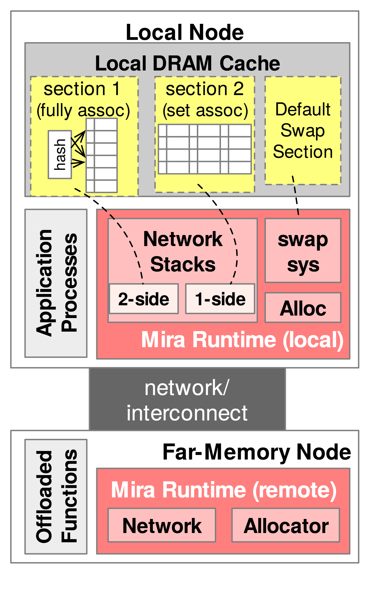

# VA-184 · 本地分区缓存与远端运行时的纵向结构

上方较大的本地节点包含三个缓存分区、应用和本地运行时，下方远端节点以较小容器承载卸载函数及网络/分配器。中间深灰互连带把两端连接起来，适合表现不对称职责分配。



## 适用范围

- 本地计算端比远端资源端承担更多职责的系统
- 不同缓存组织方式与本地运行时的归属需同时说明

不适合：两端完全对称却用面积暗示不同复杂度；需要完整逐包协议或缓存一致性状态机。

## 阅读顺序

1. 从本地节点的 DRAM Cache 区开始，区分两个专用 section 和默认交换区。
2. 向下读左侧应用进程和右侧本地运行时。
3. 检查网络栈的 2-side/1-side、swap sys 与 Alloc。
4. 穿过网络互连带，读远端卸载函数及远端运行时的网络和分配器。

## 图形表达

**布局**：窄竖幅上下节点不等高，本地节点约占上部三分之二；中间互连带比节点窄。

**对象**：缓存分区用淡黄格子，应用与卸载函数用竖排窄栏，运行时用粉色框内嵌子模块。

**连线**：虚线从缓存分区指向下部运行时模块，节点间用深灰网络带表示联系；图中不是编号步骤流程。

**配色**：缓存浅黄、本地/远端运行时粉色、其余结构灰色，中央互连深灰配白字。

**文字**：无衬线，节点标题加粗；窄栏竖排 Application Processes 与 Offloaded Functions，缓存说明较小。

## 部件与复用

| 部件 | 含义 | 改造方法 |
|---|---|---|
| 本地多分区缓存 (`cache-sections`) | 全相联、组相联和默认交换三个分区并列 | 更换策略时重画分区格子而非只改标题 |
| 本地应用进程 (`application`) | 应用位于缓存和本地运行时旁的独立窄栏 | 进程层次增多应拓宽本地容器 |
| 本地运行时模块 (`local-runtime`) | 网络栈、交换系统和分配器的本地职责 | 修改协议方式需同步改 1-side/2-side 和缓存虚线 |
| 两端网络互连 (`interconnect`) | 连接本地与远端的共享通信层 | 网络介质变化时更新带内说明及边界 |
| 远端卸载函数 (`offloaded-functions`) | 远端节点内独立执行的卸载功能 | 是否存在计算卸载须由新场景决定 |
| 远端运行时 (`remote-runtime`) | 与本地同名运行时的远端网络和分配器 | 两端同属一个运行时才使用相同名称，保留 local/remote 区分 |

## 改造步骤

1. 先划定缓存管理、通信和分配器在哪一端执行。
2. 根据实际缓存策略重写三个分区，不能将全相联和组相联当可随意互换的图标。
3. 本地/远端运行时名称保持对应，而内部职责可不对称。
4. 若远端只供存储不执行代码，应删除卸载函数栏并重新分配宽度。

## 新情景示例（假设）

假设：边缘计算节点使用远端对象池。

本地缓存分区映射为热点/批量/默认对象池，本地运行时为缓存客户端，远端运行时为对象服务。

仅在确有远程函数执行时保留卸载栏；否则改成纯对象存储并重接请求路径。

## 编辑入口

**入口**：make_figure.py 调用共享矢量运行库；example.json 保存实例配置，labels.json 列出可替换文本，asset.json 保存部件成员及边界。

**配置可改**：labels 可替换文字；components 可调整已登记部件的配色、显隐、位移。配置不会自动重排连线、容器或长标签。

**需改代码**：拓扑、对象数量及容器改变需在 customize(root, context) 编辑 SVG；新增对象须设置 data-asset-key，并将其加入相关部件 element_keys。跨区连线应随端点另行调整，避免重叠部件重复移动同一元素。

**字体**：观察到的字体层次见本图 typography；最终字体文件由构建映射提供。局部 font_size 是 SVG 坐标下的字号，不能直接当作论文纸面 pt；替换字体后检查实际字宽。本批构建已确认并嵌入完整字体：texgyreheros-bold.otf, texgyreheros-regular.otf。映射可能改变原字形和字宽，需按实际论文尺寸复核。

准备独立工作副本：

```text
python "<SKILL>/scripts/prepare_architecture.py" --id VA-184 --out figures/architecture
```

在工作副本运行：

```text
python make_figure.py --config example.json --out . --parts
python render_architecture.py fig.svg
```

## 本图检查

- 缓存分区名称与真实组织方式一致。
- 本地和远端同名模块不被误认为同一进程。
- 虚线落点指向正确运行时模块。
- 窄栏竖排字与小缓存网格在最终尺寸仍可辨。

部件图用于复用局部对象；跨边界的连接和共享容器仍需按新关系处理。示例名称、数值和曲线不是当前研究结果。

来源与许可见 [ATTRIBUTION.md](ATTRIBUTION.md)。
